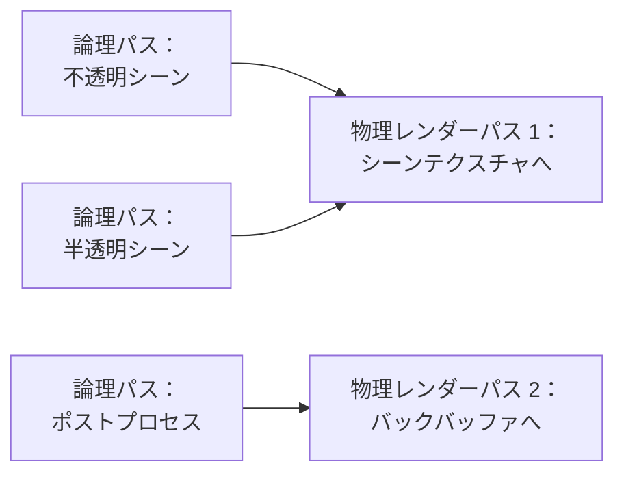
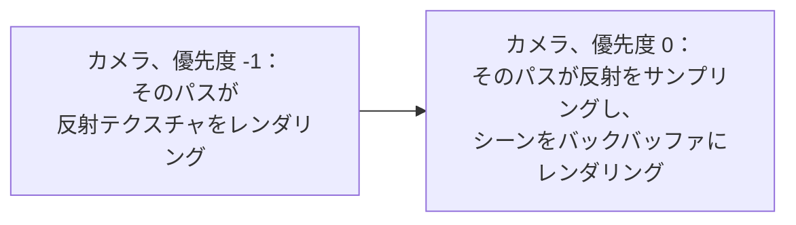

GPU は、テクスチャまたはテクスチャのセットである[レンダーターゲット](/user-manual/graphics/advanced-rendering/render-targets/)か、画面に表示される**バックバッファ**にレンダリングします。そのいずれかへの開始から終了までのレンダリングを、**物理レンダーパス**と呼びます。1 つのフレームには複数の物理レンダーパスが必要で、**フレームグラフ**は、それらを生成するフレームのステップを**論理パス**として記述します。このページではこれらの概念を説明し、このセクションの各ページでは PlayCanvas がそれらをどのように実装しているかを示します。

## 物理レンダーパス {#physical-render-passes}

レンダーターゲットは 1 つ以上のカラーバッファと、オプションで深度バッファとステンシルバッファを保持します。これらを**アタッチメント**と呼びます。バックバッファも同じアタッチメントを持ち、それらはキャンバスによって提供されます。物理レンダーパスは、次の 3 つのステップでこれらのアタッチメントにレンダリングします。

1. **開始**：アタッチメントを特定の値でクリアするか、すでに格納されている内容を読み込みます。
2. **描画**：すべてのドローコールがアタッチメントにレンダリングします。
3. **終了**：アタッチメントに描画された内容を保存するか、破棄します。

物理レンダーパスはグラフィックス API によって定義されます。WebGPU ではレンダーパスと呼ばれ、WebGL では 1 つのフレームバッファへの描画がこれに当たります。

## 物理コンピュートパス {#physical-compute-passes}

コンピュートシェーダーはレンダーターゲットにレンダリングしません。代わりにディスパッチを実行し、バッファやテクスチャを直接読み書きします。GPU はディスパッチを**物理コンピュートパス**で実行します。物理コンピュートパスは、物理レンダーパスがドローコールをまとめるのと同じように、ディスパッチをまとめます。コンピュートシェーダーは WebGPU でのみサポートされています。

## パスで構成されるフレーム {#a-frame-of-passes}

**フレーム**とは、アプリケーションがレンダリングする 1 枚の画像で、通常はディスプレイのリフレッシュごとに 1 回レンダリングされます。物理レンダーパスは単一のレンダーターゲットにレンダリングするため、フレームには複数の物理レンダーパスが必要です。たとえば、レンダリングしたばかりのテクスチャをサンプリングするために別のレンダーターゲットにレンダリングするには、1 つの物理レンダーパスを終了し、別の物理レンダーパスを開始します。シンプルなフレームでは 3 つの物理レンダーパスをレンダリングし、それぞれが直前のパスのレンダリング結果をサンプリングします。

各ボックスは 1 つの物理レンダーパスで、そのレンダリング先にちなんで名付けられています。ライトのシャドウマップ、シーンを保持するテクスチャ、そしてポストプロセスがシーンテクスチャを描画するバックバッファです。パスは互いに依存しているため、順序が重要です。テクスチャをサンプリングするパスは、そのテクスチャにレンダリングするパスの後にレンダリングされます。

## フレームグラフ {#the-frame-graph}

**フレームグラフ**は、フレームのすべてのステップを実行順に記述します。各ステップが何にレンダリングし、何を描画または計算するかを表します。各ステップが**論理パス**です。レンダラーは、処理を進めながら物理パスを開始・終了するのではなく、まずそのフレームのフレームグラフを構築し、その後で論理パスを物理パスの中で実行します。ほとんどの論理レンダーパスはそれぞれ専用の物理レンダーパスを持ちますが、フレーム全体を事前に把握することで、レンダラーはフレームに必要な物理パスだけを開始・終了できます。

- **論理パスは物理レンダーパスを共有します**。同じレンダーターゲットにレンダリングする連続した論理パスは単一の物理レンダーパスに記録されるため、それらの間でアタッチメントの保存と再読み込みは行われません。
- **アタッチメントは必要な場合にのみ保存されます**。後の論理パスが読み込むアタッチメントは保存され、それ以外は破棄できます。

次の例では、3 つの論理パスが 2 つの物理レンダーパスでフレームをレンダリングします。

### 複数のカメラ {#multiple-cameras}

シーンには複数のカメラを配置できます。たとえば、反射やミニマップをテクスチャにレンダリングするカメラと、画面にレンダリングするメインカメラです。フレームグラフは、すべてのカメラの論理パスを、カメラの[優先度](https://api.playcanvas.com/engine/classes/CameraComponent.html#priority)の順に 1 つのフレームへ合成します。優先度の値が小さいカメラのパスが先になります。そのため、テクスチャにレンダリングするカメラには、そのテクスチャを使用するカメラよりも小さい優先度が必要です。これにより、テクスチャは使用される時点で準備ができています。カメラが必要とするシャドウマップは、そのカメラのシーンより前にレンダリングされます。

## パフォーマンス {#performance}

物理レンダーパスの開始と終了には、特にモバイル GPU でコストがかかります。モバイル GPU は高速なオンチップメモリの小さなタイル単位でレンダリングし、そのメモリとメインメモリとの間でアタッチメントをコピーします。パスがアタッチメントを読み込むときはオンチップメモリに取り込み、保存するときはメインメモリに書き出します。そのため、フレームに必要な物理レンダーパスの数と、それらが何を読み込み、何を保存するかがパフォーマンスに影響します。アタッチメントを読み込む代わりにクリアすると取り込みのコピーを回避でき、同じレンダーターゲットにレンダリングする論理パス間で物理レンダーパスを共有することでも同様に回避できます。

## PlayCanvas では {#in-playcanvas}

フレームグラフの各論理パスは、エンジンのオブジェクトであるフレームパスです。エンジンは自身のフレームをフレームパスでレンダリングしており、独自のフレームパスを追加することもできます。

- [フレームパス](frame-passes.md)は、フレームグラフの論理パスです。パスのクラスとそのライフサイクルを扱います。
- [カメラパス](camera-passes.md)は、カメラの前後にレンダリングするか、カメラのレンダリングを置き換えます。
- [レンダーパス](render-pass.md)は、レンダーターゲットにレンダリングします。レンダーターゲットのすべてのピクセルに対するシェーダーの実行や、シーンのレンダリングも含みます。
- [コンピュートパス](compute-pass.md)は、コンピュートシェーダーを実行します。
