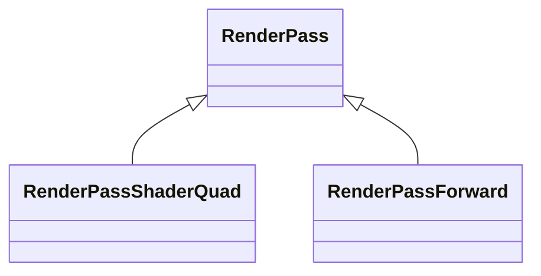

[`RenderPass`](https://api.playcanvas.com/engine/classes/RenderPass.html) は、[レンダーターゲット](/user-manual/graphics/advanced-rendering/render-targets/)に描画する[フレームパス](frame-passes.md)です。実行されると、そのドローコールはレンダーターゲット用の物理レンダーパスに記録されます。通常はパス専用の物理レンダーパスで、パスの実行直前に開始し、実行直後に終了します。あるいは、同じレンダーターゲットにレンダリングする隣接したパスと共有する物理レンダーパスです。[レンダーターゲットを共有するパス](#passes-sharing-a-render-target)を参照してください。

## RenderPass から派生したクラス {#classes-derived-from-renderpass}

`RenderPass` は、描画を行うパスの基底クラスです。一般的な種類の描画のために、エンジンはそこから派生したクラスを提供しています。これらはそのまま使用することも、独自のパスの基底クラスとして使用することもできます。



| クラス | 用途 |
| ----- | ---------- |
| [`RenderPassShaderQuad`](render-pass-shader-quad.md) | ポストプロセスエフェクトなど、レンダーターゲット全体またはその一部のすべてのピクセルに対してシェーダーを実行する。 |
| [`RenderPassForward`](render-pass-forward.md) | カメラでシーンのレイヤーをレンダリングする。 |

独自のドローコールを記録するには、`RenderPass` 自体から派生します。[パスの実装](#writing-a-pass)を参照してください。このページの以降の内容は、派生クラスを含むすべてのレンダーパスに当てはまります。

## パスのセットアップ {#setting-up-the-pass}

パスを作成したら、描画先のレンダーターゲットを指定して [`init`](https://api.playcanvas.com/engine/classes/RenderPass.html#init) を呼び出します。バックバッファに描画する場合は `null` を指定します。パスは、レンダリングする前、およびクリアとストアを設定する前に初期化する必要があります。

```javascript
const pass = new MyPass(app.graphicsDevice);
pass.name = 'MyPass';
pass.init(renderTarget);
```

パスはレンダーターゲットを所有せず、破棄もしません。アタッチメントの異なるレンダーターゲットにパスを切り替えるには、`init` を再度呼び出します。同じレイアウト（同じカラーバッファ、深度とステンシル、サンプル数）を持つレンダーターゲットであれば、[`renderTarget`](https://api.playcanvas.com/engine/classes/RenderPass.html#rendertarget) に直接割り当てることもできます。たとえば、2 つのレンダーターゲットを毎フレーム交互に使用する場合です。

## レンダーターゲットのサイズ変更 {#resizing-the-render-target}

`init` にオプションを渡すと、パスはレンダーターゲットのサイズも毎フレーム変更します。サイズは、テクスチャ、レンダーターゲット、またはバックバッファのサイズを `scaleX` と `scaleY` でスケールしたものになります。

```javascript
// バックバッファの半分のサイズのレンダーターゲット
pass.init(renderTarget, {
    resizeSource: null,
    scaleX: 0.5,
    scaleY: 0.5
});

// パスが処理するテクスチャと同じサイズのレンダーターゲット
pass.init(renderTarget, { resizeSource: sourceTexture });
```

オプションはコピーされます。後から変更するには、パスの [`resizeSource`](https://api.playcanvas.com/engine/classes/RenderPass.html#resizesource)、[`scaleX`](https://api.playcanvas.com/engine/classes/RenderPass.html#scalex)、[`scaleY`](https://api.playcanvas.com/engine/classes/RenderPass.html#scaley) を設定します。たとえば、パスが処理するテクスチャが置き換えられたときは `resizeSource` を設定します。`resizeSource` がデフォルトの `undefined` の場合、レンダーターゲットのサイズはそのまま変更されません。

レンダーターゲットのサイズは、フレームの構築中にパスの `frameUpdate` で変更され、パスが更新された時点で新しいサイズになります。サイズが変わったフレームでは、そのパスより前に更新されたパスからは、引き続き以前のサイズが見えます。

## アタッチメントのクリア {#clearing-the-attachments}

レンダーターゲットのアタッチメントとは、そのカラーバッファ、および深度バッファとステンシルバッファです。デフォルトでは、物理レンダーパスはそれらの内容をロードし、パスはその上に描画します。代わりに単一の値から開始するには、それらをクリアします。

```javascript
pass.setClearColor(Color.BLACK);
pass.setClearDepth(1);
pass.setClearStencil(0);
```

パスがアタッチメントを完全に覆う場合、タイルベースのモバイル GPU では、クリアはロードよりも高速でもあります。その場合、GPU は以前の内容をメモリから読み込まないためです。[`setClearColor`](https://api.playcanvas.com/engine/classes/RenderPass.html#setclearcolor) は、すべてのカラーバッファか、指定されたインデックスのカラーバッファをクリアします。

## アタッチメントのストア {#storing-the-attachments}

物理レンダーパスが終了すると、パスはレンダリングした内容をレンダーターゲットのテクスチャに保持し、それらをサンプリングしたり、後続のパスでロードしたりできるようにします。保持されるのは、カラーバッファ（レンダーターゲットがマルチサンプルの場合は解決されたもの）と、深度バッファのテクスチャです。その他のアタッチメントは破棄されます。破棄されるのは、解決されるマルチサンプルカラーバッファのサンプル、ステンシル、およびレンダーターゲットが内部で作成する深度バッファです。

同じフレームの後続のパスが同じレンダーターゲットに描画し、それらをロードする場合は、フレームが自動的にストアします。単独でレンダリングするパスでは、[`setStoreColor`](https://api.playcanvas.com/engine/classes/RenderPass.html#setstorecolor)、[`setStoreDepth`](https://api.playcanvas.com/engine/classes/RenderPass.html#setstoredepth)、[`setStoreStencil`](https://api.playcanvas.com/engine/classes/RenderPass.html#setstorestencil) でストアします。

ミップマップを持つカラーバッファのミップマップも、パスの終了時に生成されます。複数のパスが同じレンダーターゲットに描画する場合、ミップマップが必要になるのは最後のパスの後だけなので、それ以外のパスでは [`setGenerateMipmaps`](https://api.playcanvas.com/engine/classes/RenderPass.html#setgeneratemipmaps) でオフにします。

```javascript
firstPass.setGenerateMipmaps(false);
```

`init` はクリア、ストア、ミップマップの設定をデフォルトにリセットするため、これらはパスを初期化した後に設定してください。

## レンダーターゲットを共有するパス {#passes-sharing-a-render-target}

フレーム内では、同じレンダーターゲットに描画する連続したパスは 1 つの物理レンダーパスに統合されるため、それらの間でアタッチメントをストアしてロードする必要がなくなります。パスの間で何かを行う必要がある場合、それらのパスは統合されません。たとえば、後のパスのクリア、パスの間にある 前のパスまたは 後のパス、`onBefore` または `onAfter` コールバックがある場合です。

## パスの実装 {#writing-a-pass}

サブクラスは、物理レンダーパスがアクティブな間に実行される [`execute`](https://api.playcanvas.com/engine/classes/FramePass.html#execute) でドローコールを記録します。パスの初期化後にクリアを設定するには [`postInit`](https://api.playcanvas.com/engine/classes/RenderPass.html#postinit) を、各フレームのレンダリング前にパスを更新するには [`frameUpdate`](https://api.playcanvas.com/engine/classes/RenderPass.html#frameupdate) をオーバーライドできます（サイズ変更を維持するために `super.frameUpdate()` を呼び出します）。作成したものは [`destroy`](https://api.playcanvas.com/engine/classes/FramePass.html#destroy) で解放し、`super.destroy()` を呼び出します。

```javascript
// レンダーターゲット全体を覆うクアッドをシェーダーで描画するパス
class MyPass extends RenderPass {
    constructor(device, shader) {
        super(device);
        this.quadRender = new QuadRender(shader);
    }

    postInit() {
        // クアッドがターゲット全体を覆うため、内容をロードせずにクリアする
        this.setClearColor(Color.BLACK);
    }

    execute() {
        // デフォルトの描画ステートはクアッドに適している：ブレンドなし、深度テストと深度書き込みなし
        this.device.setDrawStates();
        this.quadRender.render();
    }

    destroy() {
        this.quadRender.destroy();
        super.destroy();
    }
}
```

シェーダーで描画するクアッドについては、[`RenderPassShaderQuad`](render-pass-shader-quad.md) がすでにこれを行い、さらにレンダーステートも設定します。

## テクスチャに一度だけレンダリングする {#rendering-into-a-texture-once}

内容を変更する必要があるときだけテクスチャにレンダリングするには、フレームの外で [`render`](https://api.playcanvas.com/engine/classes/RenderPass.html#render) を使用してパスを単独でレンダリングします。

```javascript
const renderTarget = new RenderTarget({ colorBuffer: texture, depth: false });
const pass = new MyPass(app.graphicsDevice, shader);
pass.name = 'MyPass';
pass.init(renderTarget);

// テクスチャに描画する
pass.render();

// パスを破棄し、次にパスが所有していないレンダーターゲットを破棄する
pass.destroy();
renderTarget.destroy();
```

## 例 {#example}

どのカメラにもアタッチされていない 2 つの `RenderPass` サブクラスが、マテリアルのテクスチャを生成します。パターンと、その高さから生成するノーマルマップです。これらは `prerender` イベントから単独でレンダリングされ、アニメーション中は毎フレーム、それ以外は設定が変更されたときだけレンダリングされます。

<EngineExample id="render-targets/render-pass-procedural-texture" title="Procedural Texture" />
