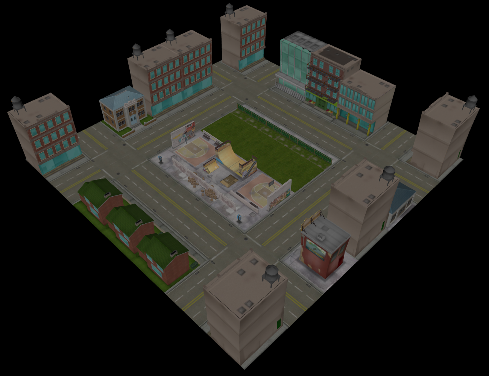
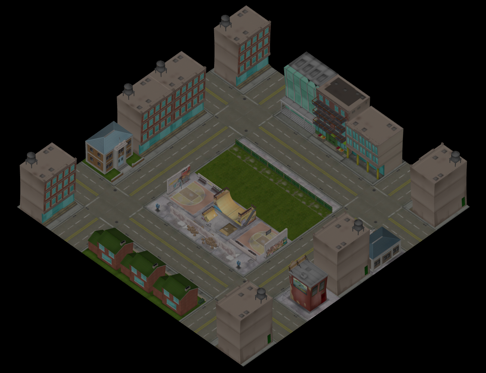

import Tabs from '@theme/Tabs';
import TabItem from '@theme/TabItem';

カメラの投影は、3Dシーンをどのように2D画像へ平面化するかを定義します。PlayCanvasのカメラは、透視投影と正投影の2つの投影タイプをサポートしています。

## 透視投影 {#perspective}

デフォルトである透視投影は、私たちの目や実際のカメラの仕組みを模倣します。遠くにあるオブジェクトほど小さく見えます。カメラが見ることのできる空間の体積（フラスタム）は、四角錐台の形になります。



フラスタムの形状は視野角（`fov`）で制御します。これは度単位の角度で、デフォルトは45です。デフォルトではこの角度は垂直方向に測られますが、`horizontalFov` を `true` に設定すると水平方向で測られます。値を大きくするとより広い範囲が映り、極端な場合は魚眼レンズのような見た目になります。値を小さくすると、ズームインした望遠レンズのような効果になります。

## 正投影 {#orthographic}

正投影は平行投影です。オブジェクトはカメラからの距離に関係なく、画面上で同じ大きさを保ちます。フラスタムは直方体になります。2Dゲームやアイソメトリックゲーム、CADスタイルのビジュアライゼーションでよく使用されます。



視野角は適用されないため、ビューのサイズは `orthoHeight` で設定します。これはワールド単位でのビューボリュームの高さの半分です（デフォルトは10）。幅はアスペクト比から導出されます。

投影タイプは次のように設定します:

<Tabs groupId="workflow" defaultValue="engine">
<TabItem value="engine" label="Engine">

```javascript
// PROJECTION_PERSPECTIVE（デフォルト） | PROJECTION_ORTHOGRAPHIC
camera.camera.projection = PROJECTION_ORTHOGRAPHIC;
camera.camera.orthoHeight = 5; // ワールド単位でのビューの高さの半分
```

</TabItem>
<TabItem value="editor" label="Editor">

Hierarchyでカメラを選択し、[Cameraコンポーネント](/user-manual/editor/scenes/components/camera)で **Projection** を **Perspective** または **Orthographic** に設定します。それに応じて **Field of View** または **Ortho Height** フィールドが表示されます。

</TabItem>
<TabItem value="react" label="React">

```jsx
import { PROJECTION_ORTHOGRAPHIC } from 'playcanvas';

<Entity name="camera">
  <Camera projection={PROJECTION_ORTHOGRAPHIC} orthoHeight={5} />
</Entity>
```

</TabItem>
<TabItem value="web-components" label="Web Components">

```html
<!-- デフォルトは透視投影。orthographic フラグを追加すると切り替わります -->
<pc-entity name="camera">
  <pc-camera orthographic ortho-height="5"></pc-camera>
</pc-entity>
```

</TabItem>
</Tabs>

## クリップ面 {#clip-planes}

ニアクリップ面とファークリップ面はフラスタムの両端を区切り、カメラが見ることのできる距離の範囲を制限します。`nearClip`（デフォルト 0.1）より近いもの、または `farClip`（デフォルト 1000）より遠いものはレンダリングされません:

```javascript
camera.camera.nearClip = 0.5;
camera.camera.farClip = 500;
```

:::note

ファークリップ面とニアクリップ面の比率は、深度バッファの精度がシーン全体にどのように分配されるかを決定します。ニア面がファー面に対して非常に小さい場合、遠くのサーフェスを確実に区別するための精度が不足し、Zファイティングと呼ばれるちらつきが発生することがあります。これを避けるには、ニア面はシーンが許容できる範囲でできるだけ大きく、ファー面は必要以上に大きくしないように設定してください。非常に長い視距離が必要なシーンでは、[リバースZ](#reverse-z)を使用してください。

:::

## リバースZ {#reverse-z}

デフォルトでは、深度バッファはニア面で深度 0、ファー面で深度 1 を格納します。透視投影は利用可能な値の大部分をカメラの近くに割り当てるため、遠くのサーフェスほど精度が低くなります。リバースZはこの範囲を反転し、ニア面で 1、ファー面で 0 を格納します。0 付近で精度が最も高くなる浮動小数点の深度バッファと組み合わせると、精度が視距離全体にほぼ均等に分配されます。これにより、地形、フライト、宇宙などのシーンで、ニア面を小さく保ったまま、ファー面を何キロメートルも先に置いても Zファイティングが発生しなくなります。

カメラごとに `reverseZ` プロパティで有効にします:

```javascript
if (app.graphicsDevice.supportsReverseZ) {
    camera.camera.reverseZ = true;
}
```

リバースZは WebGPU でサポートされており、`GraphicsDevice#supportsReverseZ` が `true` になります。その他のデバイスでは、カメラは設定を保持しますが、リバースZなしでレンダリングします。また、カメラが XR セッションのビューをレンダリングしている間は適用されません。

### 深度バッファのフォーマット {#reverse-z-depth-format}

リバースZで精度が向上するのは、深度バッファが浮動小数点値を格納する場合だけです。WebGPU では、エンジンはバックバッファと、独自の深度バッファなしで作成されたレンダーターゲットに `depth24plus-stencil8` を割り当てます。このフォーマットは 24 ビットの固定小数点深度を使用する場合があり、その場合リバースZの効果はほとんどありません。

精度を最大限に向上させるには、`depth32float` を使用する [`PIXELFORMAT_DEPTH`](https://api.playcanvas.com/engine/variables/PIXELFORMAT_DEPTH.html) の深度バッファを持つレンダーターゲットにカメラをレンダリングします:

```javascript
const colorBuffer = new Texture(device, {
    width, height,
    format: PIXELFORMAT_RGBA8,
    mipmaps: false
});

const depthBuffer = new Texture(device, {
    width, height,
    format: PIXELFORMAT_DEPTH,
    mipmaps: false
});

camera.camera.renderTarget = new RenderTarget({ colorBuffer, depthBuffer });
camera.camera.reverseZ = true;
```

深度バッファはシングルサンプルであるか、レンダーターゲットと同じサンプル数で明示的にマルチサンプルされている必要があります。マルチサンプルのレンダーターゲットがシングルサンプルの深度テクスチャを使用する場合、エンジンは内部の `depth24plus-stencil8` アタッチメントにレンダリングし、その結果を浮動小数点テクスチャに解決するだけなので、失われた精度は回復しません。

### レンダリングの動作 {#reverse-z-rendering}

リバースZでも、マテリアルと深度ステートは通常の意味を保ちます。グラフィックスデバイスがカメラの深度テスト関数と深度バイアスを反転するため、[`FUNC_LESSEQUAL`](https://api.playcanvas.com/engine/variables/FUNC_LESSEQUAL.html) は引き続き手前のフラグメントを通過させます。カメラの深度クリア値（`clearDepth`、デフォルト 1）も同様に反転されます。そのため、同じレイヤーをリバースZありとなしのカメラでレンダリングできます。

同じ深度バッファにレンダリングするカメラは、同じ設定を使用する必要があります。

組み込みの透視投影と正投影は、クリップ面から反転された深度を計算するため、ファークリップとニアクリップの比率に関係なくファー面は正確に保たれます。`calculateProjection` で指定された投影は、その 32 ビットの値から反転されるため、この比率が非常に大きい場合は精度が多少失われます。

リバースZを使用するカメラ用にコンパイルされたシェーダーには `REVERSE_Z` 定義が付きます。カメラの深度を書き込む、または読み取るカスタムシェーダーはこれに対応する必要があります。[リバースZの定義](/user-manual/graphics/shaders/#reverse-z-define)を参照してください。

:::warning

カメラがレンダリングした深度を読み取る機能は、まだリバースZをサポートしておらず、有効にすると正しくレンダリングされません:

- シーン深度マップ。[深度レイヤー](depth-layer.md)を参照してください
- [CameraFrame](/user-manual/graphics/posteffects/cameraframe/) の深度プリパス
- [ピッキング](scene-picker.md)
- [Gaussian Splat](/user-manual/gaussian-splatting/)

:::

## アスペクト比 {#aspect-ratio}

デフォルトでは、カメラのアスペクト比はレンダーターゲットと[ビューポート](multiple-cameras.md#viewports)から毎フレーム自動的に計算されるため（`aspectRatioMode` が [`ASPECT_AUTO`](https://api.playcanvas.com/engine/variables/ASPECT_AUTO.html)）、キャンバスのサイズが変わっても画像が引き伸ばされることはありません。非正方形ピクセルのディスプレイ向けにレンダリングするなどの特殊なケースでは、`aspectRatioMode` を [`ASPECT_MANUAL`](https://api.playcanvas.com/engine/variables/ASPECT_MANUAL.html) に設定し、`aspectRatio` を自分で指定してください。

## フラスタムカリング {#frustum-culling}

フラスタムカリングが有効な場合（`frustumCulling`、デフォルトで有効）、エンジンはバウンディングボックスがカメラのフラスタムの完全に外側にあるメッシュインスタンスのレンダリングをスキップします。これにより、大規模なシーンではドローコール数を大幅に削減できます。可視性に関係なくすべてをGPUに送信する必要がある場合にのみ無効にしてください。

フラスタム自体は読み取り専用の `frustum` プロパティから [Frustum](https://api.playcanvas.com/engine/classes/Frustum.html) として公開されており、カスタムの可視性判定に利用できます:

```javascript
const visible = camera.camera.frustum.containsPoint(entity.getPosition());
```
