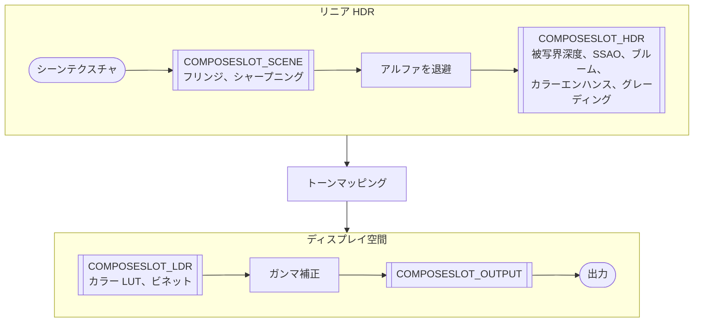

import Tabs from '@theme/Tabs';
import TabItem from '@theme/TabItem';

[`CameraFrame`](https://api.playcanvas.com/engine/classes/CameraFrame.html) は、[`CameraFrameEffect`](https://api.playcanvas.com/engine/classes/CameraFrameEffect.html) から派生したオブジェクトである**エフェクト**でポストプロセスをレンダリングします。組み込みエフェクトもエフェクトです。`cameraFrame.bloom`、`cameraFrame.vignette` などは、エフェクトクラスのインスタンスです。独自のエフェクトを作成し、組み込みエフェクトと並べてカメラフレームに登録できます。

ほとんどのエフェクトは、**合成**にシェーダーチャンクを追加します。合成は最終的な画像を描画する単一のパスで、その中でこれらのチャンクがすべて順番に実行されます。合成に追加しても、フルスクリーンパスが増えることはありません。低解像度でのブラーなど、合成ではピクセルあたり 1 回のサンプリングで行えない処理を必要とするエフェクトは、パスも持ちます。[パスを持つエフェクト](effect-passes.md)を参照してください。

## コンポーズスロット {#compose-slots}

合成は、出力の各ピクセルに対して 1 回実行されるシェーダーです。シーンがそのピクセルにレンダリングした色を読み取り、画面に書き込まれる色に変換します。シーンは、光に比例し、任意の明るさを取るリニア HDR の色をレンダリングします。トーンマッピングがそれらをディスプレイで表示できる範囲にマッピングし、続いてガンマ補正がディスプレイ向けにエンコードします。エフェクトのチャンクは、その過程で色を変更します。

**コンポーズスロット**は、この変換の中で合成がエフェクトのチャンクを呼び出す位置です。各エフェクトは 4 つのスロットのいずれかで適用され、スロットによって受け取る色、つまりエフェクトで何ができるかが決まります。同じスロットのエフェクトは順番に実行され、それぞれが直前のエフェクトの返した色を受け取ります。



各スロットには、そこで適用される組み込みエフェクトを適用順に示しています。

| スロット | 受け取る色 | 用途 |
| ---- | --------------------- | ---------- |
| `COMPOSESLOT_SCENE` | サンプリングされたままのシーンカラーとそのアルファ。後続のスロットのエフェクトが変更する前の色です。 | ほかのエフェクトの土台となる、シーンの画像そのものを変更するエフェクト。シャープニングのようにピクセルの周囲でシーンテクスチャを再度サンプリングするエフェクトや、アルファを変更するエフェクトです。後続のスロットでシーンテクスチャを再度サンプリングすると、それより前のエフェクトが行った処理が失われてしまいます。 |
| `COMPOSESLOT_HDR` | トーンマッピング前のリニア HDR の色。 | ブルームの光を加える、アンビエントオクルージョンで暗くするなど、光を扱うエフェクト。 |
| `COMPOSESLOT_LDR` | ガンマ補正前の、ディスプレイの 0-1 の範囲にトーンマッピングされた色。 | ビネットやカラールックアップテーブルなど、最終的な画像の見た目に関わるエフェクト。 |
| `COMPOSESLOT_OUTPUT` | ガンマ補正後の、画面に書き込まれる最終的な値。 | ディザリングなど、書き込まれる値そのものに関わるエフェクト。 |

`COMPOSESLOT_SCENE` と `COMPOSESLOT_HDR` はどちらもリニア HDR で、その間に変換はありません。`COMPOSESLOT_SCENE` のエフェクトはすべて `COMPOSESLOT_HDR` のどのエフェクトよりも前に実行され、出力のアルファを変更できるのはこれらのエフェクトだけです。

`COMPOSESLOT_SCENE` のチャンクのエントリー関数は、アルファを含む `vec4` の色と uv を受け取り、`vec4` の色を返します。ほかのスロットでは、`vec3` の色と uv を受け取り、`vec3` の色を返します。

### 組み込みエフェクト {#the-built-in-effects}

カメラフレームは組み込みエフェクトを次の順序で登録します。これが、各スロットでエフェクトが適用される順序になります。各エフェクトは ID で識別され、[`getEffect`](https://api.playcanvas.com/engine/classes/CameraFrame.html#geteffect) と [`insertEffectBefore`](https://api.playcanvas.com/engine/classes/CameraFrame.html#inserteffectbefore) はこの ID を受け取ります。

| ID | エフェクト | コンポーズスロット |
| -- | ------ | ------------ |
| `taa` | テンポラルアンチエイリアス、`cameraFrame.taa` | なし。パスのみを持ちます |
| `fringing` | フリンジ、`cameraFrame.fringing` | `COMPOSESLOT_SCENE` |
| `cas` | シャープニング、`cameraFrame.rendering.sharpness` | `COMPOSESLOT_SCENE` |
| `dof` | 被写界深度、`cameraFrame.dof` | `COMPOSESLOT_HDR` |
| `ssao` | アンビエントオクルージョン、`cameraFrame.ssao` | `COMPOSESLOT_HDR`（`SSAOTYPE_COMBINE` タイプの場合） |
| `volumetricFog` | ボリューメトリックフォグ、`cameraFrame.volumetricFog` | なし。パスのみを持ちます |
| `bloom` | ブルーム、`cameraFrame.bloom` | `COMPOSESLOT_HDR` |
| `colorEnhance` | カラーエンハンス、`cameraFrame.colorEnhance` | `COMPOSESLOT_HDR` |
| `grading` | カラーグレーディング、`cameraFrame.grading` | `COMPOSESLOT_HDR` |
| `colorLut` | カラールックアップテーブル、`cameraFrame.colorLUT` | `COMPOSESLOT_LDR` |
| `vignette` | ビネット、`cameraFrame.vignette` | `COMPOSESLOT_LDR` |

追加したエフェクトは、そのスロットで組み込みエフェクトの後に、追加した順に適用されます。これはエンジンのほかのエフェクトにも当てはまります。[レンズフレア](lens-flare.md)（`lensFlare`）は `COMPOSESLOT_HDR` でカラーグレーディングの後に適用され、ダイナミックスカイ、SMAA、自動露出はパスのみを持ちます。組み込みエフェクトのいずれかより前にエフェクトを適用するには、`insertEffectBefore` で登録します。[エフェクトの登録](#registering-effects)を参照してください。たとえば、`bloom` の前に挿入したエフェクトはブルームの光が加わる前のシーンに作用し、その結果にカラーグレーディングが適用されます。

## エフェクトの作成 {#writing-an-effect}

エフェクトは、グラフィックスデバイス、**ID**、および宣言（適用されるコンポーズスロットと、GLSL と WGSL のシェーダーチャンク）を指定して構築します。チャンクでは、エフェクトが設定するユニフォームと、`apply<Id>` という名前のエントリー関数を宣言します。合成は、エフェクトのスロットでこのエントリー関数を呼び出します。次のチャンクは、画像をドットとして描画します。

<Tabs groupId="shader-language" queryString="lang">
<TabItem value="glsl" label="GLSL">

```glsl
uniform float pixelationTilePixels;
uniform float pixelationIntensity;

vec3 applyPixelation(vec3 color, vec2 uv) {
    vec2 tileUV = vec2(pixelationTilePixels) * sceneTextureSize.zw;
    vec2 centerUv = (floor(uv / tileUV) + 0.5) * tileUV;

    vec2 local = (uv - centerUv) / tileUV;
    float dist = length(local);
    float edge = fwidth(dist) * 1.5;
    float mask = 1.0 - smoothstep(0.35, 0.35 + edge, dist);
    return mix(color, color * mask, pixelationIntensity);
}
```

</TabItem>
<TabItem value="wgsl" label="WGSL">

```wgsl
uniform pixelationTilePixels: f32;
uniform pixelationIntensity: f32;

fn applyPixelation(color: vec3f, uv: vec2f) -> vec3f {
    let tileUV = vec2f(uniform.pixelationTilePixels) * uniform.sceneTextureSize.zw;
    let centerUv = (floor(uv / tileUV) + vec2f(0.5, 0.5)) * tileUV;

    let local = (uv - centerUv) / tileUV;
    let dist = length(local);
    let edge = fwidth(dist) * 1.5;
    let mask = 1.0 - smoothstep(0.35, 0.35 + edge, dist);
    return mix(color, color * mask, uniform.pixelationIntensity);
}
```

</TabItem>
</Tabs>

エフェクトクラスはパラメーターをフィールドとして宣言し、`update` で適用します。

```javascript
class PixelationEffect extends CameraFrameEffect {
    // 1 タイルのサイズ（スクリーンピクセル単位）
    tilePixels = 8;

    // 元の画像（0）とピクセル化した画像（1）のブレンド
    intensity = 0.5;

    constructor(device) {
        super(device, 'pixelation', {
            slot: COMPOSESLOT_LDR,
            glsl: pixelationGLSL,
            wgsl: pixelationWGSL
        });
    }

    // 強度が 0 のときはエフェクトが画像を変更しないため、シェーダーから除外されます
    get active() {
        return this.enabled && this.intensity > 0;
    }

    update() {
        this.setUniform('pixelationTilePixels', this.tilePixels);
        this.setUniform('pixelationIntensity', this.intensity);
    }
}
```

データで駆動するエフェクトにはクラスは不要です。宣言を指定して `CameraFrameEffect` を構築し、ユニフォームを直接設定します。

### チャンクが読み取れるもの {#what-the-chunk-can-read}

すべてのチャンクは、合成が提供するものを読み取れます。シーンカラーの `sceneTexture` と、シーンテクスチャの幅、高さ、1 / 幅、1 / 高さを保持する `sceneTextureSize` です。テクセルのオフセット、ピクセルサイズ、アスペクト比など、解像度に依存するものにはこのサイズを使用してください。

[`requires`](https://api.playcanvas.com/engine/classes/CameraFrameEffect.html#requires) オプションに `FRAMERESOURCE_DEPTH` を指定したエフェクトは、`getLinearScreenDepth(uv)` でシーンの深度も読み取れます。

## エフェクトの登録 {#registering-effects}

[`addEffect`](https://api.playcanvas.com/engine/classes/CameraFrame.html#addeffect) でエフェクトをカメラフレームに登録します。同じコンポーズスロットのエフェクトは登録した順に実行されるため、同じく `COMPOSESLOT_LDR` にある組み込みのビネットの後に追加したエフェクトは、ビネットの後に適用されます。エフェクトを別のエフェクトより前に配置するには、そのエフェクトまたはその ID を指定して [`insertEffectBefore`](https://api.playcanvas.com/engine/classes/CameraFrame.html#inserteffectbefore) で登録します。[組み込みエフェクト](#the-built-in-effects)を参照してください。

```javascript
const pixelation = new PixelationEffect(app.graphicsDevice);
cameraFrame.addEffect(pixelation);

// または、ビネットの前に適用する場合
cameraFrame.insertEffectBefore(pixelation, 'vignette');

cameraFrame.update();
```

[`getEffect`](https://api.playcanvas.com/engine/classes/CameraFrame.html#geteffect) は登録済みのエフェクトを ID で返し、[`removeEffect`](https://api.playcanvas.com/engine/classes/CameraFrame.html#removeeffect) はそれを削除します。

カメラフレームのほかの部分と同様に、エフェクトは [`CameraFrame#update`](https://api.playcanvas.com/engine/classes/CameraFrame.html#update) が呼び出されたときに設定されます。パラメーターの変更や、エフェクトの追加と削除は、次の update で反映されます。カメラフレームは追加されたエフェクトを所有しません。エフェクトを削除したり、カメラフレームを破棄したりしてもエフェクトは破棄されないため、使用しなくなったら [`destroy`](https://api.playcanvas.com/engine/classes/CameraFrameEffect.html#destroy) で破棄してください。

## パラメーター {#parameters}

エフェクトは [`update`](https://api.playcanvas.com/engine/classes/CameraFrameEffect.html#update) でパラメーターを適用します。カメラフレームは、エフェクトがアクティブな間、`CameraFrame#update` のたびにこれを呼び出します。

- [`setUniform`](https://api.playcanvas.com/engine/classes/CameraFrameEffect.html#setuniform) は、チャンクが読み取るユニフォームの値を設定します。マテリアルのパラメーターと同様に値は参照で保持されるため、配列やテクスチャはその場で更新できます。
- [`setDefine`](https://api.playcanvas.com/engine/classes/CameraFrameEffect.html#setdefine) は、チャンクのバリアント用に compose シェーダーに define を設定します。define を変更すると compose シェーダーが再ビルドされるため、めったに変わらない設定には define を、それ以外にはユニフォームを使用してください。固定の define はコンストラクターで一度だけ設定できます。

[`enabled`](https://api.playcanvas.com/engine/classes/CameraFrameEffect.html#enabled) はエフェクトのオンとオフを切り替えます。強度が 0 の場合など、パラメーターの値によっては何もしないエフェクトは [`active`](https://api.playcanvas.com/engine/classes/CameraFrameEffect.html#active) をオーバーライドし、そのときはチャンクが compose シェーダーから除外されるようにします。

時間など、毎フレーム変わる値に依存する一部のエフェクトは、[`frameUpdate`](https://api.playcanvas.com/engine/classes/CameraFrameEffect.html#frameupdate) を実装します。これはエフェクトが参加する各フレームで、そのフレームの値とともに呼び出されます。値には、前のフレームからの経過時間 `dt` や、シーンがレンダリングされるサイズが含まれます。

```javascript
frameUpdate(frame) {
    this.time += frame.dt;
    this.setUniform('waveTime', this.time);
}
```

自動露出のようにカメラの露出を調整するエフェクトは、[`cameraExposureScale`](https://api.playcanvas.com/engine/classes/CameraFrameEffect.html#cameraexposurescale) からスケールを返します。

## デバッグ表示 {#debug-views}

エフェクトはデバッグ表示を提供できます。デバッグ表示は、カメラの出力の代わりに中間結果を表示します。`debugViews` オプションに名前を列挙し、チャンク内でそれぞれに対して、表示する色を返す `debug<Name>()` 関数を実装します。

```javascript
super(device, 'pixelation', {
    slot: COMPOSESLOT_LDR,
    glsl, wgsl,
    debugViews: ['pixelationMask']
});
```

表示するには、カメラフレームのデバッグ表示として設定します。

```javascript
cameraFrame.debug = 'pixelationMask';
cameraFrame.update();
```

## エフェクトのチャンクのオーバーライド {#overriding-the-chunk-of-an-effect}

エフェクトのチャンクは、組み込みのシェーダーチャンクと同様に名前でオーバーライドできます。[`ShaderChunks`](https://api.playcanvas.com/engine/classes/ShaderChunks.html) に `compose<Id>PS` という名前で設定したチャンクが、エフェクトのソースを置き換えます。これは組み込みエフェクトでも機能します。

```javascript
ShaderChunks.get(app.graphicsDevice, SHADERLANGUAGE_GLSL).set('composePixelationPS', myPixelationGLSL);
ShaderChunks.get(app.graphicsDevice, SHADERLANGUAGE_WGSL).set('composePixelationPS', myPixelationWGSL);
```

エフェクトがアクティブな間は、ほかのチャンクが判別できるように、その ID をアッパースネークケースにしたもの（この例では `PIXELATION`）が compose シェーダーで define されます。

## エディターでのエフェクト {#effects-in-the-editor}

エディターでエフェクトを使用するには、[`camera-frame-effect.mjs`](https://github.com/playcanvas/engine/blob/main/scripts/esm/camera-frame-effect.mjs) の `CameraFrameEffectScript` から派生したスクリプトを作成し、[`cameraFrame` スクリプト](/user-manual/graphics/linear-workflow/hdr-rendering/#cameraframe-in-the-editor)と並べてカメラエンティティに追加します。スクリプトはエフェクトのパラメーターをスクリプト属性として宣言し、`createEffect` でエフェクトを作成し、`updateEffect` で属性をエフェクトにコピーします。

```javascript
import { CameraFrameEffectScript } from './camera-frame-effect.mjs';

class PixelationEffectScript extends CameraFrameEffectScript {
    static scriptName = 'pixelationEffect';

    /**
     * @attribute
     * @range [0, 1]
     */
    intensity = 0.5;

    createEffect(device) {
        return new PixelationEffect(device);
    }

    updateEffect(effect) {
        effect.intensity = this.intensity;
    }
}
```

エフェクトは両方のスクリプトが存在するとすぐにカメラフレームに登録され、スクリプトの有効状態に従い、スクリプトとともに破棄されます。エフェクトのデバッグ表示を公開するには、スクリプトの `debugView` ゲッターをオーバーライドします。エンジンリポジトリにある[レンズフレア](lens-flare.md)、SMAA、自動露出の各エフェクトのスクリプトが完全な例になります。

## 例 {#example}

`COMPOSESLOT_LDR` で、組み込みのビネットの後に適用されるピクセル化エフェクト。

<EngineExample id="camera-frame/custom-compose-shader" title="Custom Compose Shader" />
