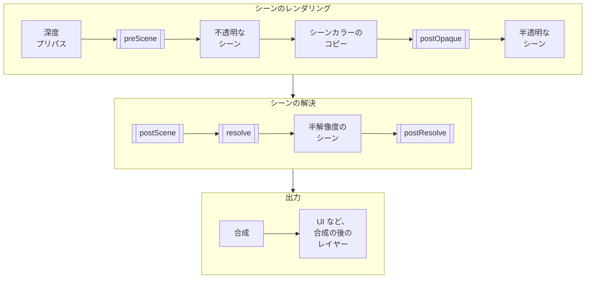

[カスタムエフェクト](custom-effects.md)は、合成ではピクセルあたり 1 回のサンプリングで行えない処理のために、[フレームパス](/user-manual/graphics/advanced-rendering/frame-graph/frame-passes/)を持つことができます。低解像度でのブラー、シーンへの描画、時間をかけたフレームの蓄積などです。組み込みのブルーム、被写界深度、テンポラルアンチエイリアスは、パスを持つエフェクトです。

カメラフレームはエフェクトにパスを要求し、シーンの深度など、エフェクトが必要とする**フレームリソース**を渡し、各パスをそれが属するフレームの**ステージ**で実行します。エフェクトはパスをほかのレンダーパスと同じように作成し、通常は[シェーダークアッドパス](/user-manual/graphics/advanced-rendering/frame-graph/render-pass-shader-quad/)として作成します。エフェクトのチャンクは、パスがレンダリングしたものを読み取れます。パスを持つエフェクトには、コンポーズスロットは必要ありません。

## カメラフレームのステージ {#the-stages-of-the-camera-frame}

カメラフレームは、シーンをレンダリングするパスの間にある 5 つのステージで、エフェクトのパスをレンダリングします。



二重枠のボックスがステージで、エフェクトのパスはここで実行されます。

| ステージ | 実行タイミング | 用途 | エンジンのエフェクト |
| ----- | ---- | ---------- | --------------------- |
| `preScene` | 深度プリパスがレンダリングされる場合はその後、シーンの前。 | シーンのマテリアルが読み取るテクスチャのレンダリング。 | `SSAOTYPE_LIGHTING` タイプのアンビエントオクルージョン、ダイナミックスカイ |
| `postOpaque` | 不透明ジオメトリ、スカイボックス、シーンカラーのコピーの後、半透明ジオメトリの前。 | 半透明ジオメトリより下になる、シーンへの描画。 | なし |
| `postScene` | シーンの後、シーンが解決される前。 | シーンへの描画。 | `SSAOTYPE_COMBINE` タイプのアンビエントオクルージョン、ボリューメトリックフォグ |
| `resolve` | シーンの解決。 | アンチエイリアスなど、シーンカラーを読み取って新しいシーンカラーをレンダリングするパス。[シーンの解決](#resolving-the-scene)を参照してください。 | TAA、SMAA |
| `postResolve` | シーンが解決され、その半解像度のコピーが作成された後、合成の前。 | ブルームなど、最終的なシーンカラーの処理。 | 被写界深度、ブルーム、レンズフレア、自動露出 |

各ステージでは、エフェクトのパスはエフェクトが登録された順に実行されます。まず組み込みエフェクトが[組み込みエフェクト](custom-effects.md#the-built-in-effects)に記載された順に実行され、その後にカメラフレームに追加されたエフェクトが追加された順に実行されます。ただし、`insertEffectBefore` でほかのエフェクトの前に挿入した場合は除きます。

## フレームリソース {#frame-resources}

エフェクトは必要なフレームリソースを [`requires`](https://api.playcanvas.com/engine/classes/CameraFrameEffect.html#requires) オプションに列挙し、カメラフレームはエフェクトがアクティブな間それらを提供します。

| リソース | 提供されるもの |
| -------- | -------- |
| `FRAMERESOURCE_DEPTH` | `resources.depth`。シーンの深度。 |
| `FRAMERESOURCE_PREPASSDEPTH` | `resources.prepassDepth`。シーンのレンダリング前に深度プリパスでレンダリングされたシーンの深度で、`preScene` ステージのパス用です。 |
| `FRAMERESOURCE_SCENECOLORHALF` | `resources.sceneColorHalf`。解決されたシーンカラーの半解像度のコピー。 |
| `FRAMERESOURCE_SCENECOLORGRAB` | `resources.sceneColorGrab`。不透明なシーンカラーのコピーのハンドルで、シェーダーは `postOpaque` ステージから `uSceneColorMap` としてサンプリングします。 |
| `FRAMERESOURCE_SCENETARGET` | `resources.sceneTarget`。シーンのレンダリング先のレンダーターゲットで、シーンに描画するパス用です。 |

リソースはパスが存在する間は同じオブジェクトのままなので、パスに一度渡すだけで済みます。リソースのテクスチャはキャンバスに合わせてサイズが変更されるため、サイズを保持しないでください。必要なリソースがパラメーターに依存するエフェクトは、`requires` をゲッターとしてオーバーライドします。

シーンの深度の格納方法はそれをレンダリングするものによって異なるため、シェーダーは格納方法を表す define を指定したうえで、`screenDepthPS` チャンクの `getLinearScreenDepth` 関数で深度を読み取ります。深度の define をシェーダーに渡し、深度のキーをシェーダーの一意な名前に追加して、格納方法の異なる深度がコンパイル済みシェーダーを共有しないようにします。

```javascript
const { depth } = resources;
this.shader = ShaderUtils.createShader(device, {
    uniqueName: `InkOutlineShader-${depth.key}`,
    attributes: { aPosition: SEMANTIC_POSITION },
    vertexChunk: 'quadVS',
    fragmentDefines: depth.defines,
    fragmentGLSL: inkGLSL,  // "screenDepthPS" をインクルードし、getLinearScreenDepth(uv) を呼び出します
    fragmentWGSL: inkWGSL
});
```

## パスの作成 {#creating-the-passes}

エフェクトは [`createPasses`](https://api.playcanvas.com/engine/classes/CameraFrameEffect.html#createpasses) で、必要なリソースからパスを作成し、各パスを実行されるステージの配列に実行順に追加します。1 つのエフェクトで複数のステージのパスを実行できます。パスは [`destroyPasses`](https://api.playcanvas.com/engine/classes/CameraFrameEffect.html#destroypasses) で解放します。

```javascript
class InkOutlineEffect extends CameraFrameEffect {
    width = 3;

    _pass = null;

    constructor(device) {
        super(device, 'inkOutline', {
            requires: [FRAMERESOURCE_SCENECOLORGRAB, FRAMERESOURCE_SCENETARGET, FRAMERESOURCE_DEPTH]
        });
    }

    createPasses(resources, passes) {
        // このパスは、不透明ジオメトリの後にシーンへ線を描画します
        this._pass = new RenderPassInkOutline(this.device, this.cameraFrame.cameraComponent, resources.depth);
        this._pass.init(resources.sceneTarget);
        passes.postOpaque.push(this._pass);
    }

    destroyPasses() {
        this._pass?.destroy();
        this._pass = null;
    }

    // cameraFrame.update() から呼び出され、パラメーターをパスに適用します
    update() {
        this._pass.width = this.width;
    }
}
```

エフェクトのレンダーターゲットにレンダリングするパスは、たとえば半解像度のシーンに追従させるために、[`resizeSource`](/user-manual/graphics/advanced-rendering/frame-graph/render-pass/#resizing-the-render-target) でそのサイズを設定します。テクスチャは参照で保持されるため、エフェクトのチャンクは、`setUniform` で設定したユニフォームを通じてパスがレンダリングしたものを読み取ります。

### パスが再構築されるタイミング {#when-the-passes-are-rebuilt}

カメラフレームは、自身のパスを構築するときにエフェクトのパスを作成します。最初の `CameraFrame#update` で作成し、パスを再構築するたびに、以前のパスを `destroyPasses` で解放したうえで再び作成します。パスが再構築されるのは、カメラフレームのオプションが変更されたとき、パスを持つエフェクトが追加、削除、有効化、無効化されたとき、およびそのようなエフェクトの必要なリソースまたは [`buildKey`](https://api.playcanvas.com/engine/classes/CameraFrameEffect.html#buildkey) が変わったときです。

`buildKey` は、パスの再作成が必要になるたびに変わる文字列を返します。つまり、パスのユニフォームではなく、パスそのものを変えるパラメーターです。パスが `update` で取り込むパラメーターは含めないでください。

```javascript
buildKey() {
    // 高品質ではパスが 1 つ多くレンダリングされます
    return `${this.highQuality}`;
}
```

`destroyPasses` は、パスの構築時に非アクティブだったエフェクトなど、エフェクトがパスを持たないときにも呼び出され、`destroy` からも呼び出されます。そのため、例のように存在するものだけを破棄し、参照をクリアしてください。

## フレームごとの値 {#values-of-each-frame}

リソースはフレームごとに変わりません。シーンがレンダリングされる解像度や、テンポラルアンチエイリアスが 2 つのテクスチャを交互に切り替える解決済みのシーンカラーなど、フレームごとに変わる値は、どのパスもレンダリングする前に、毎フレーム [`frameUpdate`](https://api.playcanvas.com/engine/classes/CameraFrameEffect.html#frameupdate) に渡されます。

```javascript
frameUpdate(frame) {
    // パスのレンダリング先である、シーンのレンダーターゲットの 1 ピクセルのサイズ
    this._pass.texelWidth = 1 / frame.renderWidth;
    this._pass.texelHeight = 1 / frame.renderHeight;
}
```

## シーンの解決 {#resolving-the-scene}

パスが `resolve` ステージで実行されるエフェクトは、フレームの残りの部分が読み取るシーンカラーを、パスがレンダリングしたもので置き換えます。カメラフレームは毎フレーム、`frameUpdate` の前に、解決中のシーンを渡してエフェクトの [`resolveScene`](https://api.playcanvas.com/engine/classes/CameraFrameEffect.html#resolvescene) を呼び出します。エフェクトは、それより前のエフェクトが解決したシーンカラーをパスに渡し、そのシーンカラーを、このフレームでパスがレンダリングするテクスチャに置き換えます。

```javascript
resolveScene(scene) {
    this._pass.setSourceTexture(scene.texture);
    scene.texture = this._pass.outputTexture;
}
```

アップスケーラーなど、シーンを別の解像度に解決するエフェクトは、シーンの `width` と `height` も設定します。

## TypeScript {#typescript}

TypeScript では、オーバーライドしたメソッドのパラメーターには基底クラスから型が付きません。フックの型である [`CameraFrameEffectResources`](https://api.playcanvas.com/engine/interfaces/CameraFrameEffectResources.html)、[`CameraFrameEffectPasses`](https://api.playcanvas.com/engine/interfaces/CameraFrameEffectPasses.html)、[`CameraFrameEffectScene`](https://api.playcanvas.com/engine/interfaces/CameraFrameEffectScene.html)、[`CameraFrameEffectContext`](https://api.playcanvas.com/engine/interfaces/CameraFrameEffectContext.html) をインポートして、パラメーターに型注釈を付けてください。

```typescript
import { CameraFrameEffect } from 'playcanvas';
import type { CameraFrameEffectPasses, CameraFrameEffectResources } from 'playcanvas';

class BlurEffect extends CameraFrameEffect {
    createPasses(resources: CameraFrameEffectResources, passes: CameraFrameEffectPasses) {
        // ...
    }
}
```

## 例 {#example}

インクアウトラインエフェクトは、不透明なシーンの深度または明るさが急に変化する箇所に線を描画します。そのパスは `postOpaque` ステージで実行され、不透明なシーンカラーのコピーとシーンの深度を読み取ってシーンに描画するため、半透明ジオメトリは線の上にレンダリングされます。

<EngineExample id="camera-frame/ink-outline" title="Ink Outline" />
