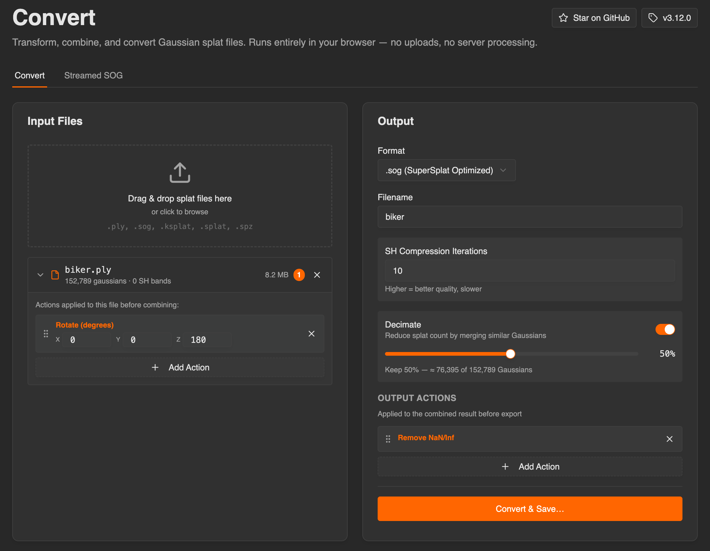
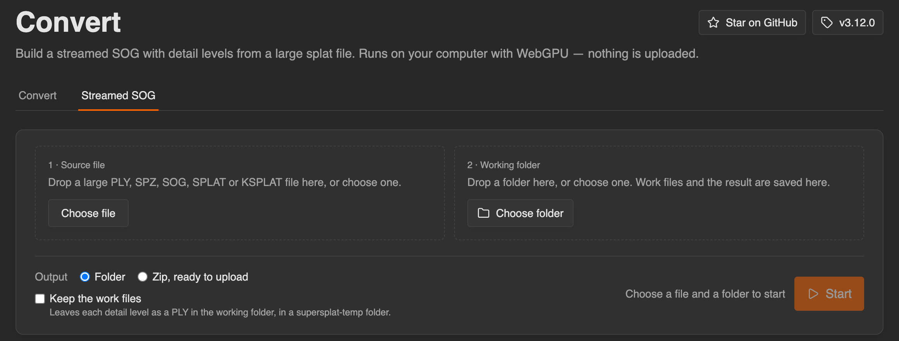

[Convertページ](https://superspl.at/convert)は、フォーマット間でスプラットを変換し、トランスフォーム、フィルタ、デシメートを行い、複数のスプラットを1つに結合するブラウザベースのツールです。インストールもコマンドラインも不要です。[splat-transform](/user-manual/splat-transform/) CLIのウェブフロントエンドであり、ヘッダーには使用しているsplat-transformのリリースが表示されます。

Convertは**完全にブラウザ内で動作**します。スプラットはサーバーにアップロードされません。すべてあなたのコンピュータ上で処理され、結果もそこに保存されます。

ページには2つのタブがあります：

- **[Convert](#converting-splats)** — スプラットファイルを変換、トランスフォーム、結合します。
- **[Streamed SOG](#streamed-sog)** — 大きなスプラットから、レベルオブディテール付きのStreamed SOGを作成します。

## ConvertとCLIの使い分け

単発の変換、インタラクティブに試したい、Node.jsをインストールしていない場合は**Convert**ページを使います。変換をスクリプト化する、多数のファイルをバッチ処理する、ビルドパイプラインに統合する場合は[splat-transform CLI](/user-manual/splat-transform/)を使います。

## スプラットの変換 {#converting-splats}

### 入力ファイル

ファイルを**Input Files**にドラッグするか、クリックしてファイルシステムから選択します。対応形式は次のとおりです：

- `.ply` — 標準PLY
- `.sog` — SuperSplat Optimized
- `.ksplat` — mkkellogg圧縮フォーマット
- `.splat` — antimatter15圧縮フォーマット
- `.spz` — Niantic圧縮フォーマット

追加した各ファイルには、ガウシアン数、球面調和関数（SH）のバンド数、サイズが表示されます。読み込めないファイルには**Unreadable or corrupt file**と表示されます。複数のファイルを追加すると、1つの出力に結合されます。

ファイルをクリックすると、そのファイル専用のアクションが表示されます。これらはファイルを結合する前にそのファイルに適用されます。ファイルのバッジにはアクションの数が表示されます。

### 出力

| 設定 | 説明 |
|---------|-------------|
| **Format** | 出力フォーマット。下の表を参照してください。デフォルトは**Standard PLY**です。 |
| **Filename** | 拡張子を除いた出力ファイル名。最初は1つ目の入力ファイルの名前になります。 |
| **SH Compression Iterations** | SOGとEmbedded Viewerの出力で表示されます。球面調和関数の圧縮に使うクラスタリングのパス数です（`1～100`、デフォルト`10`）。多いほど品質は上がりますが、時間がかかります。 |
| **Voxel Resolution** | Voxel Collision Bundleの出力で表示されます。ワールド単位のボクセルサイズです（デフォルト`0.05`）。小さいほど詳細になりますが、時間がかかります。 |
| **Opacity Cutoff** | Voxel Collision Bundleの出力で表示されます。この不透明度を超えるボクセルを固体として扱います（デフォルト`0.1`）。 |

| フォーマット | ファイル名 | 備考 |
|--------|----------|-------|
| **Standard PLY** | `.ply` | デフォルト。最大サイズ。可逆な交換フォーマットとして有用です。 |
| **Compressed PLY** | `.compressed.ply` | 量子化されたPLY。標準のPLYより小さくなります。 |
| **SuperSplat Optimized** | `.sog` | ランタイム利用に最適な圧縮。 |
| **Spreadsheet** | `.csv` | スプレッドシートやデータ分析向けに、ガウシアンごとのデータをCSVに書き出します。 |
| **Embedded Viewer** | `.html` | スプラットとビューアを含む自己完結型の`.html`ファイル。ダブルクリックでローカルから開けます。 |
| **Voxel Collision Bundle** | `.voxel.zip` | [Studio](/user-manual/supersplat/studio/collision)でシーンをウォーカブルにするためのボクセルコリジョンデータ。 |

SOG、Embedded Viewer、Voxel Collision Bundleの出力はGPUで作成されるため、Chrome 113以降やEdge 113以降など、WebGPUに対応したブラウザが必要です。

### デシメート

**Decimate**をオンにすると、似たガウシアンを統合してスプラット数を減らします。スライダーで残す割合を1%から100%（デフォルト50%）で設定し、**Keep 50% — ≈ 76,395 of 152,789 Gaussians**のように結果の数が表示されます。

### アクション

アクションはスプラットのデータをトランスフォームまたはフィルタします。各入力ファイルに専用のアクションがあり、**Output Actions**は結合した結果を書き出す前に適用されます。**Add Action**をクリックして追加します。アクションは追加した順に上から下へ実行されます。アクションを削除するには、その閉じるボタンをクリックします。

**トランスフォームアクション：**

| アクション | パラメータ | デフォルト |
|--------|-----------|---------|
| **Translate** | `X`、`Y`、`Z` | `0, 0, 0` |
| **Rotate (degrees)** | `X`、`Y`、`Z` | `0, 0, 0` |
| **Scale** | `Factor` | `1`（最小`0.001`） |

**フィルタアクション：**

| アクション | パラメータ | デフォルト |
|--------|-----------|---------|
| **Remove NaN/Inf** | _（なし）_ | — |
| **SH Bands** | `Max Band`：`0`（DCのみ）、`1`、`2`、`3`（フル） | `3` |
| **Bounding Box** | `Min X`、`Min Y`、`Min Z`、`Max X`、`Max Y`、`Max Z` | `±10` |
| **Sphere Filter** | `Center X`、`Center Y`、`Center Z`、`Radius` | 中心`0`、半径`10` |

### 変換の実行

**Convert & Save…**をクリックして保存先を選ぶと、変換が始まります。ファイルを直接保存できないブラウザでは、ボタンが**Convert & Download**になり、結果は準備ができるとダウンロードされます。

処理中は、進行状況とsplat-transformからのメッセージのログが表示されます。完了すると、**Data Summary**に**Total Gaussians**、**Columns**の数、各列の最小値、最大値、平均値が表示されます。

## Streamed SOG {#streamed-sog}

[superspl.at/convert/streamed-sog](https://superspl.at/convert/streamed-sog)の**Streamed SOG**タブは、大きなスプラットから[Streamed SOG](/user-manual/supersplat/publishing/streaming)を作成します。ビューアがストリーミングするレベルオブディテールを作成し、[アップロード](/user-manual/supersplat/publishing/upload)したり自分でホストしたりできるStreamed SOGとして書き出します。処理はあなたのコンピュータのGPUで行われ、何もアップロードされません。

デスクトップ版のChromeまたはEdgeが必要です。WebGPUを使い、作業内容をコンピュータ上のフォルダに保存するためで、これができるのはこれらのブラウザだけです。

### Streamed SOGの作成

1. **1 · Source file**で、PLY、SPZ、SOG、SPLAT、KSPLATのいずれかのファイルをドロップするか、**Choose file**をクリックします。
2. **2 · Working folder**で、フォルダをドロップするか、**Choose folder**をクリックします。作業ファイルと結果はそこに保存されるため、空き容量が十分にあるドライブを選んでください。
3. **What to expect**を確認します。作成するレベルオブディテールの数、必要な空きディスク容量、おおよそのメモリ使用量と結果のサイズが表示されます。SPZとKSPLATのファイルは、準備中に展開されるため、追加のメモリが必要です。
4. **Output**として、**Folder**か**Zip, ready to upload**を選びます。**Keep the work files**にチェックを入れると、各レベルオブディテールがPLYとして作業フォルダ内の`supersplat-temp`フォルダに残ります。
5. **Start**をクリックします。

変換は4つのステップで進み、それぞれの進行状況と残り時間の目安が表示されます：

| ステップ | 内容 |
|------|--------------|
| **Prepare source** | 無効なスプラットと透明なスプラットを取り除き、残りを空間的に並べ替えます。 |
| **Build detail levels** | 各レベルオブディテールを作成します。ガウシアンが100万未満のスプラットには、追加のレベルは必要ありません。 |
| **Write streamed SOG** | レベルをエンコードしてStreamed SOGにします。 |
| **Clean up** | 残すことを選んでいない限り、作業ファイルを削除します。 |

完了すると、**Streamed SOG ready**に保存先と、レベル数、ガウシアン数、サイズ、所要時間が表示されます。zipを選んだ場合は、**Upload to SuperSplat**でアップロードページが開くので、作業フォルダからzipを選んでください。

### 一時停止と再開

大きな変換には長い時間がかかることがあります。**Pause**をクリックすると停止し、一時停止したらタブを閉じても構いません。進行中だったステップは再開時に最初からやり直され、完了したステップはそのまま残ります。

ページに戻ると、**Unfinished conversions**にそれぞれの**Resume**ボタンが表示されます。Chromeから、ソースファイルと作業フォルダへのアクセスを再度許可するよう求められる場合があります。

変換をキャンセルすると、作業ファイルが削除されます。ソースファイルが変更されることはありません。

1つのファイルを同時に変換できるのは1つのタブだけです。別々のタブで2つの変換を同時に実行すると、約2倍のメモリが必要になり、どちらも遅くなります。

## 関連項目

- [splat-transform CLI](/user-manual/splat-transform/) — 同じアクションとフォーマットをコマンドラインで
- [ストリーミングとパフォーマンス](/user-manual/supersplat/publishing/streaming) — ビューアがレベルオブディテールをストリーミングする仕組み
- [ダイレクトアップロード](/user-manual/supersplat/publishing/upload) — 完成したスプラットをブラウザから離れずに公開する
- [Studio / コリジョン](/user-manual/supersplat/studio/collision) — `.voxel.zip`の使い方
