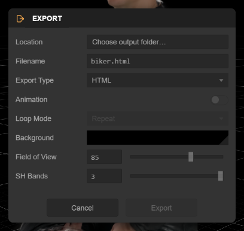

[SuperSplat Viewer](/user-manual/supersplat/developers/viewer/)は[オープンソース](https://github.com/playcanvas/supersplat-viewer)であり、[SuperSplat Editor](/user-manual/supersplat/editor/)から直接エクスポートできるため、[superspl.at](https://superspl.at)に公開する代わりに（または併用して）スプラットコンテンツをセルフホストすることもできます。エクスポートされたビューアは、通常のビューアと同じ[操作方法](/user-manual/supersplat/viewing/controls)で任意のモダンブラウザで動作し、WebXRをサポートするデバイスでは[ARとVR](/user-manual/supersplat/viewing/xr)にも対応しています。

## HTMLビューアのエクスポート

スプラットをHTMLビューアとしてエクスポートするには：

1. SuperSplat Editorで`File` > `Export`サブメニューを開きます。
2. `Viewer App…`を選択します。
3. **Location**で出力フォルダーを選び、**Filename**を入力し、以下のオプションを設定して**Export**をクリックします。Editorは次回のためにフォルダーを記憶します。File System Access APIに対応していないブラウザでは、ファイルはダウンロードとして提供されます。

エクスポートの一部としてスプラットデータはGPU上でSOGに圧縮されるため、大きなシーンでは少し時間がかかります。

## エクスポートオプション

ビューアのエクスポートはいくつかのオプションで設定できます：

| オプション | 説明 |
|--------|-------------|
| **Export Type** | エクスポートされるビューアの形式を制御します： • **HTML**: スプラットがSOGに圧縮され、Base64エンコードされてファイルに直接埋め込まれた単一ページの`.html`ファイル。すべてが1つのファイルにまとめられているため非常に便利で、ファイルをダブルクリックするだけで`file://`プロトコルを使ってブラウザで動作します。ただし、Base64エンコードによりZIP Package形式よりも約30%大きくなり、ブラウザによって最大サイズに異なる制限があります（32MB未満であればどこでも読み込まれるはずですが、それ以上の場合は問題が発生する可能性があります） • **ZIP Package**: ビューアアプリ（`index.html`、`index.js`、`index.css`、`settings.json`）と、バンドルされたSOGファイル（`index.sog`）としてのスプラットデータを含むzipファイル。サイズが小さく、読み込みが速く、どこでも読み込まれることが保証されています。ただし、`http://`経由でのみ読み込まれるため、ローカルウェブサーバ（例：Nodeの[`serve`](https://www.npmjs.com/package/serve)やPythonの[`http.server`](https://docs.python.org/3/library/http.server.html)（`python -m http.server`））を実行する必要があります |
| **Animation** | 有効にすると、[タイムライン](/user-manual/supersplat/editor/timeline)で作成したカメラアニメーションが含まれ、ビューアの読み込み時に再生されます。タイムラインにキーフレームがある場合にのみ使用でき（その場合はデフォルトで有効）ます |
| **Loop Mode** | 含まれたカメラアニメーションの再生方法： • **None**: 1回再生して停止 • **Repeat**: 連続してループ • **Ping Pong**: 順方向と逆方向の再生を繰り返し Timelineのループトグルから初期化されます。ループが有効なら**Repeat**、そうでなければ**None**になります |
| **Background** | ビューアの背景色。[Preferences](/user-manual/supersplat/editor/interface#preferences)ポップアップの**Colors**セクションで設定する、Editorの**Background Color**がデフォルトになります |
| **Field of View** | ビューアのカメラの視野角（度）。画面の長辺方向で測ります。Editorカメラの現在の設定がデフォルトになります |
| **SH Bands** | エクスポートされるスプラットデータに書き込む球面調和関数のバンド数（0～3）で、指定した数がそのまま書き込まれます。デフォルトはシーン内で最も多いバンド数で、[Preferences](/user-manual/supersplat/editor/interface#preferences)の**SH Bands**設定が上限になります。スプラットが持つバンドより多い数を選ぶと、足りないバンドはゼロで埋められます |

エクスポートされたビューアのカメラは、エクスポートした瞬間のビューポートカメラのポーズから開始します。エクスポートする前に、お気に入りのビューでフレーミングしておきましょう。

Editorのほかのエクスポートと同様に、エクスポートされたスプラットには、ビューポートが描画に使っているアンチエイリアシングモードを示すタグが付けられ（[Preferences](/user-manual/supersplat/editor/interface#preferences)の**Anti-Aliasing**を参照）、ビューアはそのタグに従います。

## HTMLビューアのウェブホスティング

エクスポート後、HTMLビューアファイルをどこかにホストしてアクセス可能にできます。簡単なオプションの1つはGitHub Pagesを使うことです：

1. [GitHub](https://github.com)で新しいリポジトリを作成します。
2. エクスポートしたHTMLファイルを追加します（ZIP Packageの場合は、zipを展開した中身である`index.html`、`index.sog`、`index.js`、`index.css`、`settings.json`を追加します）。
3. リポジトリの`Settings`ページにアクセスします。左側で`Pages`を選択します。`Source`が`Deploy from a branch`に設定されていることを確認し、`Branch`を`main`に設定して`Save`をクリックします。
4. ビューアが公開されるまでに数分かかります。URLは次の形式になります：

   `https://<github-username>.github.io/<repository-name>/<html-filename>`

## その他のセルフホスティング方法

エクスポートされたビューアは、Editorに含まれているバージョンのビューアのコピーであり、自動では更新されません。最新のビューアを配信したい場合や、1つのコピーで多数のスプラットを表示したい場合は、[npmのビルド済みビューアをホスト](/user-manual/supersplat/developers/embedding#hosting-the-prebuilt-viewer)し、URLパラメータで設定してください。同じHTMLビューアをスクリプトから生成するには、出力ファイルに`.html`を指定して[splat-transform](/user-manual/splat-transform/)を使います。

## 関連項目

- [SuperSplat Viewerの概要](/user-manual/supersplat/developers/viewer/) — オープンソースのビューアとは何か、いつ使うか
- [Embedding](/user-manual/supersplat/developers/embedding) — `@playcanvas/supersplat-viewer` npmパッケージを自分のウェブアプリで使う
- [Experience Settings](/user-manual/supersplat/developers/experience-settings) — Studioが書き、Viewerが読むJSONコントラクト
