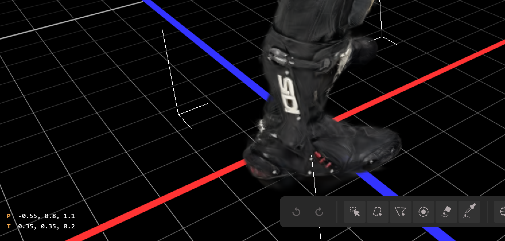

Editorの3Dビューは、マウス、タッチ、キーボードで操作します。**オービット**（デフォルト）と**フライ**の2つのコントロールモードがあります。

- **オービットモード** - カメラが焦点を中心に回転します。オブジェクトをあらゆる角度から観察するのに最適です。
- **フライモード** - カメラがシーン内を自由に移動します。大規模な環境をナビゲートするのに最適です。

<kbd>V</kbd>を押してモードを切り替えるか、<kbd>W</kbd>、<kbd>A</kbd>、<kbd>S</kbd>、<kbd>D</kbd>キーを使用して自動的にフライモードに切り替えます。

## マウスコントロール

| アクション | オービットモード | フライモード |
|--------|------------|----------|
| 左ドラッグ | 焦点を中心に回転 | 見回す |
| 中クリック | 焦点を設定 | — |
| 中ドラッグ | 焦点を中心に回転 | 見回す |
| <kbd>Shift</kbd> + 中ドラッグ | パン | パン |
| <kbd>Ctrl</kbd> + 中ドラッグ | ズーム | ズーム |
| 右ドラッグ | パン | パン |
| 右 + <kbd>Ctrl</kbd>/<kbd>Shift</kbd>ドラッグ | 回転 | 見回す |
| 右 + <kbd>Alt</kbd>/<kbd>Cmd</kbd>ドラッグ | ズーム | ズーム |
| マウスホイール | ズーム | 前進/後退 |
| マウスホイール + <kbd>Shift</kbd> | パン | パン |
| マウスホイール + <kbd>Ctrl</kbd> | 回転 | 見回す |
| ダブルクリック | 焦点を設定 | 焦点を設定（オービットに切替） |

## タッチコントロール

| アクション | オービットモード | フライモード |
|--------|------------|----------|
| 1本指ドラッグ | 回転 | 見回す |
| 2本指ドラッグ | パン | — |
| 2本指ピンチ/スプレッド | ズーム | 前進/後退 |

## キーボードコントロール

| キー | アクション |
|-----|--------|
| <kbd>W</kbd> / <kbd>A</kbd> / <kbd>S</kbd> / <kbd>D</kbd> | 前/左/後/右にフライ |
| <kbd>Q</kbd> / <kbd>E</kbd> | 下/上にフライ |
| <kbd>Shift</kbd> | 10倍速いフライ速度 |
| <kbd>Alt</kbd> | 0.1倍遅いフライ速度 |
| <kbd>V</kbd> | オービットとフライモードを切り替え |
| <kbd>Shift</kbd>+<kbd>F</kbd> | カメラをデフォルト位置にリセット |
| <kbd>F</kbd> | 選択（またはアクティブなBox、Sphere、Measure、Orientツール）にカメラをフォーカス |
| <kbd>I</kbd> | [カメラ情報オーバーレイ](#camera-info-overlay)の表示/非表示を切り替え |

## カメラ設定 {#camera-settings}

[Preferences](interface.md#preferences)（環境設定）ポップアップ（右ツールバーの歯車アイコン）にある3つの設定、**視野角**、**FOV自動ドリー**、**フライ速度**がカメラに影響します。範囲とデフォルトは[Preferences](interface.md#preferences)に記載しています。

視野角はビューポートの長辺方向に適用されます。ビューポートが横長のときは水平方向、縦長のときは垂直方向です。公開したシーンやエクスポートしたビューアも同じように適用します。

デフォルトでは、視野角の変更はレンズズームのように動作します：カメラはその場に留まり、シーンが拡大または縮小されて見えます。**FOV自動ドリー**を有効にすると、視野角の変更に合わせてカメラがドリー（移動）し、被写体のフレーミングが維持されます。

## カメラ情報オーバーレイ {#camera-info-overlay}

<kbd>I</kbd>を押す（または**Overlays**ポップアップで**Camera Info**を有効にする）と、ビューポートの左下隅に情報オーバーレイが表示されます：

オーバーレイには、カメラの現在のポーズがシーン単位の`x, y, z`座標で表示され、ナビゲートするたびにリアルタイムで更新されます：

- **P** - カメラの位置
- **T** - カメラのターゲット（オービットの中心となる焦点）

### カメラポーズを数値で設定する

両方の値は編集可能なので、カメラを正確に配置できます：

1. 値をクリックします - テキストが選択され、上書きできる状態になります
2. カンマまたはスペースで区切った3つの数値を入力します（例：`-0.55, 0.8, 1.1`）
3. <kbd>Enter</kbd>で適用します（<kbd>Esc</kbd>でキャンセル）

有効な値は緑色に点滅し、カメラが新しいポーズに移動します。無効な入力は赤色に点滅し、以前の値が復元されます。**P**を編集すると、現在のターゲットに向けたままカメラの位置が変わります。**T**を編集すると、カメラは移動せずに新しいターゲットに向きを変えます。

これは正確な視点を再現するのに便利です - 例えば、正確なカメラセットアップに戻ったり、同じシーンで作業している他の人と座標を共有したりできます。
