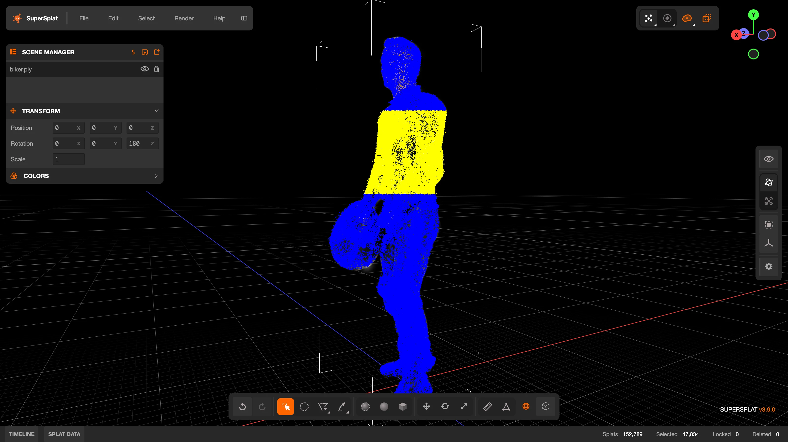
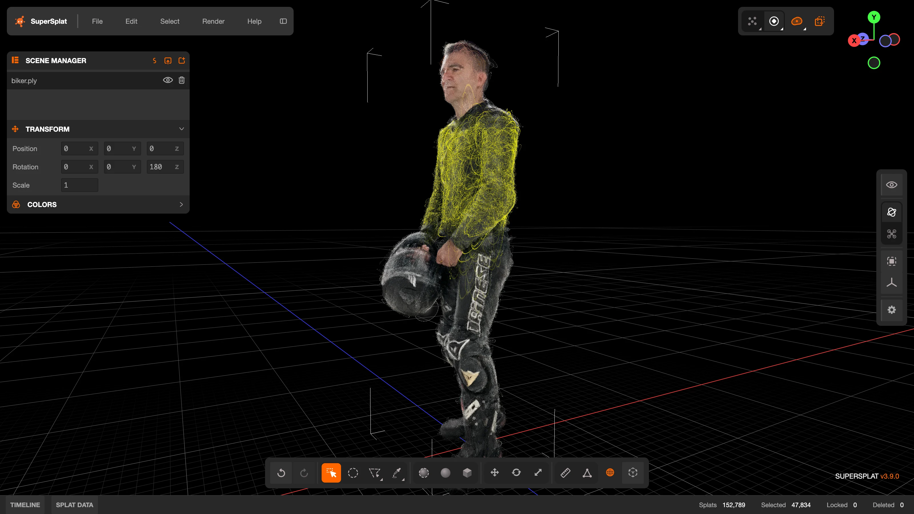

編集前に**Scene Manager**でスプラットを選択します。複数のスプラットが表示されている場合でも、ガウシアンの選択とクリーンアップ操作はアクティブスプラットだけに適用されます。

## 選択モードとX-Ray {#selection-mode-and-x-ray}

ビューキューブの横にある[モードストリップ](interface.md#mode-strip)は、2D選択ツールがどのガウシアンを対象にするかを制御し、ドラッグで何が選択されるかを表示します。

| コントロール | ショートカット | 設定 | 効果 |
|---|---|---|---|
| **Centers** / **Rings** | <kbd>M</kbd> | **Centers**（デフォルト） | 中心点で選択します。中心点がツールの形状の内側にあるガウシアンが対象になります。各ガウシアンの中心に点が表示されます。 |
| | | **Rings** | フットプリントで選択します。投影された楕円の一部でも形状の内側にあれば対象になるため、選択範囲の縁にある大きくて柔らかいガウシアンも含まれます。各フットプリントを囲むリングが表示されます。 |
| **X-Ray** | <kbd>N</kbd> | オン（デフォルト） | シーン全体を貫通して選択します。手前に何があっても、ツールの形状の下にあるすべてのガウシアンが対象になります。 |
| | | オフ | 可視サーフェスだけを選択します。他のガウシアンの背後に隠れたガウシアンはそのまま残ります。シーンを貫通せずに表面をクリーンアップしたいときは、X-Rayをオフにします。 |

モード、Markers、X-Rayの設定はセッションをまたいで記憶されます。

### マーカー

中心の点とリングをマーカーと呼びます。<kbd>Tab</kbd>を押す（またはモードストリップの**Markers**をクリックする）と、未選択のガウシアン上のマーカーの表示・非表示を切り替えられます。マーカーはデフォルトでオフなので、レンダリングされたスプラットがそのまま表示されます。モードを切り替えるとマーカーはオンになります。マーカーを隠しても選択の動作は変わらず、選択されたガウシアンには引き続きインジケーター（選択色の点またはリング。選択色のデフォルトは黄色）が表示されます。

マーカーの色は選択状態を表します。選択されたマーカーは常に選択色を使用します。未選択の中心点は未選択色（デフォルトは青色）を使用し、未選択のリングはそれぞれのガウシアンの色で描画されます。X-Rayがオフのときは、現在のビューから選択が届くガウシアンにだけ未選択のマーカーが描画されるため、ドラッグする前に何が選択されるかを確認できます。選択されたマーカーは常に描画されます。マーカーのサイズと色、選択範囲の着色とアウトラインは、モードストリップの長押しメニューで設定します。[マーカーと選択範囲の表示](color-and-appearance.md#appearance)を参照してください。

ロックまたは削除されたガウシアンは選択できません。完全に透明なガウシアンは選択できるため、目には見えなくてもメモリと描画時間を消費している残骸をクリーンアップできます。

## 選択ツール

Scene Managerの各行はインポートしたスプラットを表し、選択ツールはアクティブスプラット内の個々のガウシアンに作用します。スプラットのクロップや不要なガウシアンの削除には、次のツールを使用します。

| ツール | 説明 |
|------|-------------|
|  **Rectangle Selection**（<kbd>R</kbd>） | クリックで単一のガウシアンを選択するか、クリック＆ドラッグで矩形の内側をすべて選択します。これはデフォルトの選択ツールです。 |
|  **Brush Selection**（<kbd>B</kbd>） | クリック＆ドラッグで円形ブラシを使用して選択をペイントします。ブラシサイズは<kbd>[</kbd>（縮小）と<kbd>]</kbd>（拡大）キー、または<kbd>Alt</kbd> + マウスホイールで調整できます。有機的な選択作業に最適です。 |
|  **Polygon Selection**（<kbd>P</kbd>） | クリックしてポリゴンの頂点を配置します。<kbd>Backspace</kbd>で最後に配置した点を削除できます。最初の点をクリックする、ダブルクリックする、または<kbd>Enter</kbd>キーを押すことで図形を閉じます。直線のエッジを持つ正確な選択に便利です。Lasso Selectionとツールバーのボタンを共有します。 |
|  **Lasso Selection**（<kbd>L</kbd>） | クリック＆ドラッグで自由な形状を描画します。アウトライン内のガウシアンが選択されます。Polygon Selectionとツールバーのボタンを共有します。 |
|  **Eyedropper Selection**（<kbd>Ctrl</kbd>+<kbd>E</kbd>） | ビューポートをクリックして、類似した色のガウシアンを選択します。閾値スライダー（0～1）がカラーマッチングの感度を制御します。Flood Selectionとツールバーのボタンを共有します。 |
|  **Flood Selection**（<kbd>O</kbd>） | ビューポートをクリックして、その点から塗りつぶしで2D選択範囲を広げます。閾値スライダー（0～1）が感度を制御します。孤立したはぐれガウシアン（フローター）に特に便利です。Eyedropper Selectionとツールバーのボタンを共有します。 |
|  **Sphere Brush Selection**（<kbd>Shift</kbd>+<kbd>B</kbd>） | 3Dで選択をペイントします。ストロークの各点はカーソル下のサーフェスに投影され、その位置の球の内側にあるガウシアンを選択するため、ブラシはシーンを貫通せずにサーフェスに沿います。ブラシサイズはBrush Selectionと共有され（<kbd>[</kbd>、<kbd>]</kbd>、<kbd>Alt</kbd> + マウスホイール）、ピックした深度でのワールド空間の半径に対応します。 |
|  **Sphere Selection** | ボリューメトリック選択用の3D球体ボリュームを作成します。シーン内の任意の場所をダブルクリックして球の中心を配置します。ツールバーのMoveボタンとScaleボタン（または<kbd>1</kbd>キーと<kbd>3</kbd>キー）で球のギズモを切り替えられ、スケールギズモの中央ハンドルをドラッグすると半径が変わります。**Position**（X、Y、Z）と**Radius**を数値で入力することもできます。**Set**、**Add**、**Remove**、または**Intersect**をクリックして、現在の選択にボリュームを適用します。 |
|  **Box Selection** | ボリューメトリック選択用の3Dボックスを作成します。シーン内の任意の場所をダブルクリックしてボックスの中心を配置します。ツールバーのMove、Rotate、Scaleボタン（または<kbd>1</kbd>、<kbd>2</kbd>、<kbd>3</kbd>キー）でボックスのギズモを切り替えられ、ボックスを自由に移動・回転・リサイズできます。**Position**（X、Y、Z）と**Size**（X、Y、Z）を数値で入力することもできます。回転ギズモがアクティブな間は、**Size**フィールドの代わりに**Rotation**フィールドが表示されます（`0, 0, 0`を入力すると向きがリセットされます）。**Set**、**Add**、**Remove**、または**Intersect**をクリックして、現在の選択にボリュームを適用します。3D空間の特定領域内のガウシアンを選択するのに最適です。 |

ツールバーのボタンのうち2つは、それぞれ2つのツールを持ちます：**Polygon** / **Lasso**と**Eyedropper** / **Flood**です。ボタンをクリックすると現在表示されているツールが有効になり、長押しするともう一方を選べます。ボタンは選んだツールを記憶します。キーボードショートカットは常に特定のツールを有効にします。

### 選択修飾キー {#selection-modifiers}

2D選択ツールとSphere Brushは、選択の適用方法を制御する修飾キーをサポートしています：

| 修飾キー | アクション |
|----------|--------|
| **なし** | 新しい選択で現在の選択を置き換える |
| <kbd>Shift</kbd> | 現在の選択に追加 |
| <kbd>Ctrl</kbd> | 現在の選択から削除 |
| <kbd>Shift</kbd>+<kbd>Ctrl</kbd> | 現在の選択と新しい選択の両方に含まれるガウシアンだけを保持 |

これらのツールがアクティブな間、カーソルには現在の修飾キーで適用される操作が表示されます。通常の十字カーソルは**Set**を表し、十字カーソルのバッジは**Add**（`+`）、**Remove**（`−`）、または**Intersect**（`∩`）を示します。[Splat Dataパネル](data-panel.md)で値の範囲を選択するときも、同じフィードバックが表示されます。

3Dボリュームツール（Sphere Selection、Box Selection）は、修飾キーの代わりにツールバーに**Set**、**Add**、**Remove**、**Intersect**ボタンがあります。ボリュームの変形には変形ツールと同じギズモを使用します。アクティブなギズモモードのボタンをもう一度クリックするとギズモが非表示になり、ギズモはローカル/ワールド座標空間トグルに従い、ツールがアクティブな間のボリューム編集は元に戻すことができます。<kbd>F</kbd>を押すとボリュームをビューポートにフレーミングします。

## ロック、削除、復元 {#lock-delete-and-restore}

**Select > Lock Selection**を使用するか<kbd>H</kbd>を押すと、選択したガウシアンがロックされます。ロックすると選択が解除され、そのガウシアンを選択または削除できなくなります。完成した領域を保護しながら、近くのジオメトリをクリーンアップする場合に便利です。**Select > Unlock All**を選択するか<kbd>Shift</kbd>+<kbd>H</kbd>を押すと、アクティブスプラット内のすべてのロックが解除されます。

選択したガウシアンは、**Select > Delete Selection**、<kbd>Delete</kbd>、または<kbd>Backspace</kbd>で削除します。編集中の削除は非破壊です。直前の削除はUndoで取り消せます。また、**Select > Reset Splat**を選択すると、アクティブスプラット内で削除したすべてのガウシアンが復元されます。Reset Splatではロックされたガウシアンのロックは解除されません。

ロック、ロック解除、削除、リセットは編集履歴に記録されます。Scene Managerから行全体を削除する操作は異なり、元に戻せません。

## 選択範囲の複製と分離 {#duplicate-and-separate-a-selection}

ガウシアンが選択されている場合、**Edit**メニューではその選択範囲から別のスプラットを作成できます。

- **Duplicate**は、選択したガウシアンを新しいスプラットへコピーし、元のガウシアンを変更しません。
- **Separate**は、選択したガウシアンから新しいスプラットを作成し、元のスプラットからそのガウシアンを削除します。

どちらの操作も元に戻せます。領域ごとに異なる変形や表示を適用する場合に便利です。

## クリーンアップ手順

### フローターの除去

1. **X-Ray**（<kbd>N</kbd>）をオフにして選択が可視サーフェスで止まるようにし、作業中にマーカーを確認したい場合は<kbd>Tab</kbd>を押します。
2. 孤立した領域にはFlood Selectionを使用し、より大きな領域にはLasso、Brush、Sphere Brush、Sphere、Box Selectionを使用します。
3. カメラを回転し、目的のジオメトリだけが分離されるまで選択範囲へ追加または削除します。
4. <kbd>Delete</kbd>または<kbd>Backspace</kbd>を押します。
5. 複数のアングルから結果を確認し、削除しすぎた場合はUndoを使用します。

### スプラットのクロップ

1. Box、Sphere、Lasso、Polygon Selectionを使用して、保持する領域を選択します。選択がシーン全体を貫通するように、**X-Ray**はオンのままにします。
2. **Select > Invert**を選択します。
3. 反転した選択範囲を削除します。
4. クリーンアップした結果をエクスポートするか、スプラットとプロジェクトの設定を保持する場合は`.ssproj`を保存します。

### 完成領域の保護

完成した領域を選択し、<kbd>H</kbd>を押してロックします。残りの選択可能なガウシアンをクリーンアップし、保護した領域を再編集する場合は<kbd>Shift</kbd>+<kbd>H</kbd>を押します。

属性に基づくクリーンアップには、[Splat Dataパネル](data-panel.md)を使用して、低い不透明度や極端なスケールなどの範囲を選択します。

## 次のステップ

[変形、測定、位置合わせ](transform-measure-align.md)に進み、選択したガウシアンまたはスプラット全体の変形、スケール調整、キャプチャの位置合わせ、表示中のスプラットの結合を行います。
