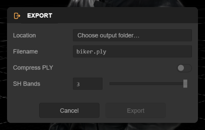

SuperSplatのインポートおよびエクスポート機能は、ワークフロー全体を通じてGaussian Splatデータを扱うために不可欠です。インポートにより、さまざまなキャプチャツールや形式からスプラットシーンを読み込み、編集、クリーンアップ、最適化を行うことができます。編集作業が完了したら、エクスポートにより、ターゲットプラットフォームに最適な形式で洗練されたスプラットを保存できます - Web展開用の圧縮形式、アーカイブ用のフル品質PLY、または簡単に共有できるスタンドアロンHTMLビューアなど。この柔軟性により、SuperSplatはあらゆるGaussian Splat制作パイプラインにシームレスに統合できます。

## 対応ファイル形式 {#supported-file-formats}

SuperSplatは、複数のGaussian Splatシーン形式に加えて、タイムラインキーフレーム作成用のCOLMAPおよびINRIAカメラポーズに対応しています。

| 形式 | インポート | エクスポート | 説明 |
| ------ | ------ | ------ | ----------- |
| `.ply` | ✅ | ✅ | 標準PLY形式 - 最も一般的な交換フォーマット、広くサポートされていますが大容量 |
| `.compressed.ply` | ✅ | ✅ | 圧縮PLY形式 - 非圧縮PLYよりもはるかに小さく、データを量子化。[詳細](https://blog.playcanvas.com/compressing-gaussian-splats/) |
| `.sog` | ✅ | ✅ | バンドル超圧縮形式（`meta.json`と`.webp`テクスチャを含むzipファイル）。ランタイムアプリケーションに推奨 |
| `meta.json` | ✅ | ❌ | アンバンドル超圧縮形式（`.webp`テクスチャを伴う）。エクスポートには[SplatTransform](/user-manual/splat-transform/) CLIツールを使用 |
| `lod-meta.json` | ✅ | ❌ | [Streamed SOG](/user-manual/supersplat/publishing/streaming)バンドル（LODごとの`.sog`チャンクを伴う）。エクスポートには[SplatTransform](/user-manual/splat-transform/) CLIツールを使用 |
| `.splat` | ✅ | ✅ | レガシー圧縮スプラット形式（antimatter15） - 圧縮PLYよりも効率が劣る |
| `.ksplat` | ✅ | ❌ | KSplat圧縮スプラット形式。インポートのみ対応 |
| `.spz` | ✅ | ✅ | Niantic圧縮形式。エクスポートはデフォルトでSPZバージョン4、古いリーダー向けにSPZバージョン3も選択可能 |
| `.lcc` / `.lcc2` | ✅ | ❌ | XGRIDSのプロプライエタリーなマルチLOD形式。SuperSplatが読み込む詳細レベルの選択を求めます |
| `images.txt` | ✅ | ❌ | [COLMAP再構築](https://colmap.github.io/format.html#images-txt)のカメラポーズ。このファイルをインポートすると[タイムラインキーフレーム](timeline.md#importing-camera-poses-as-keyframes)が作成されますが、スプラットシーンは読み込まれません |
| カメラポーズ`.json` | ✅ | ❌ | INRIA JSON形式のカメラポーズ。このファイルをインポートすると[タイムラインキーフレーム](timeline.md#importing-camera-poses-as-keyframes)が作成されますが、スプラットシーンは読み込まれません |
| `.html` | ❌ | ✅ | 圧縮スプラットデータを1つのHTMLファイルに埋め込んだ自己完結型ビューアアプリ |
| `.zip` | ❌ | ✅ | HTMLアプリと独立したバンドルSOGファイル（`index.sog`）を含むビューアパッケージ |

:::warning

3D Gaussian Splatデータを含む`.ply`ファイルのみがロード可能です。その他のPLYファイルタイプはインポートに失敗します。

:::

## スプラットのインポート {#importing-splats}

SuperSplatは、`.ply`、`.compressed.ply`、`.splat`、`.ksplat`、`.spz`、`.lcc`、`.lcc2`、`.sog`（バンドルSOG）、`meta.json`（アンバンドルSOG）、および`lod-meta.json`（Streamed SOG）形式のGaussian Splatシーンと、PLYシーケンスのアニメーション化されたスプラットをインポートできます。また、COLMAPの`images.txt`ファイルとINRIAカメラポーズ`.json`ファイルをインポートして、[カメラアニメーションのキーフレーム](timeline.md#importing-camera-poses-as-keyframes)を作成できます。

Gaussian Splatファイルを読み込む方法は4つあります。

1. **ドラッグアンドドロップ** - ファイルシステムからSuperSplatのウィンドウに1つ以上のスプラットファイル、またはフォルダー全体をドラッグアンドドロップします。ファイルをウィンドウ上にドラッグしている間は、対応形式を一覧表示する**Drop files to import**カードが表示されます。ダイアログや進行状況画面が開いている間はカードが表示されず、ドロップは拒否されます。複数ファイル形式（`.lcc`、`.lcc2`、アンバンドルSOG、Streamed SOGなど）の場合は、それらのファイルを含む親フォルダーをドラッグします。
2. **ファイルメニュー** - `File` > `Import`を選択し、ファイルシステムから1つ以上のスプラットファイルを選択します。`File` > `Import Recent`には以前にインポートしたファイルとフォルダーが一覧表示されるため、再度探すことなく読み込み直せます。一覧の最下部にある`Clear Recent`で一覧を空にできます。
3. **直接ファイルを開く** - ブラウザのアドレスバーからSuperSplatをアプリとしてインストールしている場合、File Explorer（Windows）またはFinder（macOS）で`.ply`、`.splat`、`.sog`、`.spz`、`.ksplat`、`.ssproj`ファイルをダブルクリックするとEditorで開けます。
4. **URL読み込み** - 次のような形式で`load`クエリパラメータを使用します：`https://superspl.at/editor?load=<SPLAT_URL>`。例：

    https://superspl.at/editor?load=https://raw.githubusercontent.com/willeastcott/assets/main/biker.ply

    これは、XやLinkedInのようなソーシャルプラットフォームで他の人とスプラットを共有するのに特に便利です。

    インポートしたスプラットには、URLパスの最後の部分が名前として付けられます。名前を自分で指定するには、`filename`パラメータを追加します（例：`?load=<SPLAT_URL>&filename=garden.ply`）。ファイル形式は`filename`から判断されるため、署名付きURLや拡張子のないURLのように、URLが形式の拡張子で終わっていない場合は必須です。複数のファイルをインポートするには、`load`（および`filename`を同じ順序で）を繰り返します。

    URL読み込みは、複数ファイルで構成される`.lcc`、`.lcc2`、アンバンドルSOG、Streamed SOGシーンにも対応します。関連するチャンクまたはテクスチャファイルは、コンテナから参照される相対パスに配置してください。

スプラットの読み込み中は、進行状況ダイアログに読み込み中の各ファイルが表示され、続いて**Sorting**と**Uploading**の段階が表示されます。

### 複数ファイルのインポート {#importing-several-files}

1つのファイル、または1つの複数ファイルモデル（アンバンドルSOGのフォルダーなど）を構成するファイルは、すぐにインポートされます。それ以外のもの（複数のスプラット、PLYシーケンス、またはスプラット、プロジェクト、カメラポーズの混在）は、選択、ドロップ、**Import Recent**からの再読み込みのいずれの場合もグループに分類され、**Import Files**ダイアログにグループごとに1行ずつ一覧表示されます。

| 列 | 説明 |
|---|---|
| **Files** | ファイル名、複数ファイルモデルのメインファイル、または`frame_000[1-5].ply`のようなシーケンスのフレーム範囲。 |
| **Import** | その行をインポートするかどうか。デフォルトではすべての行にチェックが入っています。対応していないファイルは一覧に表示されますが、インポートできません。 |
| **As** | 行のインポート方法。スプラットまたは複数ファイルモデルは**Scene**、`.ssproj`ファイルは**Project**、COLMAPまたはINRIAのポーズファイルは**Camera poses**、対応していないファイルは**Not supported**です。PLYシーケンスでは、**Sequence**（デフォルト）と、フレーム数とともに表示される1フレーム1シーンのオプション（例：**120 scenes**）から選べます。後者はすべてのフレームを個別のスプラットとしてインポートします。 |

**Import**をクリックするとチェックの入った行がインポートされ、**Cancel**をクリックすると何もインポートされません。プロジェクトを開くと現在のシーンが置き換えられるため、プロジェクトは一覧の先頭に表示されます。

### 詳細レベルの選択 {#choosing-a-level-of-detail}

ファイルに複数の詳細レベルが含まれる場合、SuperSplatはSplatsを割り当てる前に**Load Options**ダイアログを表示します。ダイアログには各LODとそのSplat数が一覧表示されます。初期状態では、2000万Splats未満で最も詳細なレベルが選択されるため、大きなシーンでの過剰なメモリ使用を避けられます。

編集の目的と利用可能なメモリに合うLODを選択し、**Load**をクリックします。詳細度が低いレベルほど高速に読み込まれ、使用メモリも少なくなります。レベルを読み込まずにインポートを中止するには、**Cancel**をクリックします。

### PLYシーケンスのインポート {#ply-sequences}

SuperSplatでは、アニメーション化されたGaussian Splatを[タイムライン](timeline.md)で再生できます。アニメーションの各フレームは、それぞれ1つのPLYファイルに保存された完全なスプラットです。

PLYシーケンスをインポートするには：

1. PLY（または`.compressed.ply`）ファイルが同じフォルダーにあり、共通のファイル名プレフィックスの後に連番のフレーム番号が続いていることを確認します。例：
   - `animation_0001.ply`
   - `animation_0002.ply`
   - `animation_0003.ply`
   - など

2. 次のいずれかの方法でシーケンスをSuperSplatに読み込みます：
   - ファイルシステムからすべてのPLYファイルをSuperSplatに**ドラッグアンドドロップ**
   - PLYファイルを含むフォルダーをSuperSplatに**ドラッグアンドドロップ**
   - **File > Import**を使用して複数のPLYファイルを選択

3. [Import Files](#importing-several-files)ダイアログでは、フレームがフレーム範囲を名前とする1つの行として表示されます。**As**を**Sequence**のままにして、**Import**をクリックします。

読み込まれると、シーケンスはScene Managerに1つのスプラットとして表示され、[タイムライン](timeline.md)パネルでシーケンスを制御できます。次のことができます：

- 矢印ボタンを使用してフレームを進めたり戻したりする
- 再生ボタンを使用してアニメーションを再生する
- タイムラインスライダーを使用してアニメーションをスクラブする

複数のシーケンスをインポートでき、それらは同時に再生されます。[スプラットシーケンス](timeline.md#splat-sequences)を参照してください。

:::note

シーケンスは、各フレームが完全なスプラットシーンを読み込むため、メモリを大量に消費します。最適なパフォーマンスを得るには、アニメーション化されたスプラットを操作する際、ファイルサイズとフレーム数を考慮してください。

:::

## スプラットのエクスポート

現在読み込まれているシーンをエクスポートするには、`File` > `Export`サブメニューを開き、**PLY**、**SOG**、**SPZ**、**Splat**、**Viewer App**のいずれかを選択します。エクスポートには表示中のスプラットだけが含まれます。すべてのエクスポートで同じダイアログを使用します。

- **Location** - 出力フォルダー。Editorは前回エクスポートしたフォルダーを記憶しています。別のフォルダーを選ぶには**Choose output folder…**（または**Change…**）をクリックします。File System Access APIに対応していないブラウザではこの行は表示されず、ファイルはダウンロードとして提供されます。
- **Filename** - 出力ファイルの名前。名前が無効な場合やフォルダー内に同名のファイルがある場合は警告が表示され（ボタンは**Overwrite**に変わります）、現在のシーンが読み込み中のファイルの上書きは拒否されます。
- 形式ごとのオプション：
  - **PLY**：**Compress PLY**を有効にすると、フルサイズのPLYではなく`.compressed.ply`を書き出します。**SH Bands**で含める球面調和関数のバンド数を選択します。
  - **SOG**：**SH Bands**と、球面調和関数データの圧縮に使用するクラスタリングの反復回数である**Iterations**（1～20、デフォルト10）。反復回数を増やすと、エクスポート時間は延びますが品質がわずかに向上します。
  - **SPZ**：**SH Bands**と**Version**。**SPZ 4**（仕様の最新バージョン）がデフォルトで、古いサードパーティ製SPZリーダーとの互換性のために**SPZ 3**（レガシーgzipコンテナ）も利用できます。
  - **Viewer App**：スタンドアロンHTMLビューアのオプションは[ビューアのセルフホスティング](/user-manual/supersplat/developers/self-hosting)で説明しています。

**SH Bands**（0～3）は、書き出される球面調和関数のバンドの正確な数です。初期値はシーン内の最大のバンド数で、[Preferences](interface.md#preferences)の**SH Bands**設定が上限になるため、デフォルトのエクスポートではビューポートに表示されている内容がそのまま保持されます。スプラットに含まれるより多いバンド数を選ぶと、不足している係数は0で埋められます。これにより、固定の球面調和関数レイアウトを前提とするツール向けに、バンド0のスプラットを3バンドでエクスポートできます。

候補のファイル名はスプラットの名前から作られ、元の拡張子は大文字・小文字にかかわらずエクスポート形式の拡張子に置き換えられます。たとえば、`Garden.PLY`から読み込んだスプラットをSOGでエクスポートすると、`Garden.sog`が提案されます。

`File` > `Re-export`（`Ctrl + Shift + E`）を選ぶと、前回のエクスポートを同じオプションで同じファイルに繰り返します。確認なしに以前の出力を上書きするため、クリーンアップを繰り返しながら試す際に便利です。
