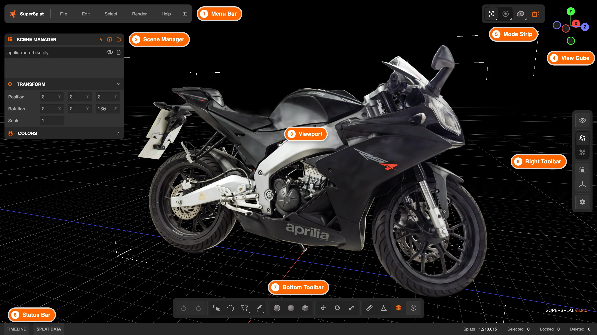
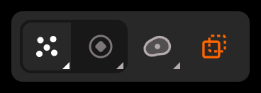
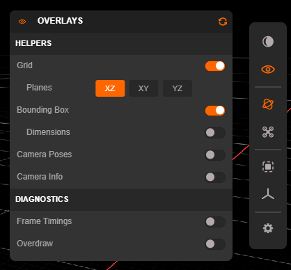
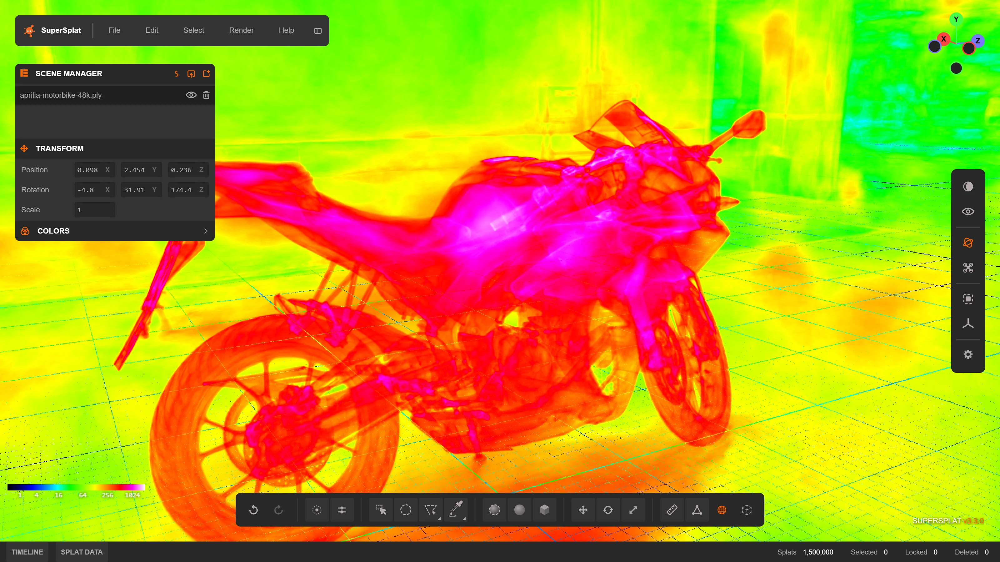
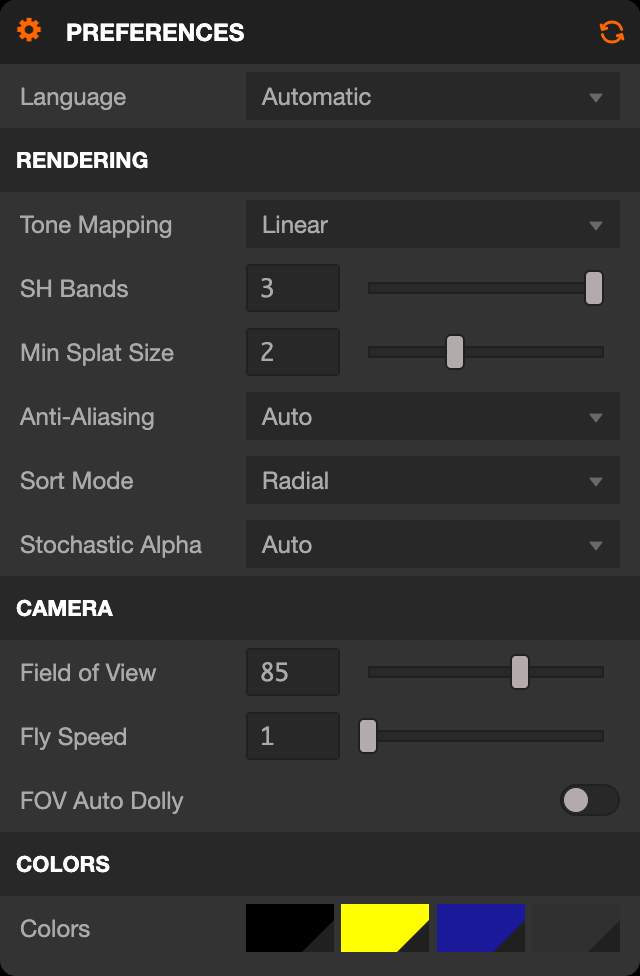

SuperSplat Editorのインターフェースは以下のようになります。

## インターフェースの要素

インターフェースの主要な要素にはラベルが付けられています。

### メニューバー

メニューバーは、SuperSplat Editorで最もよく使われる機能へのアクセスを提供します。左端のSuperSplatロゴをクリックすると[superspl.at](https://superspl.at)に戻ります。

* **ファイルメニュー:** `.ssproj`プロジェクトの作成、読み込み、保存。スプラットのインポート（**Import Recent**の一覧を含む）、対応形式へのエクスポートと**Re-export**による前回エクスポートの繰り返し、superspl.atへの公開を行います。
* **編集メニュー:** 変更の取り消しとやり直し、または選択したガウシアンの複製や新しいスプラットへの分離を行います。
* **選択メニュー:** すべて選択、選択解除、選択の反転。**Lock Selection**、**Unlock All**、**Delete Selection**と、削除したガウシアンを復元する**Reset Splat**があります。
* **レンダーメニュー:** 現在読み込まれているシーンの画像またはビデオをレンダリングします。
* **ヘルプメニュー:** 動画チュートリアル、このユーザーガイド、キーボードショートカット一覧、コミュニティへのリンク、**About SuperSplat**です。

### シーンマネージャー

シーンマネージャーには、プロジェクトへインポートしたスプラットが一覧表示されます。行をクリックしてアクティブスプラットを選択し、目のアイコンまたはSoloモードで表示を制御し、一覧の下にある折りたたみ可能な**Transform**セクションと**Colors**セクションで正確な変形とカラーグレーディングを行います。セクションのヘッダーや行を右クリックすると、その値をコピーまたは貼り付けできます。詳しい手順は[スプラットの管理](scene-management.md)を参照してください。

### ビューポート

シーンを視覚的に編集できる3Dビューポートです。グリッドがシーン内での向きを把握するのに役立ちます。デフォルトでは、グリッドはXZ平面（ワールドY軸が上方向を指します）にあります。[Overlays](#overlays)ポップアップでXY平面やYZ平面を任意の組み合わせで追加表示できます。X軸は赤色、Z軸は青色です。グリッドの単位はメートルで、目盛りはシーンからの距離に応じて変化します。近づくと1メートルと10センチメートルの線が、大きなシーンでは100メートルと1キロメートルの線が表示されます。

### ビューキューブ

ビューキューブは、ビューポートカメラに追加の制御を提供するギズモです。いずれかの円をクリックすると、シーンを6方向のいずれかから正投影ビューに切り替えることができます。これにより、特定の状況で正確な選択を行うのが容易になります。

### モードストリップ {#mode-strip}

ビューキューブの横にある小さなアイコンの列で、何を表示し、選択が何を対象にするかを決めます。ボタンにはラベルがないため、カーソルを合わせて名前、ショートカット、短い説明を確認します。左から順に次のコントロールがあります。

| コントロール | ショートカット | デフォルト | 説明 |
|---|---|---|---|
| **Centers** / **Rings** | <kbd>M</kbd> | Centers | 編集モードです。選択でガウシアンを中心点で拾うか、フットプリントで拾うかを切り替えます。モードを切り替えると**Markers**もオンになります。 |
| **Markers** | <kbd>Tab</kbd> | オフ | 未選択のガウシアンに中心点またはリングのマーカーを表示します。オフのときはシーンがそのままレンダリングされ、選択されたガウシアンにはインジケーターが表示されたままです。 |
| **X-Ray** | <kbd>N</kbd> | オン | すべての深度を貫通して選択します。オフにすると可視サーフェスだけを選択します。 |

**Centers**または**Rings**を長押しすると、そのマーカーのサイズと**Splat Colors**スイッチが表示されます。**Markers**を長押しすると、**Markers Only**、**Tint Selection**、**Outline Selection**が表示されます。[選択モードとX-Ray](editing-splats.md#selection-mode-and-x-ray)と[マーカーと選択範囲の表示](color-and-appearance.md#appearance)を参照してください。

### 右ツールバー {#right-toolbar}

この縦型のツールバーには、上から順に次のボタンがあります。

* **Overlays**（オーバーレイ、目のアイコン） — グリッド、バウンディングボックス、カメラポーズ、カメラ情報、診断機能をまとめた[Overlays](#overlays)ポップアップを開きます。
* **Orbit Camera** / **Fly Camera** — [カメラコントロールモード](camera-controls.md)を切り替える2択のスイッチです（<kbd>V</kbd>）。
* **Frame Selection**（<kbd>F</kbd>）と**Reset Camera**（<kbd>Shift</kbd>+<kbd>F</kbd>）。
* **Preferences**（環境設定、歯車アイコン） — [Preferences](#preferences)ポップアップを開きます。

OverlaysとPreferencesのポップアップは、同時に1つだけ開きます。

### 下ツールバー {#bottom-toolbar}

この横型のツールバーには、左から順に次のコントロールがあります。

* **Undo**と**Redo**。
* 2D選択ツール：**Rectangle**、**Brush**、**Polygon** / **Lasso**、**Eyedropper** / **Flood**。最後の2つのボタンはそれぞれ2つのツールを持ち、クリックで現在のツールを使用し、長押しでもう一方に切り替えます。
* 3D選択ツール：**Sphere Brush**、**Sphere Selection**、**Box Selection**。
* **Move**、**Rotate**、**Scale**。
* **Measure**と**Orient**、続いて**Use Local Orientation**トグル（<kbd>Shift</kbd>+<kbd>C</kbd>）と**Reset Pivot**。

選択ツールが何を対象にするかは、[モードストリップ](#mode-strip)で設定します。[選択とクリーンアップ](editing-splats.md)および[変形、測定、位置合わせ](transform-measure-align.md)を参照してください。

### ステータスバー

下端のバーでは、**Timeline**（<kbd>Ctrl</kbd>+<kbd>T</kbd>）と**Splat Data**（<kbd>Ctrl</kbd>+<kbd>D</kbd>）のパネルを開閉でき、アクティブスプラットの**Splats**、**Selected**、**Locked**、**Deleted**のガウシアン数がリアルタイムに表示されます。Editorのバージョンはビューポートの右下隅に表示されます。クリックすると**About**ダイアログが開き、GPUと、Editorが使用しているPlayCanvas Engine、Splat Transform、PCUIのバージョンも確認できます。

### アニメーションタイムライン

タイムラインを使用すると、ビューポートカメラのキーフレームを作成および削除できます。また、設定したアニメーションを、インポートした[スプラットシーケンス](timeline.md#splat-sequences)とともに再生（またはスクラブ）することもできます。

### Splat Dataパネル

このパネルは、アクティブスプラットのガウシアンデータをヒストグラムとして視覚化し、値の範囲を選択できます。[Splat Dataパネル](data-panel.md)を参照してください。

## Overlays（オーバーレイ） {#overlays}

**Overlays**ポップアップ（[右ツールバー](#right-toolbar)の目のアイコン）には、ビューポートのヘルパーと診断機能があります。各行はトグルで、行のどこをクリックしても切り替わります。

| セクション | コントロール | デフォルト | 説明 |
|---|---|---|---|
| Helpers | **Grid**（<kbd>G</kbd>） | オン | 基準グリッドを表示します。 |
| | **Planes** | XZ | 描画するグリッド平面：**XZ**、**XY**、**YZ**を任意の組み合わせで選べます。選択は環境設定と`.ssproj`プロジェクトに保存されます。 |
| | **Bounding Box** | オン | アクティブスプラットのバウンディングボックスを描画します。 |
| | **Dimensions** | オフ | バウンディングボックスの各辺の長さと、[Measure](transform-measure-align.md#measure-and-rescale-a-splat)ツールの線の長さをビューポート内にラベル表示します。 |
| | **Camera Poses** | オフ | [Timeline](timeline.md)の各キーフレームにカメラギズモを描画します。 |
| | **Camera Info**（<kbd>I</kbd>） | オフ | 編集可能な[カメラの位置とターゲットのオーバーレイ](camera-controls.md#camera-info-overlay)を表示します。 |
| Diagnostics | **Frame Timings** | オフ | GPUとCPUのフレーム時間（直近1秒間の中央値、最小値、95パーセンタイル）をグラフとともにリアルタイム表示し、直前のフレームがソート描画か確率的描画かを示します。 |
| | **Overdraw** | オフ | 各ピクセルに重なるガウシアン数のヒートマップで画像を置き換え、1から1000超までの凡例を表示します。赤から白の領域は、クリーンアップによるパフォーマンス改善効果が最も大きい場所です。 |

ポップアップのヘッダーにあるリセットアイコンをクリックすると、Overlaysのデフォルトに戻ります。

## Preferences（環境設定） {#preferences}

**Preferences**ポップアップ（[右ツールバー](#right-toolbar)の歯車アイコン）には、アプリケーション全体の設定があります。設定はブラウザに保存され、次回Editorを開いたときに復元されます。設定名にカーソルを合わせると、その設定の短い説明が表示されます。

| セクション | 設定 | デフォルト | 説明 |
|---|---|---|---|
| | **Language** | Automatic | インターフェースの言語。[言語](#language)を参照してください。 |
| Rendering | **Tone Mapping** | Linear | ビューポートのトーンマッピングカーブ：Linear、Neutral、ACES、ACES2、Filmic、Hejl。 |
| | **SH Bands** | 3 | ビューポートで評価する球面調和関数のバンド数（0～3）。値を下げると描画が速くなり、バンド数を減らしたエクスポートの見え方をプレビューできます。 |
| | **Min Splat Size** | 2 | 画面上に投影したサイズがこのピクセル数（0～5）より小さいガウシアンを非表示にし、大きなシーンの描画を高速化します。小さなガウシアンが抜けて隙間ができる場合は値を下げてください。1.5以下では何も非表示になりません。この設定はEditorのビューポートにだけ影響し、エクスポートしたビューアーでは常に2が使用されます。 |
| | **Anti-Aliasing** | Auto | Mip-Splattingなど、アンチエイリアスを有効にして学習したスプラット向けの設定です。このようなスプラットは、アンチエイリアスなしでは明るすぎる描画になります。**Auto**は各ファイルに保存されたアンチエイリアスのタグに従い、**On**と**Off**はすべてのスプラットでタグを上書きします。他の設定とは異なり、この設定は環境設定ではなくプロジェクトに保存され、新しいシーンはAutoから始まります。エクスポートには、ビューポートの表示と一致するタグが付けられます。 |
| | **Sort Mode** | Radial | ガウシアンをブレンドする順序。**Radial**はカメラからの距離でソートするため、カメラがその場で向きを変えても安定します。**Depth**は視線方向に沿ってソートします。正投影ビューでは常に深度でソートされます。 |
| | **Stochastic Alpha** | Auto | カメラを動かしている間に重いシーンをどのように描画するか。**Disabled**は常に深度ソート済みのブレンドフレームを描画します。**Enabled**は常に確率的透明度を使用します。ソートが不要なため非常に大きなシーンでも応答性を保てますが、画質は多少低下します。**Movement**はカメラやツールが動いている間だけ確率的フレームを使用し、ビューが静止すると正確なソート済みフレームを描画します。**Auto**はソート済みフレームが遅いと判明するまでソート描画を続け、その後はMovementと同じように動作します。 |
| Camera | **Field of View** | 85° | ビューポートカメラの視野角（10°～120°）。ビューポートの長辺方向で測ります。[カメラ設定](camera-controls.md#camera-settings)を参照してください。 |
| | **Fly Speed** | 1 | FlyモードでのWASDナビゲーションの速度（0.1～30）。 |
| | **FOV Auto Dolly** | オフ | 視野角の変更に合わせてカメラを移動し、被写体のフレーミングを維持します。[カメラ設定](camera-controls.md#camera-settings)を参照してください。 |
| Colors | **Background Color** | 黒 | ビューポートの背景。[公開](/user-manual/supersplat/publishing/editor/)したシーンとエクスポートしたビューアーのデフォルトの背景にもなります。 |
| | **Selected Color** | 黄色 | 選択されたガウシアンのマーカー、選択範囲の着色とアウトライン、[Splat Data](data-panel.md)ヒストグラムの選択されたバーの色。 |
| | **Unselected Color** | 青色 | 未選択のガウシアンのマーカー（**Splat Colors**で表示している場合を除く）と、ヒストグラムの未選択のバーの色。 |
| | **Locked Color** | 黒（不透明度5%） | [ロック](editing-splats.md#lock-delete-and-restore)されたガウシアンに適用されます。デフォルトでは、ロックされたガウシアンは暗く、ほぼ透明になります。 |

4つの色は、**Colors**行にあるカラースウォッチで設定します。スウォッチにカーソルを合わせると、その名前が表示されます。`.ssproj`プロジェクトを読み込むと、そのプロジェクトに保存された表示とカメラの設定が現在のセッションに適用されますが、ブラウザに保存された環境設定は置き換えられません。**File > New**を選択すると、環境設定が再適用されます。初期設定に戻すには、ポップアップのヘッダーにあるリセットアイコン（**Reset to Defaults**）をクリックします。インターフェース言語も**Automatic**に戻ります。Overlaysポップアップには、独自のリセットボタンがあります。

### 言語 {#language}

SuperSplatのインターフェースは複数の言語で利用できます。デフォルトではブラウザの言語に従います（**Automatic**設定）が、**Preferences**ポップアップ（[右ツールバー](#right-toolbar)の歯車アイコン）の上部にある**Language**ドロップダウンから特定の言語を選択できます。

言語の切り替えは即座に反映されます。ページの再読み込みは行われないため、読み込み済みのシーンや未保存の作業は保持されます。選択した言語は、再度変更するか**Automatic**に戻すまで、セッションをまたいで記憶されます。

サポートされている言語は以下のとおりです。

* English（英語） — `en`
* Deutsch（ドイツ語） — `de`
* Español（スペイン語） — `es`
* Français（フランス語） — `fr`
* 日本語 — `ja`
* 한국어（韓国語） — `ko`
* Português (Brasil)（ブラジルポルトガル語） — `pt-BR`
* Русский（ロシア語） — `ru`
* 中文 (简体)（簡体字中国語） — `zh-CN`

:::tip 特定の言語でリンクを共有する

URLに`?lng=`クエリパラメータを上記の言語コードのいずれかに設定すると（例：`?lng=ja`）、共有リンクの言語を固定できます。これは保存された選択とブラウザのデフォルトの両方を上書きするため、リンクは常にその言語で開きます。

:::

:::tip 言語が見つかりませんか？

SuperSplatは[オープンソース](https://github.com/playcanvas/supersplat)で、翻訳は[`static/locales`](https://github.com/playcanvas/supersplat/tree/main/static/locales)以下のプレーンなJSONファイルです。新しい言語をリクエストするには[Issueを作成](https://github.com/playcanvas/supersplat/issues)するか、ロケールファイルを追加・改善するプルリクエストを送ってください。

:::
