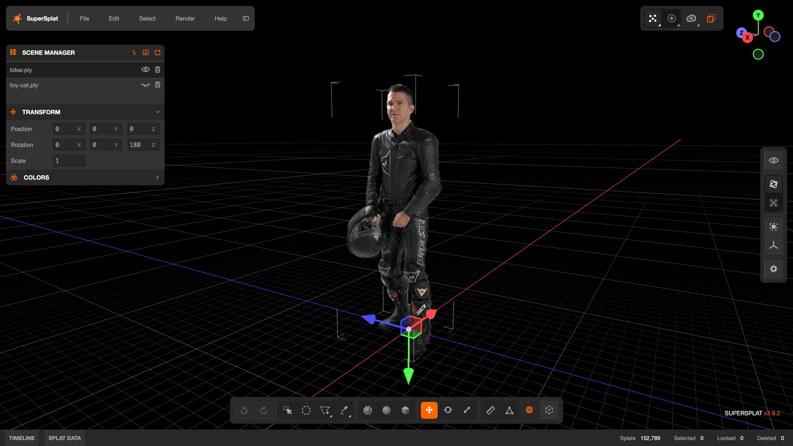

SuperSplatでは、インポートしたスプラット全体またはその中で選択したガウシアンだけを変形できます。現在の選択状態によって対象が決まります。

| アクティブスプラットの状態 | 変形の対象 |
|---|---|
| ガウシアンが選択されていない | アクティブスプラット全体 |
| 1つ以上のガウシアンが選択されている | 選択したガウシアンのみ |

スプラット全体を移動する場合は、変形前に**Select > None**を選択してください。

## 変形ツール

アクティブスプラットを選択し、下部ツールバーからツールを選びます。

- **Move**（`1`）は対象を移動します。
- **Rotate**（`2`）は対象を回転します。
- **Scale**（`3`）は対象を拡大縮小します。

ビューポート内のギズモハンドルをドラッグします。正確な値を指定するには、Scene Managerのスプラット一覧の下にある**Transform**セクションで**Position**、**Rotation**、均一な**Scale**を編集します（ヘッダーをクリックすると折りたたみと展開を切り替えられます）。変形操作は元に戻すこともやり直すこともできます。

### 変形のコピーと貼り付け

**Transform**ヘッダーを右クリックして**Copy**を選ぶと変形全体を、**Position**、**Rotation**、**Scale**のいずれかの行を右クリックするとその値だけをコピーできます。値は`{"position":[1.5,0,-2],"rotation":[0,90,0],"scale":1}`のようなプレーンなJSONテキストとして完全な精度でコピーされるため、Editorに貼り付けて戻したり、別のスプラットや任意のテキストフィールドに貼り付けたりできます。ヘッダーの**Paste**はこれらのキーの一部だけでも受け付けるため、`{"scale":2}`を貼り付けるとスケールだけが変わります。行の**Paste**は、`[1.5,0,-2]`のような単独の値またはコピーしたセクションを受け付けます。貼り付けは1回の操作として元に戻せます。クリップボードの内容が無効な場合は何も変更されず、対象が一瞬赤く点滅します。

ギズモは最初、スプラットのローカル座標空間で動作します。`Shift + C`（または下部ツールバーの座標空間トグル）で、ローカルとワールドの座標空間を切り替えられます。

## ピボットの配置

ピボットは変形の原点、つまり回転や拡大縮小の中心を示すと同時に、スプラットのローカル座標フレームを定義します。

- Move、Rotate、Scaleのいずれかがアクティブな間に表示サーフェスをダブルクリックすると、ピボットがその位置へ移動します。
- 下部ツールバーの**Reset Pivot**をクリックすると、ピボットがスプラットの原点に戻り、向きもリセットされます。`Shift`を押しながらクリックすると、代わりに境界の中心（スプラット全体の中心、ガウシアンが選択されている場合はその選択範囲の中心）にピボットが配置されます。
- [Orientツール](#orient-a-splat-to-the-grid)を使うと、スプラットのサーフェス上で指定した平面からピボットを設定できます。

ピボットを移動しただけではスプラットは移動せず、その後に変形コントロールを使用したときに作用します。ピボットの変更は元に戻すことができ、カスタムピボットは`.ssproj`ファイルにプロジェクトとともに保存されます。

## スプラットをグリッドに合わせる {#orient-a-splat-to-the-grid}

Orientツールは、サーフェス上で指定した平面または垂直な線をグリッドに合わせることで、回転がずれたスプラット（Z-upのインポート、傾いたキャプチャ、上下逆のスキャンなど）を水平にします。

1. 下部ツールバーで**Orient**を有効にします。
2. スプラット上の点をクリックします：
   - 床やテーブルの天面など、水平であるべきサーフェス上の**3点**で平面を定義します。
   - ドア枠や柱など、垂直であるべきエッジ上の**2点**で線を定義します。下の点を先に、次に上の点をクリックします。キャプチャに使える床がない場合に使用します。
3. 配置した点をクリックし、移動ギズモで位置を微調整します。`Delete`または`Backspace`でアクティブな点を削除、**Clear**ですべての点を削除、`F`で点をビューポートにフレーミングできます。
4. **Align to Grid**を押します。
   - 3点の場合は、指定した平面がグリッド平面にぴったり重なるように、アクティブスプラット全体が回転・移動します。指定した点を中心に回転するため、クリックした領域はその場に保たれます。平面のうちカメラに向いている側が上になります。結果が上下逆になった場合は、平面の下側にカメラを回り込ませてもう一度**Align to Grid**を押してください。
   - 2点の場合は、線が1点目から2点目に向かってグリッドから真上を向くように、アクティブスプラット全体が線の中点を中心に回転します。クリックの順序で向きが決まるため、傾いたキャプチャ、横倒しのキャプチャ、上下逆のキャプチャのいずれも1回の操作で水平にできます。線では床が定義されないため、スプラットはグリッド上に移動されません。

指定した平面または線がスプラット自身の軸から3度以内にある場合、回転はその軸にスナップするため、一般的なZ-upのインポートは正確な90度回転になります。

位置合わせは、ガウシアンの選択状態にかかわらずアクティブスプラット全体に適用され、1回の元に戻せる操作として記録されます。ツールがアクティブな間は、グリッドが非表示でも表示されます。対象となる平面は、[Overlays](interface.md#overlays)ポップアップの**Planes**で有効になっている最初のグリッド平面です（デフォルトはXZ。XZをオフにしている場合はXYまたはYZ）。2点の場合の「上」は、その平面に垂直な軸です（XZでは+Y、XYでは+Z、YZでは+X）。

Orientがアクティブな間は、下部ツールバーのピボットボタンが**Set Pivot**に変わります。3点を配置した状態でこのボタンを押すと、スプラットを動かさずに、指定した平面をスプラットのピボットとローカルフレームとして保存します。以降、ローカル空間のギズモと**Transform**セクションはこのフレームで動作します。スプラット自体を回転させずに、サーフェス独自の軸に沿って変形したい場合に便利です。

## 複数スプラットの位置合わせ

別々にキャプチャしたスプラットを位置合わせするには、次の手順を使用します。

1. 各キャプチャを個別のスプラットとしてインポートします。
2. 最初のスプラットを選択し、基準として固定したままにします。
3. 位置合わせするスプラットを選択し、**Select > None**を選んでスプラット全体を変形対象にします。
4. Move、Rotate、Scaleを使用し、複数のカメラアングルから結果を確認します。
5. 表示を切り替えるかSoloモードを使用して、スプラットを比較します。

グリッドの単位はメートルで、主目盛りは1 m、副目盛りは0.1 mです。数値によるサイズ確認が必要な場合は、[Overlays](interface.md#overlays)ポップアップで**Bounding Box**と**Dimensions**を有効にします。

## スプラットの測定とリスケール {#measure-and-rescale-a-splat}

Measureツールは2つのサーフェス点間の距離を表示し、既知の実寸に合わせてアクティブスプラット全体をリスケールできます。

1. 下部ツールバーで**Measure**を有効にします。
2. サーフェスをクリックして最初のマーカーを配置し、もう一度クリックして2つ目を配置します。
3. いずれかのマーカーをクリックし、移動ギズモで位置を微調整します。
4. 下部コントロールの上にあるツールバーで測定距離を確認します。Overlaysポップアップで**Dimensions**を有効にすると、ビューポート内の線に沿って距離のラベルも表示されます。
5. スプラットのスケールを合わせるには、そのフィールドに実際の距離を入力します。2つのマーカーの中点を中心に、アクティブスプラット全体が均一にリスケールされます。

Measureがアクティブな間、`Delete`または`Backspace`でアクティブなマーカーを削除でき、`F`で配置したマーカーをフレーミングできます。`Escape`でツールを終了します。距離の変更は元に戻せます。

## 表示中のスプラットの結合

スプラットの位置合わせとクリーンアップが完了したら、含めるすべてのスプラットを表示し、**File > Export > PLY**を選択します。表示中のスプラットが1つのファイルに結合されます。

**File > Save**では、結合済みのPLYではなく、各スプラットを編集可能な状態で`.ssproj`プロジェクトに保存します。[スプラットの管理](scene-management.md)および[プロジェクトの管理](managing-projects.md)も参照してください。
