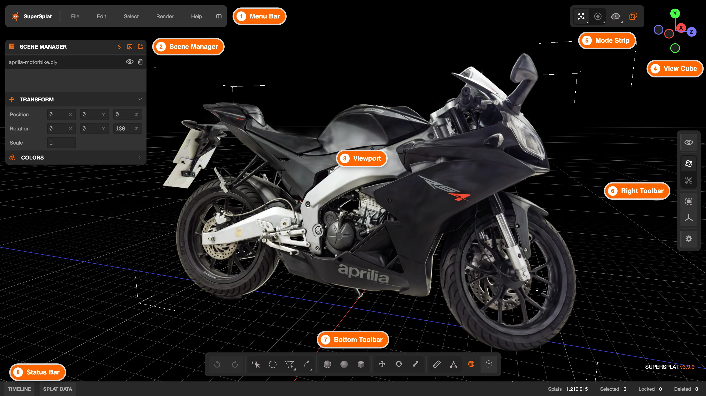
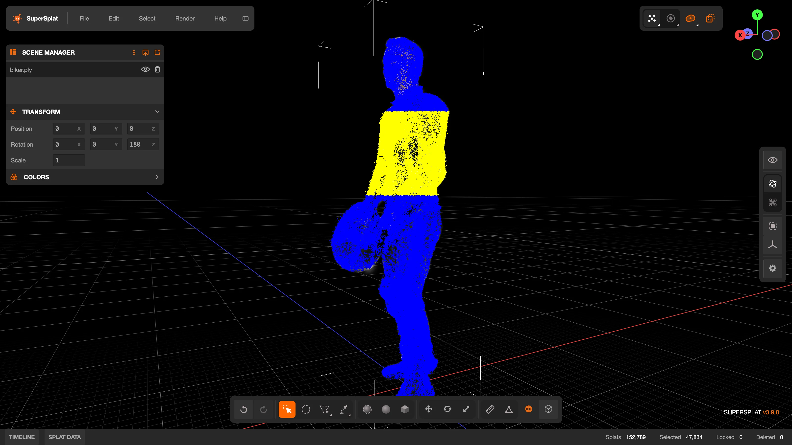
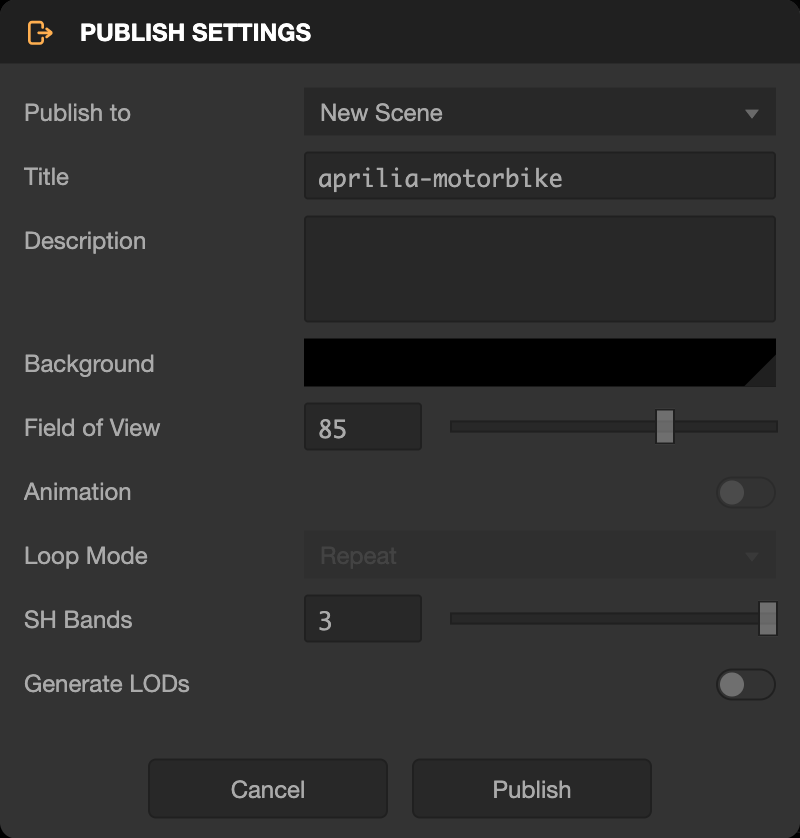
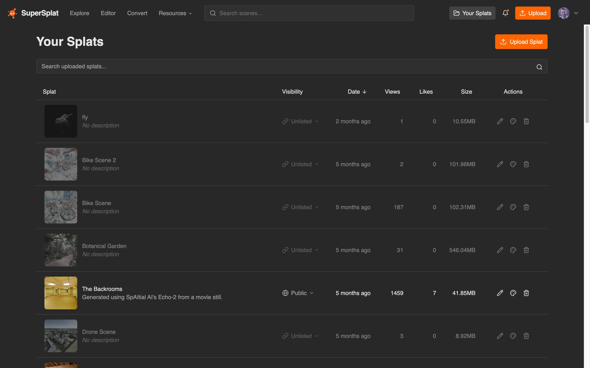
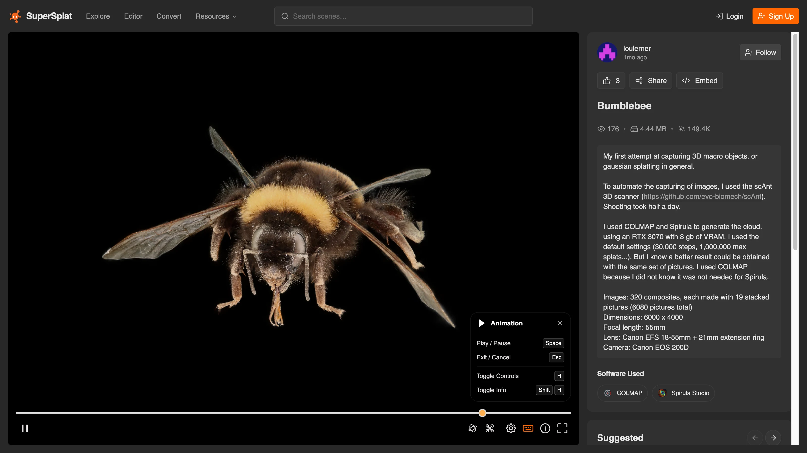

このガイドでは、生のスプラットファイルを、公開され共有可能なシーンページになるまで一通り仕上げます。所要時間は約10分で、SuperSplatのワークフロー全体（**Editor → 公開 → Studio → 共有**）に触れます。

## 始める前に

- **スプラットファイル。** ガウシアンスプラッティングのトレーナーが出力した`.ply`なら何でも使えます。`.compressed.ply`、`.sog`、`.splat`、`.ksplat`、`.spz`、XGRIDSの`.lcc`ファイルにも対応しています。まだファイルがない場合は、[スプラットの作成](/user-manual/gaussian-splatting/creating/)でキャプチャの仕組みを、[推奨ツール](/user-manual/gaussian-splatting/creating/recommended-tools)でファイルを生成するアプリの比較を確認してください。サンプルのバイカーで練習することもできます：[Editorで開く](https://superspl.at/editor?load=https://raw.githubusercontent.com/willeastcott/assets/main/biker.ply)。
- **無料のPlayCanvasアカウント**（ステップ3で使用）。読み込みと編集にはアカウントは不要ですが、公開には必要です。[アカウント作成](/user-manual/account-management/user-accounts/account-creation)を参照してください。
- **WebGPUに対応したブラウザ。** Editorの[システム要件](/user-manual/supersplat/editor/#system-requirements)を参照してください。インストールは不要です。

## 1. Editorでスプラットを読み込む

[superspl.at/editor](https://superspl.at/editor)を開き、ウィンドウ内の任意の場所にファイルをドロップします。**File → Import**からも読み込めます。

スプラットが表示されたら、操作に慣れましょう：

| 操作 | 動作 |
|---------|----|
| 左ドラッグ | 注視点を中心に回転 |
| 右ドラッグ | パン |
| マウスホイール | ズーム |
| ダブルクリック | 注視点を設定 |
| <kbd>F</kbd>キー | 現在の選択にカメラをフォーカス |

シーンが横倒しや上下逆になっている場合は、**Scene Manager**で選択し、トランスフォームコントロールで正しい向きに回転させます。[トランスフォーム、計測、位置合わせ](editor/transform-measure-align.md)を参照してください。操作の一覧は[カメラコントロール](editor/camera-controls.md)にあります。

## 2. クリーンアップする

生のキャプチャの多くには**フローター**（トレーナーが判断に迷った場所に浮かんでいる不要なガウシアン）が含まれています。これを取り除くことが、品質向上のもっとも大きな一手です。

1. ビューポート右上のモードストリップで**X-Ray**をオフにし（または<kbd>N</kbd>キーを押し）、選択が可視サーフェスで止まるようにします。さらに**Markers**をオンにして（または<kbd>Tab</kbd>キーを押して）ガウシアンの中心点を表示します。
2. ツールバーから選択ツールを選びます：フローターを塗るように選択する**Brush Selection**、サーフェスに沿って3Dでペイントする**Sphere Brush**、3D領域をまとめて選択する**Sphere Selection**や**Box Selection**、孤立した部分を選ぶ**Flood Selection**などです。<kbd>Shift</kbd>を押しながらで選択に追加、<kbd>Ctrl</kbd>を押しながらで選択から除外できます。
3. <kbd>Delete</kbd>を押します。カメラを回して別の角度から確認し、繰り返します。
4. 消しすぎてしまった場合は**Edit → Undo**で元に戻せます。削除したすべてのガウシアンを復元するには**Select → Reset Splat**を使います。

被写体の外側をすべて切り落とすには、残したい領域をBox SelectionまたはSphere Selectionで選択し、**Select → Invert**を選んでから削除します。[選択とクリーンアップ](editor/editing-splats.md)ではすべてのツールとクリーンアップのレシピを、[色と外観](editor/color-and-appearance.md)では露出や色味の調整を解説しています。

:::tip 作業を保存する

**File → Save**を選ぶと`.ssproj`プロジェクトファイルが保存されます。編集内容とプロジェクトの設定が保持されるので、後で続きから作業できます。[プロジェクトの管理](editor/managing-projects.md)を参照してください。

:::

## 3. 公開する

1. [superspl.at](https://superspl.at)にログインしていることを確認します（右上の**Login**ボタン）。ログイン中は、そこにアバターが表示されます。
2. お気に入りの構図を決めます。公開されたシーンは、カメラをそのまま残した位置から始まります。
3. **File → Publish**を選び、スプラットに**Title**と**Description**を入力して、**Publish**をクリックします。

SOG形式への圧縮には少し時間がかかり、非常に大きなシーンでは数分かかることもあります。完了すると、新しい[シーンページ](/user-manual/supersplat/viewing/scene-page/)のURLがダイアログに表示されます。新しいスプラットは**Unlisted**（限定公開）です。リンクを知っている人は誰でも閲覧できますが、ステップ5でPublicにするまでExploreには表示されません。

:::tip すでにクリーンですか？

ファイルに編集が必要なければ、Editorを省略できます。superspl.atのオレンジ色の**Upload Splat**ボタンで直接公開できます。[Direct Upload](/user-manual/supersplat/publishing/upload/)を参照してください。

:::

既存のシーンへの再公開を含む、ダイアログのすべてのオプションは[Editorからの公開](/user-manual/supersplat/publishing/editor/)で解説しています。

## 4. Studioでキュレーションする

スプラットは[Manageページ](/user-manual/supersplat/publishing/manage/)に表示されるようになりました。その行の**Open in Studio**、またはシーンページの**Edit in Studio**をクリックすると[Studio](studio/index.md)が開き、訪問者に見せる内容を作り込めます。

最初に試す価値のある3つのこと：

- **最初のショットを決める。** **Scene**タブの**Cameras**で、最良のアングルをフレーミングして**Set camera to current view**をクリックし、訪問者がそこから始められるようにします。[カメラ](studio/cameras.md)を参照してください。
- **ホットスポットを追加する。** 細部に構図を合わせて<kbd>C</kbd>を押し、注釈を付けたい場所をクリックして、タイトルとテキストを付けます。訪問者はガイドツアーのようにホットスポットを順にクリックして巡ることができます。[注釈](studio/annotations.md)を参照してください。
- **仕上げを加える。** **Look & Tone**で**Tonemapping**のカーブを選んだり、**Post Effects**で**Vignette**や**Color Grading**を試したりしてみましょう。[Look & Tone](studio/look-and-tone.md)と[ポストエフェクト](studio/post-effects.md)を参照してください。

<video autoPlay muted loop controls src='/video/supersplat-studio-edit-camera.mp4' style={{width: '100%', height: 'auto'}} />

満足したら、ヘッダーの**Save**をクリックします。編集は自動保存されません。保存のたびに設定全体が公開されるため、訪問者はリロードするとすぐに更新を確認できます。

## 5. 共有する

`superspl.at/scene/<hash>`にある[シーンページ](/user-manual/supersplat/viewing/scene-page/)を開きます。

- **Share**はリンクをコピーしたり、ソーシャルプラットフォームに投稿したりできます。
- **Embed**は、自分のウェブサイト向けの`<iframe>`スニペットを提供します。後からStudioで変更した内容も自動的に反映されます。
- 訪問者がスプラットをダウンロードできるようにするには、[Manageページ](/user-manual/supersplat/publishing/manage/)で**Downloadable**を有効にし、Creative Commonsライセンスを選択します。
- [Explore](/user-manual/supersplat/viewing/explore/)や検索結果に表示させるには、Manageで**Visibility**を**Public**に切り替えます。

## 次のステップ

- [キーボードショートカット](editor/keyboard-shortcuts.md)でクリーンアップを高速化する。
- [タイムライン](editor/timeline.md)でカメラをアニメーションさせ、フライスルーを公開する。
- [コリジョン](studio/collision.md)でシーンを一人称視点で歩けるようにする。
- [Convert](convert.md)でブラウザを離れずに形式を変換したり、スプラットを軽量化したりする。
- [ビューアのセルフホスティング](/user-manual/supersplat/developers/self-hosting/)で、どこにでもホストできる単一HTMLファイルをエクスポートする。
- [APIと統合](/user-manual/supersplat/developers/api-integrations/)で自分のパイプラインから公開する。
