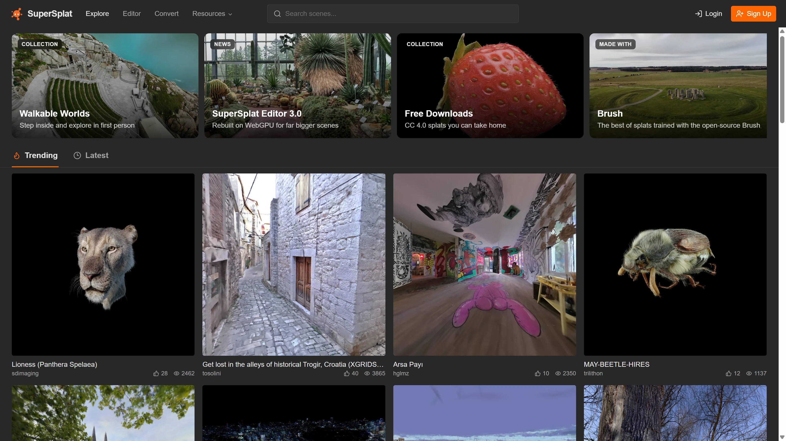

SuperSplat Editorからの公開では、編集したスプラットを[superspl.at](https://superspl.at)にアップロードします。アップロードされたスプラットは[Manageページ](/user-manual/supersplat/publishing/manage)に表示され、公開[シーンページ](/user-manual/supersplat/viewing/scene-page)が割り当てられ、[Studio](/user-manual/supersplat/studio/)で開いて視聴体験（カメラ、カメラアニメーション、注釈、ポストエフェクト、スカイボックス、コリジョン）をキュレーションできます。

Editorを開かずに完成済みのファイルを公開するには、[ダイレクトアップロード](/user-manual/supersplat/publishing/upload)を使います。公開の方法の比較と、公開したスプラットを誰が閲覧できるかは、[公開](/user-manual/supersplat/publishing/)で説明しています。

superspl.atに公開する代わりに（または併用して）自前のサーバーで公開済みビューアをホストする方法については、[ビューアのセルフホスティング](/user-manual/supersplat/developers/self-hosting)を参照してください。

## ログイン状態の確認

スプラットを公開するには、ログインしている必要があります。

始める前に、[PlayCanvasアカウントを作成し](/user-manual/account-management/user-accounts/account-creation)、[playcanvas.com](https://playcanvas.com)にログインしている必要があります。次に、[superspl.at](https://superspl.at)にも（右上にある「`Login`」ボタンから）ログインしてください。[superspl.at](https://superspl.at)のページの右上にあなたのアカウントアバターが表示されていることを確認して、ログイン状態を確かめてください。

## スプラットの公開

スプラットを公開するには：

1. `File`メニューを開きます。
2. `Publish`を選択します。
3. Publishダイアログのオプションを記入します：

   

   | オプション | 説明 |
   |--------|-------------|
   | **Publish to** | シーンの公開先を選択します。**New Scene**（デフォルト）を選択すると新しいURLで全く新しいシーンを公開し、またはドロップダウンから既存の公開済みシーンの1つを選択して上書きします |
   | **Title** | スプラット公開後にサムネイルの下に表示される短いタイトル |
   | **Description** | スプラットのビューアーページでスプラットの下に表示されるテキストの説明 |
   | **Background** | ビューアーの背景色。Editorの現在の背景色（[Preferences](/user-manual/supersplat/editor/interface/#preferences)ポップアップの**Colors**セクションで設定）がデフォルトになります |
   | **Field of View** | ビューアーのカメラの視野角（度）。画面の長辺方向で測ります。Editorカメラの現在の設定がデフォルトになります |
   | **Animation** | 有効にすると、[タイムライン](/user-manual/supersplat/editor/timeline/)で作成したカメラアニメーションがシーンにベイクされ、読み込み時に再生されます。タイムラインにキーフレームがある場合にのみ使用でき（その場合はデフォルトで有効）ます |
   | **Loop Mode** | 含まれたカメラアニメーションのビューアでの再生方法： • **None**: 1回再生して停止 • **Repeat**: 連続してループ • **Ping Pong**: 順方向と逆方向の再生を繰り返し タイムラインのループトグルから初期化されます - ループ有効なら**Repeat**、無効なら**None** |
   | **SH Bands** | 公開する球面調和関数のバンド数（0～3）。デフォルトはシーン内の最大のバンド数で、[Preferences](/user-manual/supersplat/editor/interface/#preferences)の**SH Bands**設定が上限になります。シーンに含まれるより多いバンド数を選ぶと、不足しているバンドは0で埋められます |
   | **Generate LODs** | 公開されたスプラットが段階的にストリーミングされるように、複数のレベルオブディテールを生成します。広い範囲に及ぶ100万ガウシアン以上のシーンでは自動的に有効になります。ガウシアン数が4000万を超えるシーン（削除したガウシアンは数えません）はLODを生成して公開する必要があり、トグルはオンの状態で無効になり、必須であることを示す注記が表示されます。[ストリーミングとパフォーマンス](/user-manual/supersplat/publishing/streaming)を参照してください |

4. `Publish`を選択します。

アカウントが現在それ以上モデルを公開できない場合は、ダイアログにその理由が表示され、`Publish`は無効になります。これは、アカウントが[公開の上限](/user-manual/supersplat/publishing/#limits)のいずれかに達したときに発生します。既存のシーンのアニメーションだけを更新する場合は、モデルをアップロードしないため、引き続き公開できます。

公開されたシーンのカメラは、公開した瞬間のビューポートカメラのポーズから開始します。ダイアログを開く前に、お気に入りのビューでフレーミングしておきましょう。

:::note

新しいシーンは**Unlisted**として公開されます。[Explore](/user-manual/supersplat/viewing/explore)に載せる方法は、[誰が閲覧できるか](/user-manual/supersplat/publishing/#visibility)を参照してください。

:::

:::note

大きなスプラットのSOGへの圧縮には数分かかることがあります。

:::

公開プロセスが完了すると、公開されたスプラットのURLが記載されたモーダルダイアログが表示されます。それをコピーして、好きな相手と共有してください。公開に失敗した場合は、**Publish Failed**ダイアログにエラーが表示されます。superspl.atがアップロードを拒否した場合は、その理由も表示されます。

## 既存シーンへの再公開

**Publish to**を既存のシーンの1つに設定すると、そのシーンがその場で上書きされます。シーンのURL、タイトル、説明、[Studio](/user-manual/supersplat/studio/)の設定は維持されるため、ダイアログには**Title**、**Description**、**Background**、**Field of View**、**Animation**が表示されません。代わりに、2つのトグルで何を置き換えるかを選択します（アニメーションだけを置き換える場合、**SH Bands**と**Generate LODs**も表示されません）：

| オプション | 説明 |
|--------|-------------|
| **Override Model** | シーンのスプラットモデルを、現在読み込まれているシーンで置き換えます |
| **Override Animation** | シーンのカメラアニメーションを、現在のタイムラインアニメーションで置き換えます |

公開するには、少なくともどちらか一方を有効にする必要があります。アニメーションのみを上書きすれば、スプラットデータ自体を再アップロード（および再圧縮）せずに、公開済みのカメラパスをすばやく更新できます。

## 次のステップ

- 新しいスプラットは[Manageページ](/user-manual/supersplat/publishing/manage)に表示され、タイトル、説明、公開範囲、ダウンロード可否とライセンスを編集できます。
- [Studio](/user-manual/supersplat/studio/)で開いて、カメラをフレーミングしたりアニメーションさせたり、注釈、ポストエフェクト、スカイボックス、コリジョンジオメトリを追加したりできます。
- 訪問者は公開[シーンページ](/user-manual/supersplat/viewing/scene-page)で表示、共有、埋め込み、いいね、コメント、（許可されていれば）ダウンロードを行えます。
