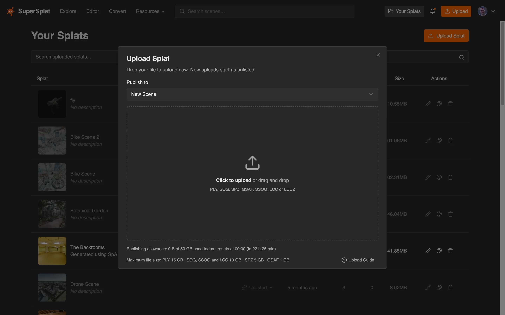

すでにクリーンなスプラットファイルをお持ちの場合、公開のために[SuperSplat Editor](/user-manual/supersplat/editor/)を使う必要はありません。**Direct Upload**フローを使うと、完成済みのスプラットを[Manageページ](/user-manual/supersplat/publishing/manage)に直接プッシュでき、そこから[Studio](/user-manual/supersplat/studio/)で開いたり[シーンページ](/user-manual/supersplat/viewing/scene-page)を共有したりできます。

次のような場合にこの経路が適しています：

- スプラットがすでにクリーンである（浮遊物がなく、不要な背景もなく、適切なサイズに調整されている）。
- スプラットを別のツールで作成した — トレーニングパイプライン、スマートフォンスキャナ、または[Convert](/user-manual/supersplat/convert)ユーティリティや[splat-transform](/user-manual/splat-transform/) CLIなど。
- Editorを経由せずにすばやく公開したい。

## Uploadダイアログの起動

Upload Splatダイアログを開く方法は3つあります：

- [superspl.atのホームページ](https://superspl.at)にあるオレンジ色の**Upload Splat**ボタン。まだサインインしていない、あるいはManageビューにいない場合の最速ルートです — サインインを求められます。
- [Manageページ](/user-manual/supersplat/publishing/manage)の**Upload Splat**ボタン。
- [superspl.at/upload](https://superspl.at/upload)へのアクセス。ダイアログを開いた状態でManageページにリダイレクトされます。

アップロードにはPlayCanvasアカウントでのサインインが必要です。[アカウント作成](/user-manual/account-management/user-accounts/account-creation)を参照してください。

## 対応入力フォーマット {#supported-input-formats}

ファイルシステムからドラッグ＆ドロップするか選択します。ダイアログは以下のフォーマットを、それぞれの最大サイズまで受け付けます。ダイアログの**Upload Guide**にも概要がまとめられています。

| フォーマット | アップロードするファイル | 最大サイズ | 検証方法 |
|--------|----------------|--------------|---------------------|
| **PLY** | `.ply` | 15 GB | ガウシアンスプラットのデータを含むPLYファイルであること。メッシュや点群だけを含むPLYは拒否されます。 |
| **SPZ** | `.spz` | 5 GB | 読み込み可能なSPZファイルであること。 |
| **SOG** | `.sog` | 10 GB | 1つの`meta.json`ファイルと、期待されるSOGのWebPペイロードファイルを含むこと。 |
| **Streamed SOGバンドル (SSOG)** | `.zip` | 10 GB | `lod-meta.json`と1つ以上のSOGチャンクフォルダを含むこと。[ストリーミングとパフォーマンス](/user-manual/supersplat/publishing/streaming)を参照してください。 |
| **LCCまたはLCC2** | `.zip` | 10 GB | 正確に1つの`.lcc2`ファイル、または正確に1つの`.lcc`ファイルと隣接する`index.bin`および`data.bin`ファイルを含むこと。 |

ファイルの内容は選択後に検証されます。Direct Uploadは`.compressed.ply`、`.ksplat`、`.splat`ファイルを直接受け付けません。これらの変換や、フォーマットの最大サイズに収めるための縮小には、[Convert](/user-manual/supersplat/convert)ユーティリティまたは[splat-transform CLI](/user-manual/splat-transform/)を使用してください。

### 詳細レベル

PLYまたはSPZファイルを選ぶと、ダイアログに**Auto generate LODs**チェックボックスが表示されます。オンにすると、スプラットは単一のSOGファイルではなく、段階的にストリーミングされる[Streamed SOG](/user-manual/supersplat/publishing/streaming)として公開されます。100万ガウシアン以上のスプラットでは自動的にオンになり、アップロード前に変更できます。4,000万ガウシアンを超えるスプラットはストリーミングが必須のため、オンに固定されます。SOGファイルは常に単一ファイルとして公開され、SSOGおよびLCCアーカイブは常にストリーミングされます。

## アップロード後の流れ

ダイアログは4段階で進行します：

1. **Select** — ファイルを選ぶ（またはドロップする）。
2. **Ready** — ファイルがローカルで検証されます。続行前に変更可能です。
3. **Uploading** — ファイルがPlayCanvasのストレージにストリーミングされます。
4. **Publishing** — プラットフォームがシーンレコードを作成します。

公開が完了すると、新しく作成されたシーンの**Edit Splat**ビューにダイアログが切り替わり、メタデータをすぐに入力できます。デフォルトは意図的に控えめになっています：

| フィールド | デフォルト |
|-------|---------|
| **Title** | 拡張子を除いたファイル名 |
| **Description** | _(空)_ |
| **Visibility** | **Unlisted** — 直接URLでのみアクセス可能 |
| **Downloadable** | **Off** — 閲覧は可能だがソースファイルはダウンロードできない |

Edit Splatビューから次のことができます：

- **Title**と**Description**を調整する。
- スプラットのキャプチャまたはトレーニングに使った**Software Used**をタグ付けする（[シーンページ](/user-manual/supersplat/viewing/scene-page)にチップとして表示されます）。
- **Visibility**を**Public**に切り替えて、スプラットを[Explore](/user-manual/supersplat/viewing/explore)の検索に表示させる。
- **Downloadable**を有効にし、[クリエイティブ・コモンズライセンス](/user-manual/supersplat/publishing/manage#downloadable-license)を選ぶ。
- 公開[シーンページ](/user-manual/supersplat/viewing/scene-page)を**表示**するか、**Open in Studio**で視聴体験をキュレーションする。

## エラー

| エラー | 原因 |
|-------|-------|
| **Unrecognized Format** | 上記の対応構造のいずれにも合致しないファイル。 |
| **No Gaussian Splat Data** | 有効なPLYファイルだが、ガウシアンスプラットではなくメッシュや点群を含んでいる。 |
| **File Too Large** | ファイルがそのフォーマットの最大サイズを超えている。メッセージに両方のサイズが表示されます。 |
| **Upload Failed** | ネットワーク中断またはサーバー側の問題。再試行してください。問題が続く場合は接続を確認してください。 |

アカウントの[公開の上限](/user-manual/supersplat/publishing/#limits)も適用されます。いずれかに達すると、ダイアログにその旨（**Publishing Allowance Used**または**Scenes Still Processing**）と、再びアップロードできる時期が表示されます。

## 関連項目

- [Editorからの公開](/user-manual/supersplat/publishing/editor) — SuperSplat Editorを経由する代替経路
- [Manage](/user-manual/supersplat/publishing/manage) — アップロード後のスプラットでできること
- [Studio](/user-manual/supersplat/studio/) — 公開済みスプラットの視聴体験をキュレーションする
