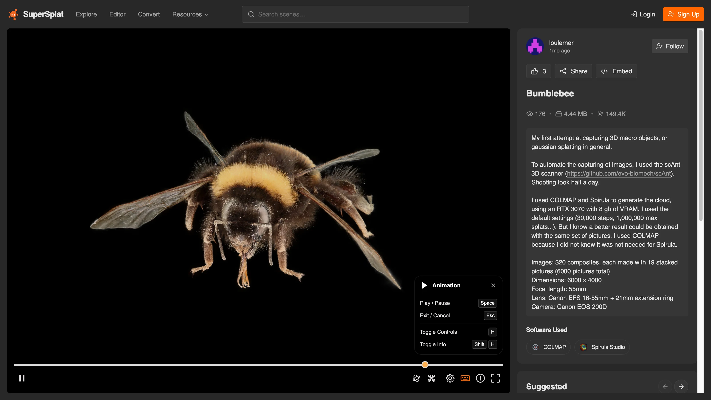

`https://superspl.at/scene/<hash>`にある**シーンページ**は、公開済みスプラットの公開フェイスです。[Editor](/user-manual/supersplat/editor/)で作成し、[Studio](/user-manual/supersplat/studio/)でキュレーションした内容のすべてが、訪問者にはここに表示されます。オーナーには、Studioを開いたりManageに戻ったりする追加のコントロールが見えます。

訪問者はPlayCanvasアカウントなしでシーンページを閲覧できます。スプラットへの**いいね**、コメント投稿、クリエイターの**フォロー**にはアカウントが必要です。

## 訪問者に表示されるもの

シーンのコンテンツは、中央の**埋め込みビューア**と、メタデータやアクションのある右側の**サイドバー**に分かれています。

### 埋め込みビューア

ビューアはオープンソースの[SuperSplat Viewer](/user-manual/supersplat/viewer/)で、iframe内でレンダリングされます。[Studio](/user-manual/supersplat/studio/)で設定した、またはエディターから公開したカメラ、[カメラアニメーション](/user-manual/supersplat/studio/animation)、注釈、ポストエフェクト、スカイボックス、コリジョンが、すべてここに反映されます。訪問者は、シーンをオービットやフライで見て回ったり、（コリジョンが設定されていれば）シーン内をウォークスルーしたりできるほか、注釈を順にたどる、カメラアニメーションを再生する、対応デバイスでVRやARに入る、といった操作も行えます。ビューア下部に沿って並ぶツールバーには、カメラモードと、ビューアの設定・コントロール・情報の各パネルがあります。[ビューアの操作](/user-manual/supersplat/viewer/controls)と[VRとARでの表示](/user-manual/supersplat/viewer/xr)を参照してください。

### サイドバーのメタデータ

| フィールド | 表示内容 |
|-------|---------------|
| **Title** | [Edit Splatダイアログ](/user-manual/supersplat/manage)で設定した見出し。 |
| **Author** | クリエイターの[ユーザープロファイル](/user-manual/supersplat/user-profile)へのリンク付きチップ。**Follow**ボタンで[クリエイターをフォロー](/user-manual/supersplat/following)できます。 |
| **Views** | 総閲覧数。 |
| **Downloads** | 総ダウンロード数。スプラットがダウンロード可能な場合にのみ表示されます。 |
| **Visibility badge** | **Public**または**Unlisted**。 |
| **Software used** | Edit Splatダイアログでタグ付けしたツール（キャプチャ／トレーニングツール）のチップ。 |
| **Description** | Edit Splatダイアログで設定した詳しい説明（サニタイズされたHTML）。 |
| **Format / size** | 公開済みスプラットのフォーマットとダウンロードサイズ。ツールチップ付き。 |
| **Splat count** | 公開済みスプラットのガウシアン数。ツールチップには、[ストリーミング](/user-manual/supersplat/streaming)されるスプラットの詳細レベルと、球面調和関数のバンド数が表示されます。 |
| **Created** | スプラットが公開された相対時刻。ホバーで正確な日付が表示されます。 |

### アクションボタン {#actions}

| ボタン | 動作 |
|--------|--------------|
| **Like**（サムズアップ） | スプラットのいいね数を表示し、あなたのいいねを切り替えます。あなたがいいねしていればハイライトされます。ログインが必要です — 匿名の訪問者にはサインインが促されます。 |
| **Share** | [Shareダイアログ](#share-dialog)を開きます。 |
| **Embed** | [Embedダイアログ](#embed-dialog)を開きます。 |
| **Download** | [Downloadダイアログ](#download-dialog)を開きます。スプラットがダウンロード可能な場合にのみ表示されます。 |

オーナーにはこのシーンの[Studio](/user-manual/supersplat/studio/)を開く**Edit in Studio**のエントリポイントも表示されます。

## Shareダイアログ {#share-dialog}

Shareダイアログはソーシャルプラットフォームへのワンクリック共有と、コピー可能なリンクを提供します。

| アクション | 挙動 |
|--------|----------|
| **Facebook / X / LinkedIn / Reddit** | プラットフォームの共有インテントを、シーンのURLとタイトルが事前入力された状態で開きます。 |
| **Copy link** | シーンURLをクリップボードにコピーし、短い **Copied!** 確認を表示します。 |

## Embedダイアログ {#embed-dialog}

Embedダイアログは、自分のウェブページに貼り付けられる`<iframe>`スニペットを提供します。スニペットはシーンの公開URLを参照するため、Studioでの変更は自動的に反映されます。

| フィールド | 説明 |
|-------|-------------|
| **Iframe snippet** | コピー可能な`<iframe>`タグ。 |
| **Size presets** | いくつかの一般的な埋め込みサイズから選ぶか、レスポンシブレイアウトを使います。 |

superspl.atを参照するのではなく、ビューアの自前コピーをホストしてスプラットを自己完結型のファイルにバンドルしたい場合は、[ビューアのセルフホスティング](/user-manual/supersplat/viewer/self-hosting)を参照してください。

## Downloadダイアログ {#download-dialog}

Downloadボタンは、[Manageページ](/user-manual/supersplat/manage)でオーナーがスプラットに対して**Downloadable**を有効にしている場合にのみ表示されます。クリックするとDownloadダイアログが開き、以下を提供します：

| セクション | 内容 |
|---------|----------|
| **Targets** | ダウンロードできるフォーマットの一覧 — 通常は元の公開フォーマット、圧縮済みPLY、自己完結型のHTMLビューア、（シーンにコリジョンがある場合は）`voxel.zip`。各エントリにはファイルサイズが表示されます。 |
| **License** | オーナーが選んだクリエイティブ・コモンズライセンスを表示する展開可能なセクション。CCアイコン、概要、**Open License**リンク、貼り付け可能なクレジット文を生成する**Copy Credit**ボタンを表示します。 |

:::note 準備に時間がかかる場合があります

一部のダウンロード対象はオンデマンドで生成されます — ファイル生成中はダイアログに **Preparing…** の状態が表示され、その後ダウンロード可能になります。

:::

## コメント {#comments}

ビューアの下にはコメントセクションがあります。サインインしていれば誰でもコメントを投稿でき、スプラットのオーナーは任意のコメントを削除できます。

- 各コメントには、投稿者のアバター、ユーザー名、タイムスタンプ、サニタイズされたHTML本文が表示されます。
- 個々のコメントにいいねできます（コメントごとのサムズアップアイコン）。
- コメントリストはページネーションされ、1ページあたり最大**100コメント**が返されます。
- コメントは新しい順に並びます。

投稿にはPlayCanvasアカウントが必要です — 未認証の訪問者にはサインインを促すプロンプトが表示されます。

## いいね {#likes}

アクションバーの**Like**ボタン（サムズアップ）はワンクリックのトグルで、いいね数も表示します。カウントはすぐに更新されます。いいねにはPlayCanvasアカウントが必要で、アカウントのない訪問者にはサインインが促されます。

## おすすめスプラット

ページ下部近くのカルーセルが、関連するスプラットをいくつかおすすめします。任意のカードをクリックすると、そのシーンページへ移動します。

## 関連項目

- [Studio](/user-manual/supersplat/studio/) — オーナーはStudioを使って、ここで訪問者が見るものを変更します
- [Viewerの埋め込み](/user-manual/supersplat/viewer/embedding) — スプラットの表示方法をプログラム的に完全制御する場合
- [Manage](/user-manual/supersplat/manage) — メタデータの編集、公開範囲の変更、ダウンロード可否とライセンスの選択
