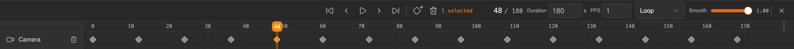

**カメラアニメーション**は、キーフレームで定義したパスに沿ってカメラを動かします。オブジェクトの周りを穏やかに回るターンテーブルから、キャプチャした空間の本格的なフライスルーまで作れます。[Studio](/user-manual/supersplat/studio/)では、**Timeline**パネルで作成し、**Scene**タブの**Animation**セクションで制御します。訪問者は[シーンページ](/user-manual/supersplat/viewing/scene-page)でそれを見ることができ、いつでも一時停止したりカメラを操作したりできます。

シーンが持てるカメラアニメーションは1つです。Editorの[タイムライン](/user-manual/supersplat/editor/timeline)のアニメーション付きでスプラットを公開した場合、Studioはそのアニメーションを読み込んだ状態で開き、すぐに編集できます。

## タイムラインパネル

ヘッダーの**Timeline**をクリックするか<kbd>T</kbd>を押すと、Studioの下部のパネルを表示または非表示にできます。

| コントロール | 動作 |
|---------|--------------|
| **Previous keyframe** / **Next keyframe** | 再生ヘッドを隣のキーフレームにジャンプします。 |
| **Step back one frame** / **Step forward one frame** | 再生ヘッドを1フレーム移動します。 |
| **Play** / **Pause** | ビューポートでアニメーションを再生します（<kbd>Space</kbd>）。[カメラ編集モード](/user-manual/supersplat/studio/cameras#edit-camera-mode)中は使えません。 |
| **Add keyframe at playhead** | ビューポートのカメラを再生ヘッドの位置にキーフレームとして保存します（<kbd>Enter</kbd>）。 |
| **Delete selected keyframes** | 選択したキーフレームを削除します。選択中のキーフレーム数が横に表示されます。 |
| フレーム表示 | 再生ヘッドのフレームと総フレーム数。 |
| **Duration** | アニメーションの長さ（秒、0.1～600）。 |
| **FPS** | タイムラインの1秒あたりのフレーム数（1～120）。アニメーションのフレーム数は**Duration** × **FPS**です。 |
| **Loop mode** | **Play once**、**Loop**（デフォルト）、**Ping-pong**（順方向に再生した後、逆方向に再生することを繰り返す）。 |
| **Smooth** | キーフレーム間のパスの滑らかさ。`0`（直線）から`1`（デフォルト、滑らかな曲線）まで。 |
| **Hide timeline** | パネルを閉じます。 |

コントロールの下の**Camera**トラックには、キーフレームごとのマーカーが付いたルーラーが表示されます。ルーラーをクリックまたはドラッグすると再生ヘッドが移動します。トラックのゴミ箱アイコン**Delete camera animation**は、すべてのキーフレームとともにアニメーションを削除します。

## キーフレームの作成

1. タイムラインを開き、再生ヘッドを目的のフレームに移動します。
2. ビューポートでショットをフレーミングします。
3. **Add keyframe at playhead**をクリックするか、<kbd>Enter</kbd>を押します。そのフレームにすでにキーフレームがある場合は置き換えられます。
4. 再生ヘッドを移動して繰り返します。

各キーフレームには、カメラの位置、ターゲット、視野角が保存されます。最初のキーフレームを追加すると、**Play animation on open**もオンになります。

## キーフレームの編集

- **選択**: キーフレームをクリックします。<kbd>Ctrl</kbd>キーを押しながらクリック（macOSでは<kbd>Cmd</kbd>キー）すると選択に追加または選択から除外でき、トラックの空いている部分をドラッグすると範囲内のすべてのキーフレームを選択できます。
- **移動**: 選択をトラックに沿ってドラッグします。
- **コピー**: <kbd>Shift</kbd>キーを押しながらドラッグします。
- **変更**: 再生ヘッドをキーフレームに移動し、新しいショットをフレーミングして、もう一度キーフレームを追加します。

タイムラインの編集はすべて<kbd>Ctrl</kbd>+<kbd>Z</kbd>（macOSでは<kbd>Cmd</kbd>+<kbd>Z</kbd>）で元に戻せます。

:::tip 滑らかなループ

**Loop mode**が**Loop**の場合、カメラは残りのフレームを使って最後のキーフレームから最初のキーフレームへ戻ります。最後のキーフレームの後にフレームを残し、最初と最後の両方のフレームにキーフレームを置かないでください。そうしないとループ時にカメラが飛びます。

:::

## 開いたときの再生 {#playing-on-open}

**Scene**タブの**Animation**セクションには、**Play animation on open**というスイッチが1つあります：

- **オン**: シーンページを開くとすぐにアニメーションが再生されます。訪問者は一時停止したりカメラを操作したりできます。
- **オフ**: シーンは[開始カメラ](/user-manual/supersplat/studio/cameras)で開き、アニメーションは再生されません。

スイッチがオフのままアニメーションにキーフレームがある場合、タイムラインに**Viewer won't play this animation**と表示され、**Play on open**ボタンでスイッチをオンにできます。

**Save**をクリックしたとき、キーフレームのないアニメーションは保存されず、シーンは開始カメラで開きます。

## EditorとStudioでのアニメーション

Editorの[タイムライン](/user-manual/supersplat/editor/timeline)でカメラのキーフレームを作成し、スプラットと一緒にアニメーションを公開することもできます。どちらも同じアニメーションを編集するため、最後に保存したほうが有効になります。**Override Animation**を有効にしてEditorから再公開すると、Studioで作成したアニメーションは置き換えられます。すでに公開済みのスプラットでは、公開されたビューアで結果をすぐに確認できるStudioのほうが手早く作業できます。

## 関連項目

- [Cameras](/user-manual/supersplat/studio/cameras) — 開始カメラと視野角
- [ビューアの操作](/user-manual/supersplat/viewing/controls) — 訪問者がアニメーションを再生、一時停止、スクラブする方法
- [Experience Settings](/user-manual/supersplat/developers/experience-settings) — このページで編集する`animTracks`と`startMode`フィールド
