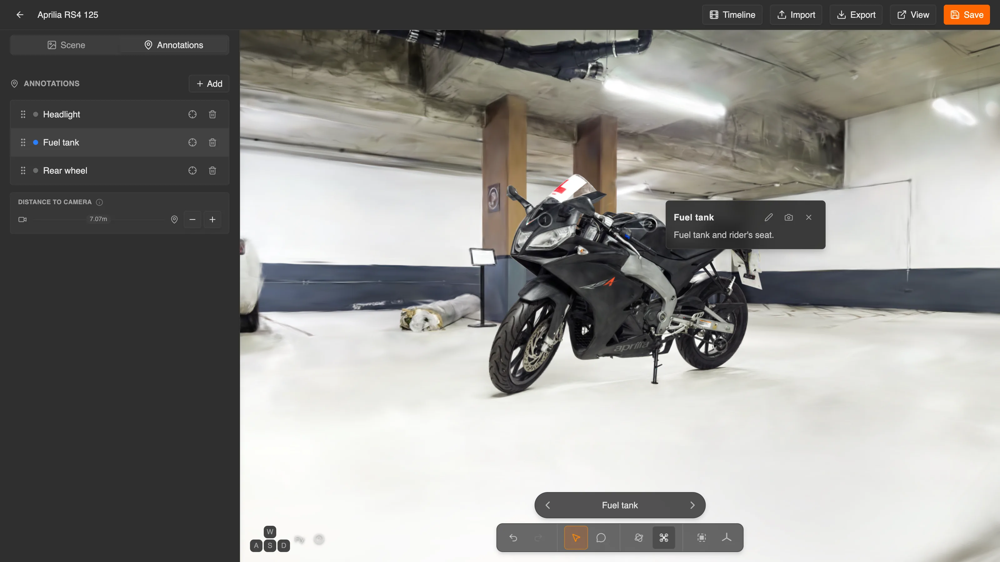

**Annotations**は、[Studio](/user-manual/supersplat/studio/)で公開済みスプラットに配置する3D空間配置のテキストホットスポットです。ビューア側では、各注釈は訪問者がクリックできる番号付きのホットスポットとして表示されます。クリックすると、カメラがキュレーションされた姿勢に移動し、タイトルと本文が表示されます。注釈を使って、機能を説明したり、ストーリーを語ったり、シーンのセルフガイドツアーを提供したりできます。

## 注釈のプロパティ

各注釈には以下があります：

| フィールド | 説明 |
|-------|-------------|
| **Position** | ホットスポットマーカーがシーン内で置かれるワールド空間の`[x, y, z]`。 |
| **Title** | 注釈が選択されたときに表示される短い見出し。 |
| **Text** | より長い本文。ビューアではプレーンテキストとして表示されます。 |
| **Camera** | この注釈が選択されたときにビューアがアニメーションする[カメラ姿勢](/user-manual/supersplat/studio/cameras)。 |
| **Extras** | カスタム統合のための自由形式のメタデータ。Studioは保持しますが、編集するコントロールはありません。[インポートする設定](/user-manual/supersplat/studio/#saving-changes)で指定してください。 |

## 注釈の追加 {#adding-an-annotation}

1. 訪問者にシーンのこの部分をどう見せたいかに合わせてビューポートをフレーミングします。
2. **Add annotation**を選びます：ビューポートのツールバーのボタン、**Annotations**タブの**Add**、または<kbd>C</kbd>。
3. スプラット上の注釈を付けたい点をクリックします。Studioはそこにホットスポットを配置し、現在のビューを注釈のカメラとして保存します。
4. ホットスポットの横に開くカードにタイトル（入力するまでは**Untitled**）と説明を入力し、**OK**をクリックします。

1シーンあたりの注釈は最大50個、タイトルは最大60文字、テキストは最大280文字までです。これらは[Experience Settings](/user-manual/supersplat/developers/experience-settings#authoring-limits)の作成時の制限です。

## 注釈の編集

ホットスポットまたは**Annotations**タブの行をクリックして注釈を選択します。ビューポートの注釈のカードには3つのボタンがあります：

- **Edit annotation**（鉛筆アイコン） — タイトルと説明を変更します。
- **Set camera to current view** — 現在のビューを注釈のカメラとして保存します。
- **Unselect annotation** — カードを閉じます。

注釈を選択している間、**Annotations**タブの**Distance to camera**でホットスポットを視線方向に動かせます：<kbd>-</kbd>でカメラに近づけ、<kbd>+</kbd>で遠ざけます。<kbd>Shift</kbd>キーを押しながらだと細かく動きます。ホットスポットを表面から浮かせたり、表面に近づけたりするのに使います。

**Annotations**タブの各行には、ビューポートを注釈のカメラに移動する**Go to annotation**と、**Delete annotation**もあります。行をドラッグして並べ替えられます。順序は、訪問者が注釈をどの順に進むかと、各ホットスポットに表示される番号を決めます。

<!-- TODO: media — /video/user-manual/supersplat/studio/annotation-flythrough.mp4 — ホットスポット間を移動する訪問者 -->

## 訪問者の使い方

[シーンページ](/user-manual/supersplat/viewing/scene-page)では、ビューアが各注釈を番号付きのホットスポットとして表示します。ホットスポットを選択するとカメラが注釈のビューへなめらかに移動してタイトルとテキストが表示され、ナビゲータを使うとリストの順に注釈をたどれます。訪問者が注釈でできることは、すべて[ビューアの操作](/user-manual/supersplat/viewing/controls#annotations)で説明しています。

:::note

設定フォーマットはシーンのstart modeとして`annotation`を受け付けますが、ビューアはこの値を反映しません。シーンは常に[開始カメラ](/user-manual/supersplat/studio/cameras)またはカメラアニメーションから始まります。

:::

## 関連項目

- [Cameras](/user-manual/supersplat/studio/cameras) — 注釈が参照するカメラ姿勢
- [カメラアニメーション（タイムライン）](/user-manual/supersplat/editor/timeline) — 訪問者の操作を必要としないシネマティックなフライスルー
- [Experience Settings](/user-manual/supersplat/developers/experience-settings) — 注釈を格納するJSONコントラクト
