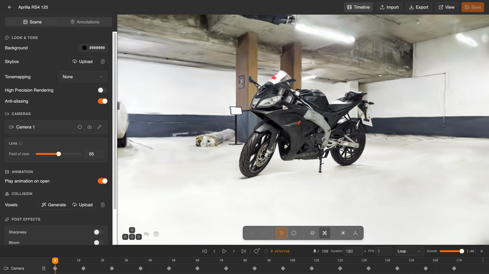

**SuperSplat Studio**は、すでに[公開](/user-manual/supersplat/publishing/editor)または[直接アップロード](/user-manual/supersplat/publishing/upload)したスプラットの視聴体験をキュレーションする場所です。公開済みシーンの上に開き、訪問者が[シーンページ](/user-manual/supersplat/viewing/scene-page)で見るもの — 背景またはスカイボックス、トーンマッピング、開始カメラ、カメラアニメーション、ウォーカブルシーン用のコリジョンジオメトリ、ポストエフェクト、シーン上の注釈 — を形作ります。

Studioは出力を単一のJSONドキュメント、[Experience Settings](/user-manual/supersplat/developers/experience-settings)として書き出し、これをオープンソースの[SuperSplat Viewer](/user-manual/supersplat/developers/viewer/)がランタイムで読み込みます。

## Studioの起動 {#launching-studio}

Studioは **`https://superspl.at/scene/<hash>/studio`** で動作します。Studioを開けるのはスプラットのオーナーのみで、他のユーザーがURLにアクセスしても404になります。

たどり着く方法は3つあります：

- [Manageページ](/user-manual/supersplat/publishing/manage)で、スプラットの行の**Open in Studio**をクリックします。
- Manageページのスプラットの**Edit Splat**ダイアログで、プレビューカードの**Edit in Studio**をクリックします。
- 自分のスプラットの[シーンページ](/user-manual/supersplat/viewing/scene-page)で、**Edit in Studio**エントリポイントを使用します。

:::note デスクトップ推奨

Studioはキーボードとマウスを備えたデスクトップブラウザ向けに作られています。スマートフォンやタブレットで開くと「Studio works best on desktop」という警告が表示されます。続行することもできますが、UIの制約があります。

:::

## レイアウト

- **ヘッダ**: **Back to manage**、シーン名、右側に**Timeline**、**Import**、**Export**、**View**、**Save**。[変更の保存](#saving-changes)を参照してください。
- **左パネル**（2つのタブ）：
  - **Scene**: シーンの見た目と動作を構成するセクション。上から順に：
    - [Look & Tone](/user-manual/supersplat/studio/look-and-tone): 背景色、スカイボックス、トーンマッピング、High Precision Rendering、アンチエイリアス。
    - [Cameras](/user-manual/supersplat/studio/cameras): 開始カメラと視野角。
    - [Animation](/user-manual/supersplat/studio/animation#playing-on-open): シーンを開いたときにカメラアニメーションを再生するかどうか。
    - [Collision](/user-manual/supersplat/studio/collision): シーンをウォーカブルにするボクセルジオメトリ。
    - [Post Effects](/user-manual/supersplat/studio/post-effects): シャープネス、ブルーム、カラーグレーディング、ビネット、色収差フリンジング。
  - **Annotations**: シーン上の[注釈](/user-manual/supersplat/studio/annotations)のリスト。
- **ビューポート**: 訪問者がシーンをどう見るかのライブプレビュー。下部にツールバーがあります。
- **タイムライン**: [カメラアニメーション](/user-manual/supersplat/studio/animation)のキーフレームを作成する下部のパネル。**Timeline**をクリックするか<kbd>T</kbd>を押すまで非表示です。

### ビューポートのツールバー

| ボタン | 動作 |
|--------|--------------|
| **Undo** / **Redo** | 編集を元に戻す／やり直す。 |
| **Move** | デフォルトのツール：ナビゲーションと選択。 |
| **Add annotation** | スプラットをクリックして[注釈](/user-manual/supersplat/studio/annotations#adding-an-annotation)を配置します（<kbd>C</kbd>）。 |
| **Orbit mode** / **Fly mode** | ビューポートのカメラの動かし方を切り替えます。 |
| **Frame selection** | 選択をビューポートにフレーミングします（<kbd>F</kbd>）。 |
| **Reset camera** | ビューポートのカメラを開始ビューに戻します（<kbd>Shift</kbd>+<kbd>F</kbd>）。 |
| **Open shortcut guide** | Studioのキーボードショートカットを一覧表示します。 |

### キーボードショートカット

| ショートカット | 動作 |
|----------|--------|
| <kbd>W</kbd> <kbd>A</kbd> <kbd>S</kbd> <kbd>D</kbd> | 移動（フライモード） |
| <kbd>Q</kbd> / <kbd>E</kbd> | 下降／上昇（フライモード） |
| <kbd>Shift</kbd> / <kbd>Ctrl</kbd>を押し続ける | 速く／遅く移動（フライモード） |
| ダブルクリック | オービットポイントを設定 |
| <kbd>F</kbd> | 選択をフレーミング |
| <kbd>Shift</kbd>+<kbd>F</kbd> | カメラをリセット |
| <kbd>C</kbd> | 注釈を追加 |
| <kbd>T</kbd> | タイムラインの表示／非表示 |
| <kbd>Space</kbd> | カメラアニメーションの再生／一時停止 |
| <kbd>Enter</kbd> | 再生ヘッドの位置にキーフレームを追加 |
| <kbd>Ctrl</kbd>+<kbd>Z</kbd> / <kbd>Ctrl</kbd>+<kbd>Shift</kbd>+<kbd>Z</kbd> | 元に戻す／やり直す（macOSでは<kbd>Cmd</kbd>） |
| <kbd>Esc</kbd> | キャンセルまたは選択解除 |

## 変更の保存 {#saving-changes}

編集は自動保存されません。未保存の変更がある間は**Save**が有効になり、完全なExperience Settingsをsuperspl.atに書き込みます。それ以降にシーンページを開く訪問者には新しいバージョンが表示されます。未保存の変更がある状態でStudioを離れようとすると、変更が失われる前に確認を求められます。

例外はスカイボックスとコリジョンのファイルで、追加した時点で**Save**なしにアップロードされます。

ヘッダの他のボタンは、設定をファイルとして扱います：

- **Export**は、現在の設定を`settings-<hash>.json`としてダウンロードします。たとえば[自分でホストするビューア](/user-manual/supersplat/developers/embedding)で使えます。
- **Import**は、確認の後、現在の設定を選択したJSONファイルで置き換えます。公開するには**Save**をクリックしてください。
- **View**はシーンページを開きます。

Experience Settingsの形式にはバージョンがあり、現在のバージョンは2です。Studioは古い設定を読み込むときに自動的に移行します。

## AIエージェント {#ai-agents}

実験的な[WebMCP API](https://webmachinelearning.github.io/webmcp/)に対応したブラウザでは、Studioはツールを登録し、AIエージェントが開いているStudioタブで作業できるようにします。Editorの[AIエージェント（WebMCP）](/user-manual/supersplat/editor/webmcp)のツールと同様です。エージェントは、シーンとライブカメラの読み取り、スプラット上の点のピック、ビューポートの画像キャプチャ、カメラと注釈の作成・更新、カメラアニメーションの編集、タイムラインの再生やシークができます。エージェントの編集はあなたの元に戻す履歴を共有します。

エージェントは保存できません。エージェントが行ったことを確認し、自分で**Save**をクリックしてください。

## 関連項目

- [Experience Settings](/user-manual/supersplat/developers/experience-settings) — Studioが書き、Viewerが読むJSONコントラクト
- [ビューアの操作](/user-manual/supersplat/viewing/controls) — キュレーションしたシーンを訪問者がどう操作するか
- [シーンページ](/user-manual/supersplat/viewing/scene-page) — Studioの変更が保存された後に訪問者が見るもの
