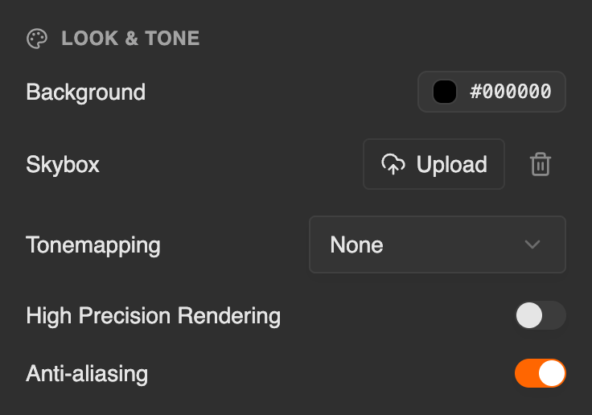

[Studio](/user-manual/supersplat/studio/)の**Scene**タブの最上部にある**Look & Tone**セクションでは、スプラットの周囲に何を表示するか、そして画像全体をどのようにレンダリングするかを設定します。変更はすぐにビューポートに反映されます。

| コントロール | 動作 |
|---------|--------------|
| **Background** | スプラットの背後の単色。スウォッチをクリックするとカラーピッカーが開きます。 |
| **Skybox** | スプラットを囲むエクイレクタンギュラー画像を**Upload**するか、現在の画像を削除します。[スカイボックス](#skybox)を参照してください。 |
| **Tonemapping** | ハイダイナミックレンジ出力をディスプレイにどうマッピングするか。[トーンマッピング](#tonemapping)を参照してください。 |
| **High Precision Rendering** | より高い精度でレンダリングします。フレームごとのGPU負荷は増えます。明るいハイライト、細かなグレーディング、ポストエフェクトでバンディングが見えるときに使います。[Bloom](/user-manual/supersplat/studio/post-effects#bloom)にはこれが必要です。デフォルトはオフです。 |
| **Anti-aliasing** | Mip-Splattingなど、アンチエイリアスありでトレーニングされたスプラット向けに描画します。デフォルトはオンです。小さいガウシアンや遠くのガウシアンが薄すぎる場合はオフにしてください。[アンチエイリアス](#anti-aliasing)を参照してください。 |

## スカイボックス {#skybox}

**Skybox**の横の**Upload**をクリックすると、**Upload Skybox**ダイアログが開きます。`.webp`または`.hdr`ファイルを1つ受け付けます。HDRファイルはアップロード前にブラウザ内で変換されます。最良の結果を得るには、**エクイレクタンギュラー**画像 — 周囲の球にきれいにマッピングされる2:1のパノラマ投影 — を使ってください。

各シーンが持てるスカイボックスは1つで、別の画像をアップロードすると置き換えられます。アップロードはすぐに行われ、**Save**は必要ありません。ゴミ箱アイコンでスカイボックスを削除します。

スカイボックスがあっても背景色には意味があります。スカイボックスが覆わない場所には背景色が表示されます。

### どちらを使うか

- **背景色のみ** — スプラット自体に焦点を当てたいスタジオ風プレゼンテーション向け。
- **スカイボックス** — 屋外でキャプチャしたシーンや、周囲のライティングと地平線を合わせることが重要な信憑性のある環境向け。

## トーンマッピング {#tonemapping}

| オプション | 備考 |
|--------|-------|
| **None** | スケーリングなしのパススルー。 |
| **Linear** | トーンマッピングカーブなし — 出力はリニアです。 |
| **Filmic** | クラシックなフィルム風カーブ。 |
| **Hejl** | Hejl-Burgess-Dawsonカーブ。 |
| **ACES** | ACESフィルミックカーブ。 |
| **ACES 2** | ハイライトをロールオフしたACESのバリアント。 |
| **Neutral** | Khronos Neutralトーンマップ。 |

## アンチエイリアス {#anti-aliasing}

Mip-Splattingなどでアンチエイリアスありでトレーニングされたスプラットは、補正しないと明るすぎて描画されます。Studioのスイッチは、シーン全体でこの補正をオン（デフォルト）またはオフにし、その選択をシーンの設定と一緒に保存します。superspl.atのシーンページと埋め込みはこのスイッチに従い、ここでオフにしない限り補正はオンになります。

## ビューアでの動作

- **AR** — [ARセッション](/user-manual/supersplat/viewing/xr)中はスカイボックスと背景色が非表示になり、スプラットの周囲に実際の部屋が透けて見えます。VRセッションではそのまま表示されます。
- **セルフホスティング** — ビューアはシーンの設定からスカイボックスとアンチエイリアスの設定を読み込みません。[ビューアを自分でホストする](/user-manual/supersplat/developers/embedding#url-parameters)場合は、`skybox` URLパラメータまたは`skyboxUrl`オプションで画像を渡し、High Precision Renderingは`hpr`で上書きし、アンチエイリアスは`aa`で指定してください。`aa`がない場合は、各スプラットファイル自身のアンチエイリアスのタグで決まります。

## 関連項目

- [Post Effects](/user-manual/supersplat/studio/post-effects) — シャープネス、ブルーム、カラーグレーディング、ビネット、色収差フリンジング
- [Experience Settings](/user-manual/supersplat/developers/experience-settings) — これらの設定を格納するJSONコントラクト
