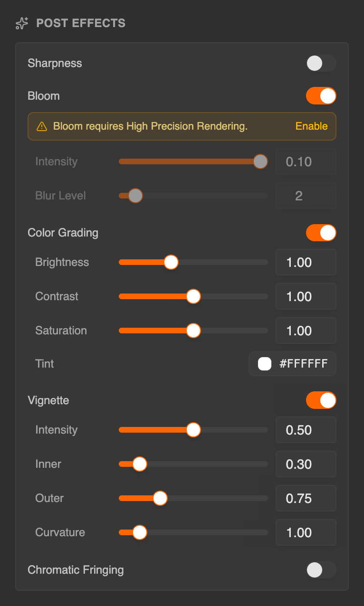

[Studio](/user-manual/supersplat/studio/)の**Scene**タブの最下部にある**Post Effects**セクションは、スプラットがレンダリングされた後のシーンの見え方を制御します。エフェクトはビューア内でフレームごとに評価されます。各エフェクトにはスイッチがあり、オンにするとそのパラメータが表示されます。

画像全体を形作るTonemappingとHigh Precision Renderingは、[Look & Tone](/user-manual/supersplat/studio/look-and-tone)セクションにあります。

## Sharpness

| フィールド | 説明 |
|-------|-------------|
| **Amount** | シャープニングフィルタの強度。 |

密度の高いスプラットキャプチャの体感的なディテールを回復するのに有用です。

## Bloom

| フィールド | 説明 |
|-------|-------------|
| **Intensity** | ブルームグローの強さ。 |
| **Blur Level** | ブルームカーネルのサイズ。大きいほど柔らかく広いグローになります。 |

シーンの明るい領域にグローを追加します。Bloomには[High Precision Rendering](/user-manual/supersplat/studio/look-and-tone)が必要です。それがオフの間は、セクションに**Bloom requires High Precision Rendering**と表示され、**Enable**でオンにできます。

## Color Grading

カラーグレーディングは画像にグローバルな変換を適用します。

| フィールド | 説明 |
|-------|-------------|
| **Brightness** | 全体的な明るさのリフト。 |
| **Contrast** | 暗部と明部のトーン分離。 |
| **Saturation** | 色の強度（`0`はグレースケール）。 |
| **Tint** | 画像にブレンドされるRGB色。暖色／寒色のグレーディングに有用です。 |

## Vignette

| フィールド | 説明 |
|-------|-------------|
| **Intensity** | コーナーの暗化の強さ。 |
| **Inner** | ビネットが始まる半径。 |
| **Outer** | ビネットが完全な強度に達する半径。 |
| **Curvature** | ビネットの減衰の形状。 |

## Chromatic Fringing

| フィールド | 説明 |
|-------|-------------|
| **Intensity** | フレーム端での色収差効果の強さ。 |

## ビューアでの動作

- **VRとAR** — [VRまたはARのセッション](/user-manual/supersplat/viewer/xr)中は、ポストエフェクトと高精度レンダリングは適用されません。シーンのトーンマッピングは引き続き適用され、セッションが終了するとすべて元に戻ります。
- **セルフホスティング** — [ビューアを自分でホストする](/user-manual/supersplat/viewer/embedding#url-parameters)場合は、`nofx` URLパラメータでポストエフェクトをオフにできます。

## 関連項目

- [Look & Tone](/user-manual/supersplat/studio/look-and-tone) — 背景、スカイボックス、トーンマッピング、High Precision Rendering
- [Experience Settings](/user-manual/supersplat/studio/experience-settings) — ポストエフェクト設定を格納するJSONコントラクト
