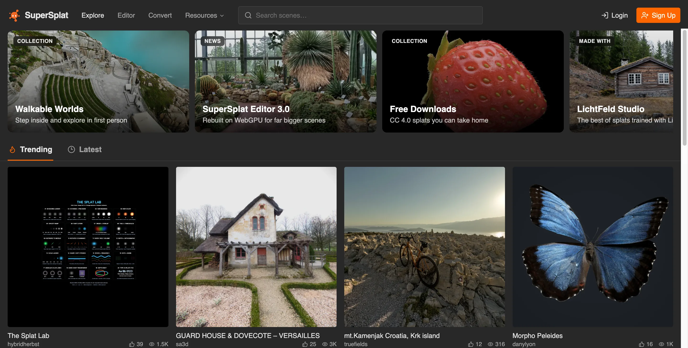

[Exploreページ](https://superspl.at)はSuperSplatの公開ホームです。プラットフォームに公開されたすべての**Public**スプラットの無限スクロールギャラリーで、アカウントなしで訪問者がシーンを発見できる場所です。

Exploreの閲覧は**匿名**で可能で、PlayCanvasアカウントは不要です。アカウントは、スプラットに[いいね](/user-manual/supersplat/viewing/scene-page/#likes)したり、[コメント](/user-manual/supersplat/viewing/scene-page/#comments)したり、[自分のスプラットを公開](/user-manual/supersplat/publishing/upload)したりするときに役立ちます。

## 注目のコレクション {#featured-collections}

ホームページの上部に並ぶカードから、厳選されたビューに移動できます。ドラッグするか矢印を使うと、すべてのカードを見られます：

| カード | 開くもの |
|------|-------|
| **Walkable Worlds** | コリジョンがあり、訪問者が中を歩けるスプラット。 |
| **News** | PlayCanvasブログの記事。 |
| **Free Downloads** | クリエイターがクリエイティブ・コモンズライセンスでのダウンロードを許可しているスプラット。 |
| **Made With** | [1つのツールで作られたスプラット](#splats-by-software)。Postshot、LichtFeld Studio、Brush、Spirula Studioなど、日替わりで変わります。 |
| **Best of the Week** | 過去7日間で最も閲覧されたスプラット。 |
| **All-Time Greats** | これまでに公開された中で最も閲覧されたスプラット。 |

## フィードのタブ

コレクションの下のホームページのフィードはタブに分かれています。

| タブ | 表示内容 |
|-----|---------------|
| **Trending**（デフォルト） | 現在最も注目を集めているスプラット。 |
| **Latest**（`?tab=latest`） | 最近公開されたスプラット。 |
| **Following**（`?tab=following`） | フォローしているクリエイターの公開スプラットを新しい順に表示。サインイン中のみ表示されます。[クリエイターのフォロー](/user-manual/supersplat/viewing/user-profile#following)を参照してください。 |

## グリッド

スプラットはサムネイル、タイトル、著者付きのカードとして表示されます。カードをクリックすると、スプラットの[シーンページ](/user-manual/supersplat/viewing/scene-page)が開きます。

グリッドはスクロールに合わせて段階的に読み込まれます。最初のページでは32スプラット、以降のページでは16ずつを返します。「次のページ」ボタンはなく、スクロールを続けるだけです。

## 検索とフィルタ {#search-and-filters}

すべてのページの上部にある検索ボックスは、[superspl.at/search](https://superspl.at/search)の検索ページを開き、入力した語句をスプラットの**タイトル**と**説明**に照合します。フィルタバーでは、特徴フィルタ、期間、並べ替え順を組み合わせられます。すべてのオプションはURLパラメータでもあるため、どのビューもそのまま共有可能なリンクになります。

### 並べ替え (`?sort=...`)

| 値 | ラベル | 順序 |
|-------|-------|-------|
| `trending`（デフォルト） | **Trending** | 現在最も注目を集めているスプラット |
| `newest` | **Newest** | 公開日時の新しい順 |
| `oldest` | **Oldest** | 古い順 |
| `views` | **Most viewed** | 閲覧数の多い順 |
| `likes` | **Most liked** | いいね数の多い順 |
| `largest` | **Largest** | ファイルサイズの大きい順 |
| `smallest` | **Smallest** | ファイルサイズの小さい順 |

**Trending**は、最近のエンゲージメントを重視したスコアでスプラットをランク付けします。直近（おおむね過去1週間ほど）のいいねと閲覧が最も大きく影響し、いいねは閲覧よりも重く評価されます。スコアは定期的に更新されるため、全期間の人気作ではなく*今*人気のあるものが表示されます。

### 期間 (`?time=...`)

ある期間内に公開されたスプラットだけに結果を絞り込みます。これは**Trending以外**のすべての並べ替えに適用されます。Trendingはすでに新しさを考慮していて常に全期間を対象とするため、Trendingを選択している間は期間を選べません。その他の並べ替えでは、デフォルトで過去1ヶ月になります。

| 値 | ラベル |
|-------|-------|
| `day` | **Past day** |
| `week` | **Past week** |
| `month` | **Past month** |
| `year` | **Past year** |
| `all` | **All time** |

### 特徴フィルタ (`?features=...`)

カンマ区切りのフィルタのリストで、フィルタバーではスイッチとして表示されます：

| 値 | ラベル | 一致するスプラット |
|-------|-------|-----------------|
| `walkable` | **Walkable** | [コリジョン](/user-manual/supersplat/studio/collision)があり、訪問者が中を歩けるスプラット |
| `downloadable` | **Downloadable** | クリエイターが[ダウンロード](/user-manual/supersplat/publishing/manage/#downloadable-license)を有効にしているスプラット |

### 検索 (`?q=...`)

検索する語句で、スプラットのタイトルと説明に照合されます。一致するものがない場合は、フィルタを調整してすべてを閲覧するよう提案されます。

### 組み合わせ例

`https://superspl.at/search?sort=likes&time=month&features=walkable&q=museum`

> 過去1ヶ月に公開された、タイトルまたは説明に「museum」を含むウォーカブルなスプラットを、いいね数の多い順に表示。

## ソフトウェアごとのスプラット {#splats-by-software}

クリエイターは、スプラットのキャプチャやトレーニングに使ったツールを、その[Edit Splatダイアログ](/user-manual/supersplat/publishing/manage#editing-splat-metadata)の**Software Used**フィールドでタグ付けします。各ツールには、そのタグが付いた公開スプラットのページが`https://superspl.at/explore/software/<tool>`にあります。たとえば[superspl.at/explore/software/postshot](https://superspl.at/explore/software/postshot)です。ページの見出しは**Splats using**とツール名で、ホームページと同じグリッドがTrendingの順に表示されます。

このページには、[シーンページ](/user-manual/supersplat/viewing/scene-page)の**Software Used**にあるツールのチップか、[注目のコレクション](#featured-collections)の**Made With**カードをクリックして移動します。

## クリエイタープロファイル

カードの著者チップをクリックすると、そのユーザーの[プロファイルページ](/user-manual/supersplat/viewing/user-profile)に移動します。そのユーザーが共有したすべてのPublicスプラットのグリッド、加えてアバター、自己紹介、ソーシャルリンクが表示されます。そこから[フォロー](/user-manual/supersplat/viewing/user-profile#following)すると、そのユーザーの新しいスプラットがFollowingタブに表示されるようになります。

## 関連項目

- [シーンページ](/user-manual/supersplat/viewing/scene-page) — カードをクリックしたときに起こること
- [プロファイルとフォロー](/user-manual/supersplat/viewing/user-profile) — 1人のクリエイターの公開スプラットを閲覧し、フォローする
- [通知](/user-manual/supersplat/viewing/notifications) — 自分のスプラットへのコメント、いいね、新しいフォロワー
- [管理](/user-manual/supersplat/publishing/manage) — スプラットを**Public**に設定してExploreに表示させる
