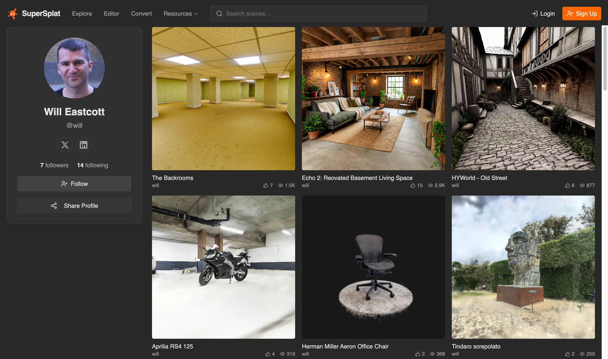

SuperSplatの各クリエイターには`https://superspl.at/user/<username>`に公開プロファイルが用意されます。プロファイルには、アバター、表示名、自己紹介、追加されたソーシャルリンク、フォロワー数とフォロー中の数、そして公開したすべての**Public**スプラットのグリッドが表示されます。

プロファイルは、すべての[シーンページ](/user-manual/supersplat/viewing/scene-page)と[Explore](/user-manual/supersplat/viewing/explore)グリッドのすべてのカードに表示される**著者チップ**からリンクされます — 著者名をクリックするとプロファイルへ移動します。

プロファイルの閲覧は匿名で可能で、PlayCanvasアカウントは不要です。

## プロファイルに表示される内容

| セクション | 含まれるもの |
|---------|------------------|
| **アバターと表示名** | クリエイターのPlayCanvasアカウントのアバターと、選択した表示名。 |
| **自己紹介** | クリエイター自身が書いた短いプロフィール紹介。 |
| **ソーシャルリンク** | クリエイターが追加した外部プロフィール（X、LinkedIn、個人サイトなど）へのリンク。 |
| **フォロワーとフォロー中** | クリエイターをフォローしている人数と、クリエイターがフォローしている人数。どちらかの数をクリックすると、誰なのかが表示されます。[もっとクリエイターを見つける](#lists)を参照してください。 |
| **Follow** | クリエイターを[フォロー](#following)すると、そのスプラットがFollowingフィードに表示されます。 |
| **Share Profile** | プロファイルの[Shareダイアログ](/user-manual/supersplat/viewing/scene-page#share-dialog)を開きます。プロファイルのリンクをFacebook、X、LinkedIn、Redditに投稿したり、コピーしたりできます。 |
| **スプラットグリッド** | クリエイターが公開したすべての**Public**スプラットを、[Explore](/user-manual/supersplat/viewing/explore)と同じカードUIで表示。任意のカードをクリックすると、その[シーンページ](/user-manual/supersplat/viewing/scene-page)が開きます。 |

Unlistedのスプラットは公開プロファイルには表示されません — クリエイター本人だけが[Manageページ](/user-manual/supersplat/publishing/manage)から確認できます。

## クリエイターのフォロー {#following}

クリエイターをフォローすると、そのクリエイターの公開スプラットが、[superspl.at](https://superspl.at)のホームページにある**Following**フィードに表示されます。

1. クリエイターのプロファイルか、そのクリエイターの[シーンページ](/user-manual/supersplat/viewing/scene-page)を開きます。
2. **Follow**をクリックします。

ボタンが**Following**に変わります。フォローするにはPlayCanvasアカウントでサインインしている必要があります。

### Followingフィード {#following-feed}

[ホームページ](https://superspl.at)で**Following**タブを開きます。フォローしているすべての人の公開スプラットが新しい順に表示されます。フォローする前に公開されたスプラットも含まれます。

### もっとクリエイターを見つける {#lists}

どのプロファイルでも、フォロワー数かフォロー中の数をクリックするとリストが開き、リスト内の誰かをクリックするとその人のプロファイルに移動します。あるクリエイターがフォローしている人も、フォローする価値があることがよくあります。

### フォローを解除する {#managing}

クリエイターのプロファイルか、そのクリエイターのシーンページで**Following**をクリックします。

フォローしている人を1か所でまとめて確認するには、自分のプロファイルを開いて**following**の数をクリックします。フォローを解除したい人の横にある**Following**をクリックしてください。

## 自分のプロファイル

自分のプロファイルには、次のものもあります。

- **フォローしている全員。** 自分の**following**の数をクリックするとリストが開き、誰でも[フォローを解除](#managing)できます。
- **Likesタブ。** いいねしたすべてのスプラットが表示されます。このタブはあなただけに表示されます。

自分のスプラットへのコメント、いいね、新しいフォロワーは[通知](/user-manual/supersplat/viewing/notifications)パネルに表示され、そこでメールで受け取る通知も選べます。

## 関連項目

- [Explore](/user-manual/supersplat/viewing/explore) — プラットフォーム全体でスプラットとクリエイターを発見する
- [シーンページ](/user-manual/supersplat/viewing/scene-page) — 特定の1つのスプラットを開く
- [アカウント作成](/user-manual/account-management/user-accounts/account-creation) — あなた自身のプロファイルを作る
